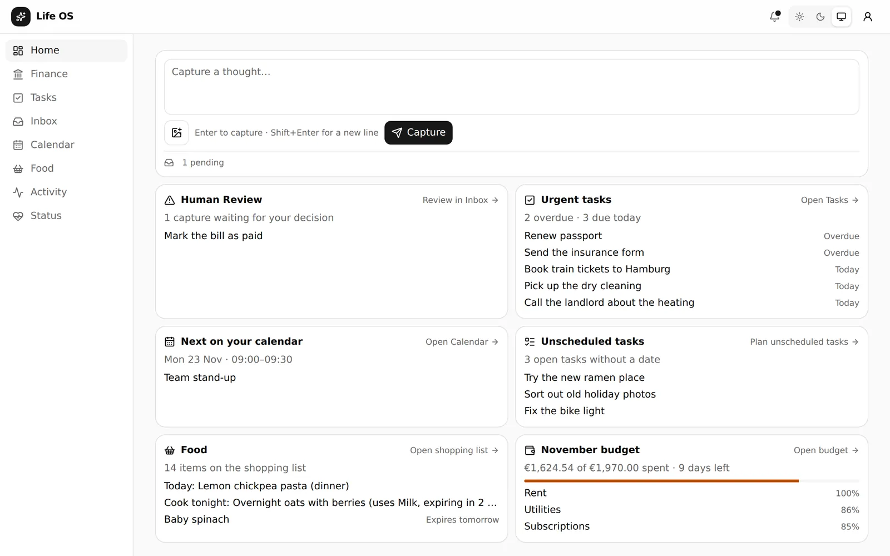
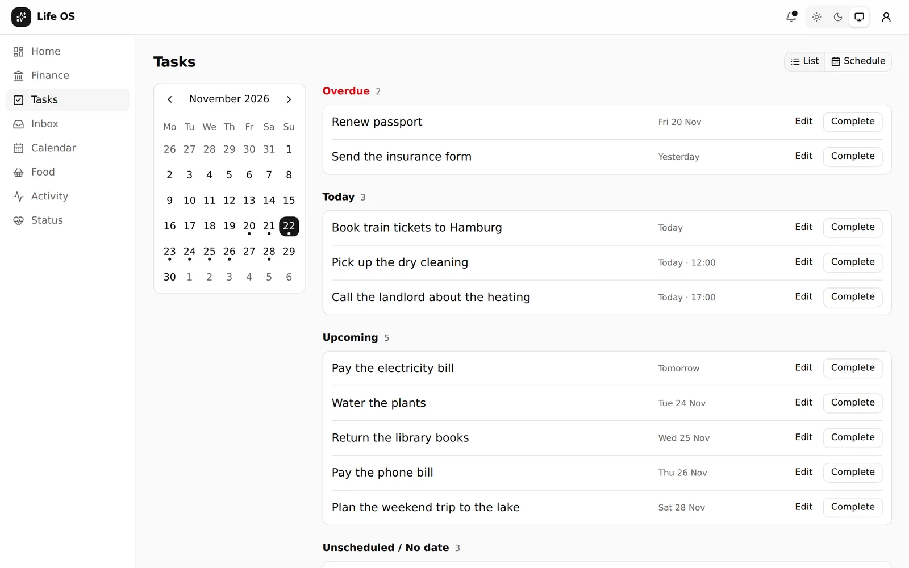
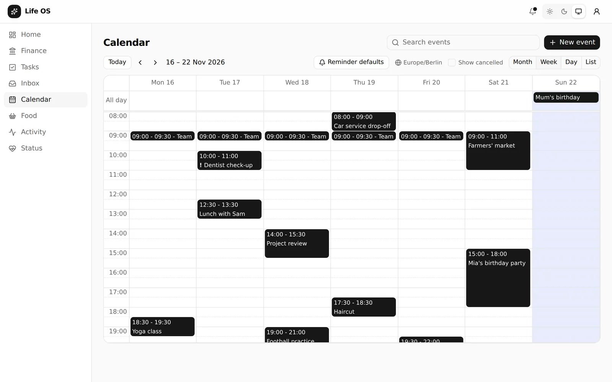
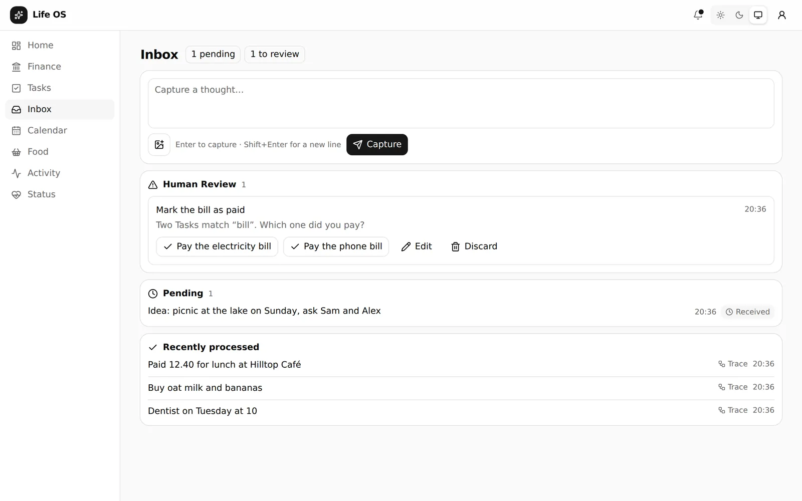
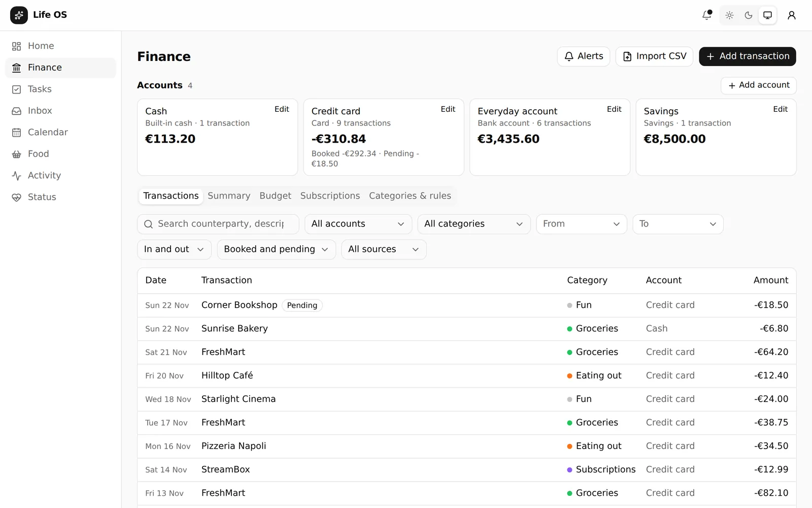
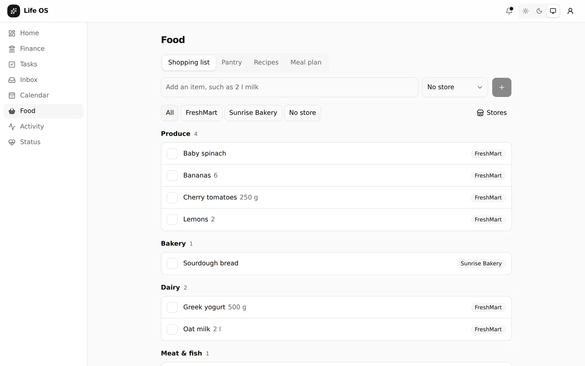
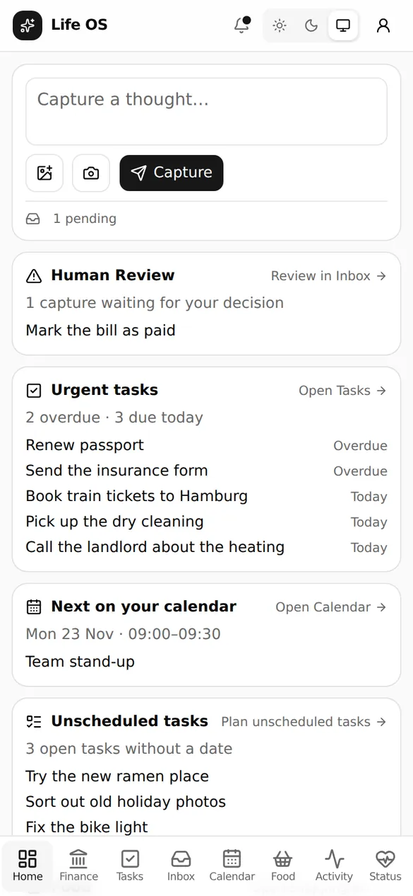
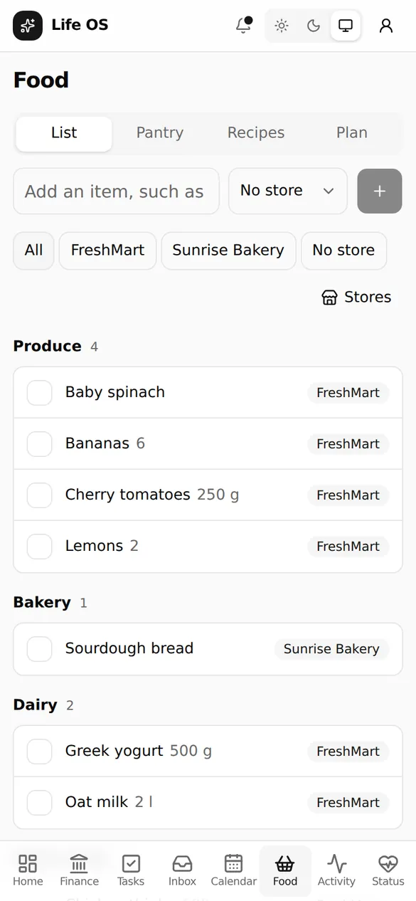

# Life OS

Life OS is a personal system you run on your own server: tasks, a calendar, an Inbox for quick notes, a shopping list and pantry, and your money, in one web app. An optional AI files what you capture: "dentist on Friday at 10" becomes a calendar event, "buy milk" goes on the shopping list.



> [!WARNING]
> **Early preview, made by one developer.** Life OS works, and its developer uses it every day, but previews have rough edges and may change between releases. Back up before you update. Bugs and questions: [GitHub Issues](https://github.com/GAMch1k/life-os/issues).

## What works today

- **Tasks**: due dates with or without a time, repeating tasks, a list of tasks without a date, and a schedule view.
- **Calendar**: day, week, month, and list views, repeating events, reminders, and search. Subscribe to calendar feeds (ICS), such as holidays. Optional two-way sync with Google Calendar.
- **Inbox**: one box for whatever comes to mind, typed, shared from your phone, a photo, or a voice note (turned into text on your own server). With AI processing on, each capture becomes a task, an event, a shopping item, or an expense, and when the AI is not sure, it asks you in **Human Review** instead of guessing.
- **Food**: a shopping list grouped by aisle and store, the pantry with expiry dates, recipes (also saved from a link), and a meal plan.
- **Finance**: accounts you keep by hand, CSV import, categories with rules, a monthly summary, a budget, and subscriptions. Optional read-only bank sync through Enable Banking.
- **Home**: what needs you today, on one page. **Notifications**: a morning summary and reminders, in Life OS and, if you want, on your phone.
- **Your server**: an account with two-factor sign-in and passkeys, a Status page, and nightly backups of every database, with a weekly restore check.
- **Phone and watch apps** for Android and Wear OS, from the [life-os-app releases](https://github.com/GAMch1k/life-os-app/releases): [Phone and watch apps](docs/install/phone-apps.md). Life OS also works in any phone browser.

| Tasks | Calendar |
| --- | --- |
|  |  |
| **Inbox** | **Finance** |
|  |  |
| **Food** | **On a phone** |
|  |   |

The screenshots show made-up demo data ([how they are made](docs/development/screenshots.md)).

### Not there yet

- **One account per install.** Accounts for family members come in a later version.
- **AI processing needs an AI plan or key.** It runs OpenAI's Codex with your ChatGPT plan, or Anthropic's Claude Code with your Claude plan or an Anthropic API key. With it on, your captures are sent to that provider. Without it, Life OS works, and captures stay in Inbox for you to file. Details: [AI processing](docs/install/ai-processing.md).
- **Bank sync** is tested with one bank so far, Deutsche Bank: [Bank sync](docs/install/bank-sync.md).
- **Not tested on a Raspberry Pi yet.** The ARM (arm64) images are tested on GitHub's ARM servers. Voice notes are slow on a Pi, most of all a Pi 4: [Raspberry Pi](docs/install/README.md#raspberry-pi).
- **Phone apps for Android only.** They are installed from their APK files on GitHub, not from Google Play. There is no iPhone app; the web app works in Safari.
- **The app is in English only.** Voice notes and captures can be in other languages.

## What you need

- A 64-bit Linux server, x86 (amd64) or ARM (arm64, such as a Raspberry Pi 4 or 5 with a 64-bit OS), with 2 GB of memory at least (4 GB to be comfortable) and 10 GB of free disk.
- Docker Engine 25 or newer with the Compose plugin (version 2.27 or newer), plus `curl`, `openssl`, and Bash 4.4 or newer.
- On amd64, voice notes also need a processor with AVX2.

The [install guide](docs/install/README.md#what-you-need) has the details.

## Quick start

1. **Download the newest release** into a new directory:

   ```sh
   mkdir ~/life-os && cd ~/life-os
   version=$(curl -fsSL https://api.github.com/repos/GAMch1k/life-os/releases | sed -n 's/^ *"tag_name": *"\([^"]*\)".*/\1/p' | head -n 1)
   release=https://github.com/GAMch1k/life-os/releases/download/$version
   for file in compose.yaml setup.sh SHA256SUMS; do curl -fsSLO "$release/$file"; done
   # GitHub serves .env.example as default.env.example
   curl -fsSL -o .env.example "$release/default.env.example"
   ```

2. **Check the download.** Every file must say `OK`:

   ```sh
   sha256sum -c SHA256SUMS
   ```

3. **Set up.** The script checks the server, asks for your timezone, currency, and address, and writes `.env` with new passwords. Skip the optional modules for a first look:

   ```sh
   chmod +x setup.sh
   ./setup.sh
   ```

4. **Start it.** The first start downloads the images and prints a one-time **setup code** for your account:

   ```sh
   ./setup.sh up
   ```

5. **Open it.** Life OS listens only on the server itself. From your computer, open an SSH tunnel, then open <http://127.0.0.1:3000> and set up your account with the setup code:

   ```sh
   ssh -N -L 3000:127.0.0.1:3000 you@your-server
   ```

For everyday use from your phone and laptop, choose a way in with HTTPS: [Access it safely](docs/install/access.md#choose-a-way-in). Never expose Life OS to the internet over plain HTTP.

## Documentation

- [Install guide](docs/install/README.md): the requirements, setup, and every `setup.sh` command.
- [Manual install](docs/install/manual.md): with Portainer, Dockge, or Unraid, and a `.env` from `./setup.sh env`.
- [Access it safely](docs/install/access.md), [Accounts](docs/install/accounts.md), [Email](docs/install/email.md), and [Modules](docs/install/modules.md): AI processing, voice notes, Google Calendar, bank sync, and more, each switched on when you want it.
- [Backups](docs/install/backups.md), [Updating](docs/install/updating.md), [Troubleshooting](docs/install/troubleshooting.md), and [Uninstalling](docs/install/uninstall.md).
- [Phone and watch apps](docs/install/phone-apps.md), downloaded from the [life-os-app releases](https://github.com/GAMch1k/life-os-app/releases).
- Building Life OS from source, or working on it: [Development](docs/development/README.md) and the [technical documentation](docs/README.md).

## Official sources and name

The official Life OS comes only from its code on GitHub, [github.com/GAMch1k/life-os](https://github.com/GAMch1k/life-os) with its releases (and the phone and watch apps in [github.com/GAMch1k/life-os-app](https://github.com/GAMch1k/life-os-app)), and from its container images at [ghcr.io/gamch1k](https://github.com/GAMch1k?tab=packages). Forks are welcome under the AGPL, but please don't present a fork as the official Life OS: give it a name of its own, and say what it is based on.

## How it's built

Life OS is one person's project, built with a lot of help from AI. Most of its code, tests and documentation were written by Claude (Anthropic's AI) in Claude Code, and the commits it wrote say so in a `Co-Authored-By: Claude` line. The maintainer decides what gets built, and runs Life OS every day on their own server. Every change, whoever wrote it, has to pass the same automated checks before it is merged (unit and integration tests, and the whole stack with a browser test suite), and GitHub's code, dependency and secret scanning watch the repository.

## Contributing and security

- Bugs and ideas: [open an issue](https://github.com/GAMch1k/life-os/issues/new/choose).
- [CONTRIBUTING.md](CONTRIBUTING.md): how to propose a change, and the checks a pull request must pass.
- [SECURITY.md](SECURITY.md): the supported versions, and how to report a vulnerability privately.
- [CODE_OF_CONDUCT.md](CODE_OF_CONDUCT.md): how we treat each other.

## License

Copyright (C) 2026 GAMch1k and the Life OS contributors.

Life OS is free software: you can redistribute it and/or modify it under the terms of the GNU Affero General Public License, version 3 only (SPDX: `AGPL-3.0-only`), as published by the Free Software Foundation. It is distributed in the hope that it will be useful, but WITHOUT ANY WARRANTY; see [`LICENSE`](LICENSE) for the full text. If you run a modified version for other people over a network, the license requires you to offer them its source code.
