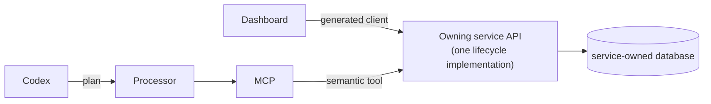

# Editable entities and UI/agent parity

This page records a design rule for future work. It explains how Life OS adds editing to a user-owned entity, and how the Dashboard and the AI agent share that editing without two implementations of the same behaviour.

## The rule

When a domain introduces a **persistent, user-owned entity that reasonably needs editing** (for example a Task, a Calendar event, or a manual Finance transaction):

1. **The lifecycle lives in the owning service.** Create, update, complete/reopen, cancel, and similar operations are implemented once, in the owning service's domain layer. They are exposed through its OpenAPI contract and enforce validation, idempotency, and activity events there.
2. **User interfaces call that operation.** The Dashboard (and future native clients) use the generated client for the owning service's endpoint. They hold no business rules of their own beyond presentation and input handling.
3. **The agent may expose the equivalent semantic operation.** When it is safe and useful, MCP adds a tool that maps to the same owning-service endpoint, for example `task_update`. The tool may resolve which entity is meant (`task_search`, exactly one match), but the mutation itself is the owning service's operation. Ambiguous identity goes to Human Review instead of guessing. An irreversible operation, such as deleting a Task, may stay a deliberate UI action with no tool.
4. **The agent never gets a parallel domain implementation.** MCP, the Inbox processor, and Codex never write another service's database, re-implement validation, or apply changes the owning service could not apply itself. Codex only plans; the processor executes the plan through MCP; MCP calls the owning API.

The result is that a Task renamed in the Dashboard and a Task renamed by a voice note follow the same rules and produce the same `task.updated` activity event. They differ only in the actor and correlation.

## Scope boundary

- **Phase 8 applies this rule to Tasks only.** Tasks are the reference implementation. `PATCH /v1/tasks/{taskId}` and the explicit complete and reopen actions are used by the Tasks workspace (`/tasks`) and by MCP's `task_update`, `task_complete`, and `task_reopen` tools. `DELETE /v1/tasks/{taskId}` is used by the Tasks workspace only, behind a confirmation; MCP has no tool for it. See [Tasks](../services/tasks.md) and the [MCP tool contract](../services/mcp-tool-contract.md).
- **Other domains are not retrofitted.** Finance, Calendar, Inbox, and Voice keep their current APIs, UI, and MCP tools. When one of them needs editing, it gets its own implementation ticket that adds the owning-service operation first, then the Dashboard and, if useful, the MCP tool. Each surface lands in its own ticket.
- **No generic framework.** There is no shared CRUD layer, generic "entity edit" API, or mutation engine. Each domain implements its own lifecycle where it lives. A shared abstraction would only be justified by repeated, existing implementations, not in advance.

## Checklist for a future editability ticket

- Does the owning service expose the operation in OpenAPI, with validation, idempotency where retries are possible, and an activity event?
- Does the Dashboard use the generated client for that operation, and nothing else?
- If an MCP tool is added, does it call the same endpoint, resolve identity safely, and route ambiguity to Human Review?
- Is anything outside that domain changed? If so, it belongs in a separate ticket.
