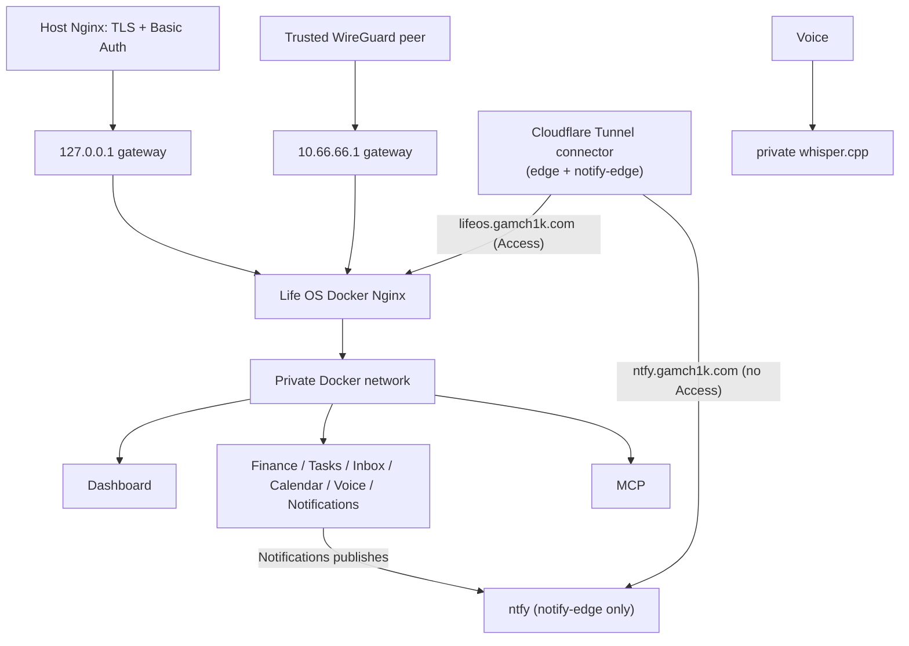

# Networking and data flows

Only the `gateway` container publishes an application port, defaulting to `127.0.0.1:3000`. Dashboard and services use Docker `expose`; PostgreSQL has no host port. The current deployment uses `LIFE_OS_GATEWAY_BIND_ADDRESS=10.66.66.1`: every WireGuard peer able to reach that address is trusted to use Dashboard and unauthenticated API/MCP routes. Peer membership is the authentication boundary; never expose this port on a LAN/public address or describe it as host-Nginx/Basic-Auth protected.

The alternative supported model is loopback binding behind operator-managed host Nginx TLS/Basic Auth; see [`../host-nginx-example.conf`](../host-nginx-example.conf). Applying/reloading host Nginx is an operator task. Choose one boundary intentionally; moving between them requires changing ignored `.env`, recreating gateway, and (for loopback) applying host configuration.

Docker networks:

| Network | Members | Purpose |
| --- | --- | --- |
| `backend` (`lifeos-backend`) | every service, Postgres, the Dashboard, the gateway | the private network |
| `edge` (`lifeos-edge`, `10.255.249.0/29`) | `cloudflared`, `gateway` | the Life OS tunnel route (behind Cloudflare Access) reaches the gateway only |
| `notify-edge` (`lifeos-notify-edge`, `10.255.249.16/29`) | `cloudflared`, `ntfy`, `notifications` | the ntfy tunnel route (no Access, for the phone's ntfy app) reaches ntfy only; Notifications publishes to it |

So there are two public entry points, both through the Cloudflare Tunnel: `lifeos.gamch1k.com` behind Cloudflare Access to the gateway, and `ntfy.gamch1k.com` without Access straight to ntfy, which is protected by its own deny-all accounts. ntfy is on no other network, and nothing of Life OS but Notifications is on `notify-edge`, so the route without Access cannot reach the gateway or any other service ([ntfy](../operations/ntfy.md#security-model)). `tools/check-ingress` asserts the published ports and both edge memberships.

Routes are `/` to Dashboard, `/api/{finance,tasks,inbox,calendar,voice,notifications}/` to corresponding private services, `/api/activity/` read-only to Activity, and `/api/mcp/` to the Streamable HTTP MCP endpoint. The Whisper worker has no gateway route and no host port. Browser code always uses gateway-relative paths.

The gateway has a 26 MiB body ceiling, connection/request rate limits, explicit proxy timeouts, a longer MCP streaming timeout, and basic browser security headers. It discards caller-supplied forwarded headers and derives them from the immediate peer. It also guards Activity attribution: public traffic may only say it is the owner (`X-Life-OS-Actor: user`) or a development tool (`dev:<name>`, 1–64 letters, digits, `.`, `_`, `-`); `agent:` and `system:` claims are dropped, so such a write fails the services' actor gate (`400 actor_required`), and `X-Correlation-ID` and `X-Causation-ID` are cleared. Internal callers that legitimately send those headers (processor and MCP, Voice worker) use the private network, never the gateway. See [Activity](../services/activity.md#the-actor-gate). It emits no permissive CORS policy; Dashboard is same-origin. There is no cookie/session auth today, so CSRF tokens are not meaningful; add Origin/CSRF checks before introducing cookie authentication. MCP is gateway-routed only for the selected trusted ingress and is not a public browser API.

## Gateway hosts

The gateway serves Life OS only for an explicit list of hosts, the `server_name` of the Life OS server in `infra/nginx/life-os.conf` (matched without the port):

| Host | Why |
| --- | --- |
| `lifeos.gamch1k.com` | the public hostname, through Cloudflare Access and the tunnel |
| `10.66.66.1` | the WireGuard address the deployment publishes on (`http://10.66.66.1:3001`), for peers and for maintenance on the host |
| `127.0.0.1` | the default loopback bind (`127.0.0.1:3000`), the verification stack (`127.0.0.1:13001`) with its smokes and browser tests, and smokes that ask Compose for the published address |
| `localhost` | the same, by name (`http://localhost:3000` in the README) |

Any other Host gets no answer: the default server returns `444` and closes the connection. Nothing inside Docker calls the gateway; the Dashboard and services use each other's private addresses. To serve Life OS under another name, add it to that one list, for example the hostname of a host Nginx in the loopback model, which forwards its own Host. `tools/check-gateway-hosts` (run by `tools/check` and `tools/check-ingress`) checks the form: the default server only returns 444, the list holds exact names only (no wildcard, regex, or `_`) including the three addresses above, and nothing in the gateway refers to ntfy. `tools/smoke-e2e` checks that unlisted hosts get no answer on the verification stack.

In addition, a request that arrives through the tunnel (from the `edge` network) without Cloudflare Access's token (`Cf-Access-Jwt-Assertion`) is refused with 403, so a tunnel route without Access cannot serve Life OS even under a listed host.

Typical write flow: browser → gateway → service validation → its database → JSON response. Typical dashboard read flow: request a page → Dashboard reads required private service APIs → rendered page returns through gateway. A service failure is isolated; dashboard pages show loading/error states instead of directly exposing a container port.
