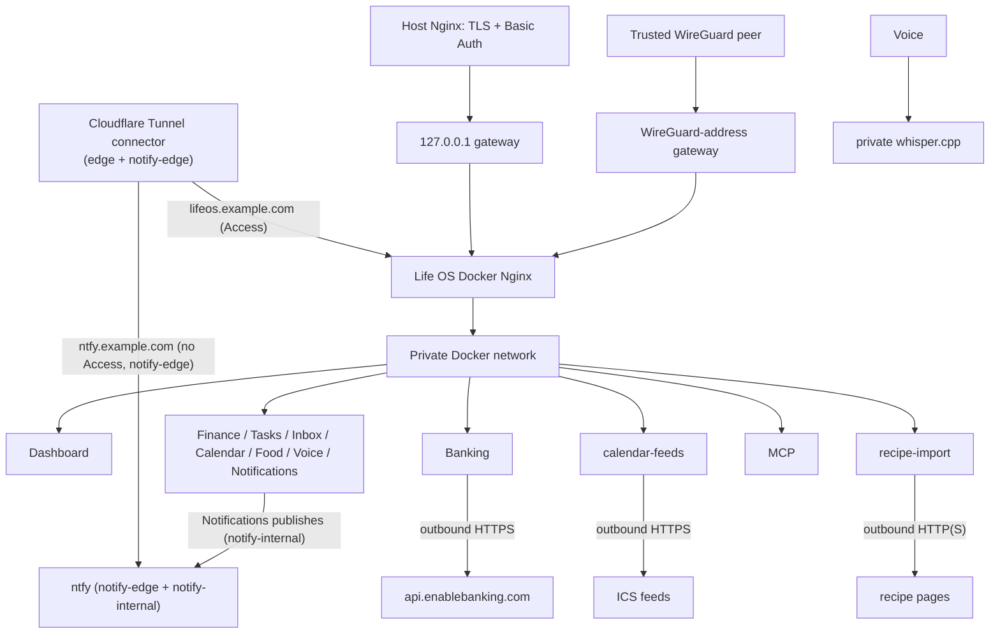

# Networking and data flows



Only the `gateway` container publishes an application port, defaulting to `127.0.0.1:3000`. Dashboard and services use Docker `expose`; PostgreSQL has no host port. A WireGuard deployment, such as the reference one, sets `LIFE_OS_GATEWAY_BIND_ADDRESS` to the server's WireGuard address (for example `10.8.0.1`): every WireGuard peer able to reach that address is trusted to use Dashboard and unauthenticated API/MCP routes. Peer membership is the authentication boundary; never expose this port on a LAN/public address or describe it as host-Nginx/Basic-Auth protected.

### Other containers on the host

With a non-loopback bind, Docker also forwards connections from every other container on the host to the gateway's published port, so on a server shared with other projects any of their containers could use Life OS without a login. [`infra/host/lifeos-gateway-firewall`](../../infra/host/lifeos-gateway-firewall) drops forwarded connections to `LIFE_OS_GATEWAY_BIND_ADDRESS:LIFE_OS_GATEWAY_PORT` unless they arrive on the WireGuard interface (`wg0`, or `LIFE_OS_WIREGUARD_INTERFACE`); its systemd unit applies it whenever Docker starts. Cloudflare's tunnel reaches the gateway inside Docker and the host's own connections are not forwarded, so neither changes. Install it once, as root, with the gateway's address and port from `.env`:

```sh
sudo install -m 755 infra/host/lifeos-gateway-firewall /usr/local/sbin/
sudo install -m 644 infra/host/lifeos-gateway-firewall.service /etc/systemd/system/
printf 'LIFE_OS_GATEWAY_BIND_ADDRESS=%s\nLIFE_OS_GATEWAY_PORT=%s\n' 10.8.0.1 3000 | sudo tee /etc/default/lifeos-gateway-firewall
sudo systemctl daemon-reload && sudo systemctl enable --now lifeos-gateway-firewall
```

To check it, a throwaway container must now time out where it used to get the Dashboard: `docker run --rm curlimages/curl -m 8 http://10.8.0.1:3000/` (use your address and port). `sudo systemctl disable --now lifeos-gateway-firewall` takes the rule out again. Members of the host's `docker` group can still read everything (Docker access is root access); only a server of your own fixes that.

The alternative supported model is loopback binding behind operator-managed host Nginx TLS/Basic Auth; see [`../host-nginx-example.conf`](../host-nginx-example.conf). Applying/reloading host Nginx is an operator task. Choose one boundary intentionally; moving between them requires changing ignored `.env`, recreating gateway, and (for loopback) applying host configuration.

Docker networks:

| Network                                                                    | Members                                             | Purpose                                                                       |
| -------------------------------------------------------------------------- | --------------------------------------------------- | ----------------------------------------------------------------------------- |
| `backend` (`lifeos-backend`)                                               | every service, Postgres, the Dashboard, the gateway | the private network                                                           |
| `edge` (`lifeos-edge`, `10.255.249.0/29`)                                  | `cloudflared`, `gateway`                            | the Life OS tunnel route (behind Cloudflare Access) reaches the gateway only  |
| `notify-edge` (`lifeos-notify-edge`, `10.255.249.16/29`)                   | `cloudflared`, `ntfy`                               | the ntfy tunnel route (no Access, for the phone's ntfy app) reaches ntfy only |
| `notify-internal` (`lifeos-notify-internal`, `10.255.249.32/29`, internal) | `ntfy`, `notifications`                             | Notifications publishes to ntfy without sharing a network with the connector  |

So there are two public entry points, both through the Cloudflare Tunnel: Life OS's hostname (`LIFE_OS_PUBLIC_HOSTNAME`, such as `lifeos.example.com`) behind Cloudflare Access to the gateway, and ntfy's (the host of `LIFE_OS_NTFY_PUBLIC_URL`, such as `ntfy.example.com`) without Access straight to ntfy, which is protected by its own deny-all accounts. ntfy is on those two networks only, no Life OS service is on `notify-edge`, and the connector is not on `notify-internal`, so the route without Access cannot reach the gateway or any service, Notifications included ([ntfy](../operations/ntfy.md#security-model)). `tools/check-ingress` asserts the published ports and the memberships of all three.

Routes are `/` to Dashboard, `/api/{finance,tasks,inbox,calendar,food,voice,notifications}/` to corresponding private services, `/api/activity/` read-only to Activity, `/api/integrations/<name>/` to integration services (today `/api/integrations/banking/` to [Banking](../services/banking.md), `/api/integrations/calendar-feeds/` to [calendar-feeds](../services/calendar-feeds.md), `/api/integrations/google-calendar/` to [google-calendar](../services/google-calendar.md), and `/api/integrations/recipe-import/` to [recipe-import](../services/recipe-import.md)), and `/api/mcp/` to the Streamable HTTP MCP endpoint. `/android/` is the one route the gateway answers itself: the Android apps' download page, update manifest, and APKs, static files from a host directory mounted read-only, behind Access like the rest ([Android releases](../operations/android-releases.md)). The bank's return to `/finance/bank/callback`, like Google's to `/calendar/google/callback` (a Dashboard page, which posts the code to google-calendar), carries a one-time code in the query and is kept out of the gateway's access log. google-calendar calls Google's OAuth and Calendar APIs over outbound HTTPS from the backend network and Calendar's API inside it. Banking calls Enable Banking's API over outbound HTTPS from the backend network and publishes nothing; its private key is a read-only bind mount. calendar-feeds downloads feeds over outbound HTTPS from the backend network, refusing private and loopback addresses, and publishes nothing. recipe-import fetches recipe pages over outbound HTTP(S) from the backend network with the same guard and writes to Food's API inside it. The Whisper worker, the [monitor](../services/monitor.md), the [backup service](../services/backup.md), and [host-health](../services/host-health.md) have no gateway route and no host port; host-health and its docker gateway share `host-docker`, an internal network nothing else is on, so only host-health can reach the gateway that holds the Docker socket; the monitor reads the Dashboard's `/api/status` and posts to Notifications on the private network, and the backup service connects to PostgreSQL and serves its API there; the Dashboard reads its status and passes on the Status page's Back up now through its own `/api/backups/` route (only `GET v1/status` and `POST v1/backups`). Browser code always uses gateway-relative paths.

The gateway has a 26 MiB body ceiling, connection/request rate limits, explicit proxy timeouts, a longer MCP streaming timeout, and basic browser security headers. It discards caller-supplied forwarded headers and derives them from the immediate peer. It also guards Activity attribution: public traffic may only say it is the owner (`X-Life-OS-Actor: user`) or a development tool (`dev:<name>`, 1–64 letters, digits, `.`, `_`, `-`); `agent:` and `system:` claims are dropped, so such a write fails the services' actor gate (`400 actor_required`), and `X-Correlation-ID` and `X-Causation-ID` are cleared. Internal callers that legitimately send those headers (processor and MCP, Voice worker) use the private network, never the gateway. See [Activity](../services/activity.md#the-actor-gate). It emits no permissive CORS policy; Dashboard is same-origin. There is no cookie/session auth today, so CSRF tokens are not meaningful; add Origin/CSRF checks before introducing cookie authentication. MCP is gateway-routed only for the selected trusted ingress and is not a public browser API.

### Upstream addresses

The gateway finds each service by its Compose service name, through Docker's embedded DNS (`resolver 127.0.0.11 valid=10s ipv6=off`), when a request comes, and keeps an answer at most 10 seconds. Every `proxy_pass` names its upstream through a variable (`set $upstream food:8080; proxy_pass http://$upstream;`), which is what makes nginx resolve at request time; a fixed host name in `proxy_pass` is resolved once, when nginx starts. Until BUG-37 the gateway did that: a redeployed service came back in a new container with a new address, and the gateway kept sending its traffic to the old one, which could by then belong to another container (a 404 from the wrong service, and traffic crossing between services). Now a recreated service is reached again within about 10 seconds, without touching the gateway.

The API locations strip their prefix with `rewrite ^/api/food(/.*)$ $1 break;`, as the earlier `proxy_pass http://food:8080/;` did: `/api/food/v1/stores?limit=5` reaches Food as `/v1/stores?limit=5`, the query string unchanged, the path normalised as before (`%3A` and `%2F` decoded, `//` merged), and `/api/food` without the slash is still a 301 to `/api/food/`. The Dashboard's locations (`/`, `= /share`, and the two OAuth callbacks) pass the request URI as the client sent it, as before. A service that is not running (its name does not resolve) is a 502 for its requests; nginx no longer refuses to start because of it. The routes of an optional [module](modules.md) that is off are different: the gateway answers them `404` with `{"error":{"code":"module_off",…}}` at once, before any lookup (`modules.envsh`, from `LIFE_OS_MODULES` and `module-routes`). The gateway's own configuration is still read once: a change to `infra/nginx/life-os.conf.template` (built into the gateway's image since P20-02: `docker compose build --pull gateway` first) or to its settings in `.env` needs the gateway recreated (`docker compose up -d --no-build --no-deps --force-recreate gateway`); a reload does not render the template again. `tools/smoke-gateway-recreate` proves it on the verification stack: it removes Food, recipe-import, and Calendar in turn, holds each one's old address with a throwaway placeholder container (Docker would otherwise give the freed address back), starts the service again on a new address, and checks that the gateway reaches it within 15 seconds without being restarted. It touches only the `lifeos-verify` project and its networks; the verification backend has a fixed subnet (`10.255.250.0/24`, `compose.verify.yaml`) so the placeholder can take a given address.

## Gateway hosts

The gateway serves Life OS only for an explicit list of hosts, the `server_name` of the Life OS server (matched without the port). It comes from `.env`: `infra/nginx/life-os.conf.template` is a template, built into the gateway's image (`infra/nginx/Dockerfile`), which renders it into the gateway's configuration at every start. Only the `${LIFE_OS_*}` names are replaced (`NGINX_ENVSUBST_FILTER`); nginx's own `$variables` stay as they are. The list is `${LIFE_OS_PUBLIC_HOSTNAME} ${LIFE_OS_GATEWAY_BIND_ADDRESS} 127.0.0.1 localhost`:

| Host                           | Why                                                                                                                                                                               |
| ------------------------------ | --------------------------------------------------------------------------------------------------------------------------------------------------------------------------------- |
| `LIFE_OS_PUBLIC_HOSTNAME`      | the public hostname (empty: none), such as `lifeos.example.com` through Cloudflare Access and the tunnel, or a host Nginx's hostname; the host of `LIFE_OS_PUBLIC_URL`            |
| `LIFE_OS_GATEWAY_BIND_ADDRESS` | the address the gateway publishes on (default `127.0.0.1`), such as a WireGuard address (`http://10.8.0.1:3000`), for peers and for maintenance on the host                       |
| `127.0.0.1`                    | the default loopback bind (`127.0.0.1:3000`), the verification stack (`127.0.0.1:13001`) with its smokes and browser tests, and smokes that ask Compose for the published address |
| `localhost`                    | the same, by name (`http://localhost:3000` in the README)                                                                                                                         |

`infra/nginx/server-names.envsh`, which the image's entrypoint sources just before it renders the template, leaves out a setting that repeats one of the fixed names (the default bind address `127.0.0.1`, for example), which nginx would warn about.

Any other Host gets no answer: the default server returns `444` and closes the connection. Nothing inside Docker calls the gateway; the Dashboard and services use each other's private addresses. To serve Life OS under another name, such as the hostname of a host Nginx in the loopback model, which forwards its own Host, set `LIFE_OS_PUBLIC_HOSTNAME` (one name) and recreate the gateway (`docker compose up -d --no-build --no-deps --force-recreate gateway`); for more names, add them to `server_name` in the template.

`tools/check-gateway-hosts` (run by `tools/check` and `tools/check-ingress`) renders the template as the gateway does, with the hosts from the environment or `.env`, and checks the result: the template names only the settings `compose.yaml` gives the gateway; the default server only returns 444; the list holds exact names only (no wildcard, regex, or `_`), including `LIFE_OS_PUBLIC_HOSTNAME`, `LIFE_OS_GATEWAY_BIND_ADDRESS`, and `127.0.0.1`; the host of `LIFE_OS_PUBLIC_URL` is one of them; nothing in the gateway refers to ntfy; and upstreams are resolved per request (the Docker DNS resolver, and no `proxy_pass` with a fixed host; see [Upstream addresses](#upstream-addresses)). `tools/smoke-e2e` checks on the verification stack that the gateway answers those hosts and gives no answer to an unknown one or to ntfy's hostname (the host of `LIFE_OS_NTFY_PUBLIC_URL`).

In addition, a request that arrives through the tunnel (from the `edge` network) without Cloudflare Access's token (`Cf-Access-Jwt-Assertion`) is refused with 403, so a tunnel route without Access cannot serve Life OS even under a listed host.

Typical write flow: browser → gateway → service validation → its database → JSON response. Typical dashboard read flow: request a page → Dashboard reads required private service APIs → rendered page returns through gateway. A service failure is isolated; dashboard pages show loading/error states instead of directly exposing a container port.
