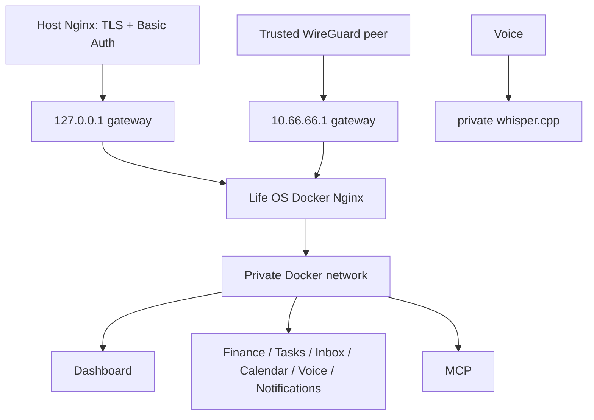

# Networking and data flows

Only the `gateway` container publishes an application port, defaulting to `127.0.0.1:3000`. Dashboard and services use Docker `expose`; PostgreSQL has no host port. The current deployment uses `LIFE_OS_GATEWAY_BIND_ADDRESS=10.66.66.1`: every WireGuard peer able to reach that address is trusted to use Dashboard and unauthenticated API/MCP routes. Peer membership is the authentication boundary; never expose this port on a LAN/public address or describe it as host-Nginx/Basic-Auth protected.

The alternative supported model is loopback binding behind operator-managed host Nginx TLS/Basic Auth; see [`../host-nginx-example.conf`](../host-nginx-example.conf). Applying/reloading host Nginx is an operator task. Choose one boundary intentionally; moving between them requires changing ignored `.env`, recreating gateway, and (for loopback) applying host configuration.

Routes are `/` to Dashboard, `/api/{finance,tasks,inbox,calendar,voice,notifications}/` to corresponding private services, `/api/activity/` read-only to Activity, and `/api/mcp/` to the Streamable HTTP MCP endpoint. The Whisper worker and the [monitor](../services/monitor.md) have no gateway route and no host port; the monitor reads the Dashboard's `/api/status` and posts to Notifications on the private network. Browser code always uses gateway-relative paths.

The gateway has a 26 MiB body ceiling, connection/request rate limits, explicit proxy timeouts, a longer MCP streaming timeout, and basic browser security headers. It discards caller-supplied forwarded headers and derives them from the immediate peer. It also guards Activity attribution: public traffic may only say it is the owner (`X-Life-OS-Actor: user`) or a development tool (`dev:<name>`, 1–64 letters, digits, `.`, `_`, `-`); `agent:` and `system:` claims are dropped, so such a write fails the services' actor gate (`400 actor_required`), and `X-Correlation-ID` and `X-Causation-ID` are cleared. Internal callers that legitimately send those headers (processor and MCP, Voice worker) use the private network, never the gateway. See [Activity](../services/activity.md#the-actor-gate). It emits no permissive CORS policy; Dashboard is same-origin. There is no cookie/session auth today, so CSRF tokens are not meaningful; add Origin/CSRF checks before introducing cookie authentication. MCP is gateway-routed only for the selected trusted ingress and is not a public browser API.

Typical write flow: browser → gateway → service validation → its database → JSON response. Typical dashboard read flow: request a page → Dashboard reads required private service APIs → rendered page returns through gateway. A service failure is isolated; dashboard pages show loading/error states instead of directly exposing a container port.
