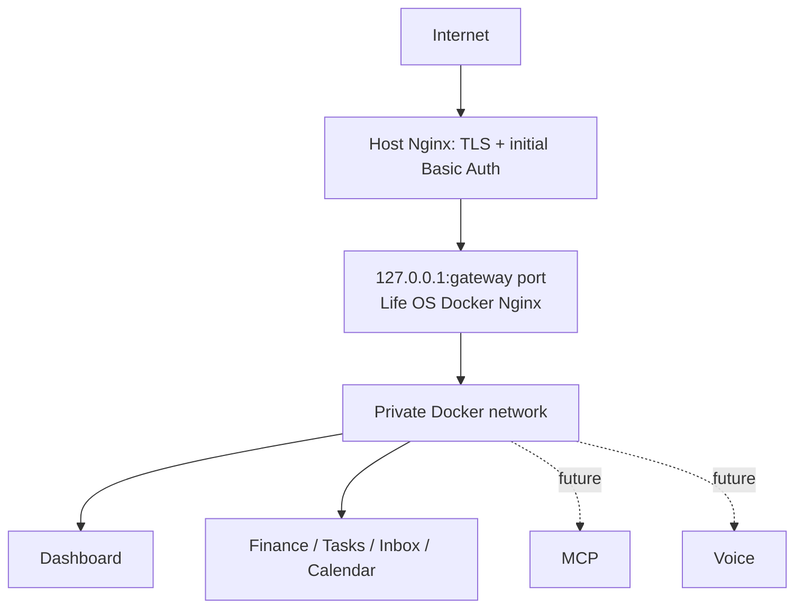

# Networking and data flows

Only the `gateway` container publishes an application port, defaulting to `127.0.0.1:3000`. Dashboard and services use Docker `expose`; PostgreSQL has no host port. The host Nginx configuration is deliberately operator-managed; see [`../host-nginx-example.conf`](../host-nginx-example.conf). A WireGuard-only deployment can set `LIFE_OS_GATEWAY_BIND_ADDRESS=10.66.66.1`.

Routes are `/` to Dashboard and `/api/{finance,tasks,inbox,calendar}/` to the corresponding private service. `/api/mcp/` and `/api/voice/` are reserved and unavailable until implemented. Browser code always uses these gateway-relative paths.

Typical write flow: browser → gateway → service validation → its database → JSON response. Typical dashboard read flow: request a page → Dashboard reads required private service APIs → rendered page returns through gateway. A service failure is isolated; dashboard pages show loading/error states instead of directly exposing a container port.
