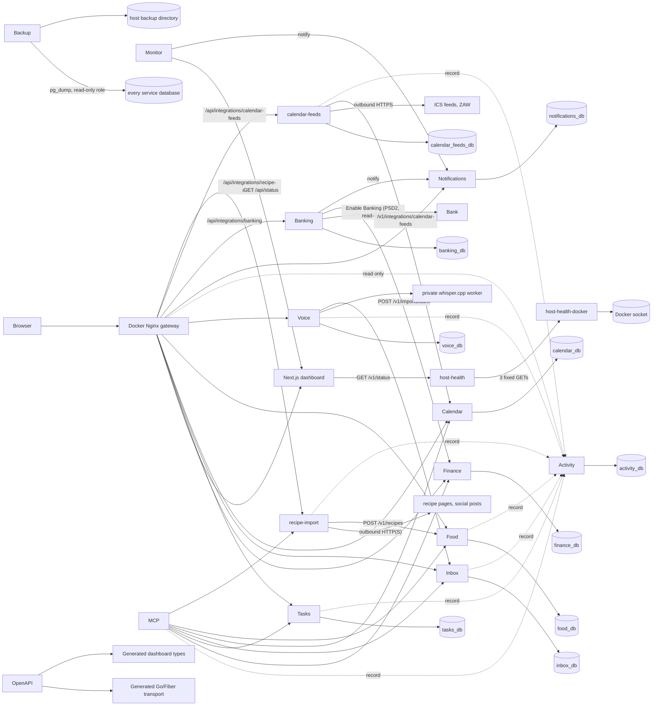

# Architecture overview

Life OS separates domain ownership from presentation. Finance, Tasks, Inbox, Calendar, Food, and Voice are independently deployable Go + Fiber services; each owns its OpenAPI contract, migrations, sqlc queries, database, credentials, and domain types. Services never read each other's tables. Shared `pkg/` code is infrastructure only: configuration, database/runtime helpers, request IDs, logging, errors, health/readiness, and graceful shutdown.

The dashboard consumes API contracts rather than databases. OpenAPI is the cross-language transport source of truth; generated DTOs may differ from internal domain types. PostgreSQL is one server for local simplicity, not a shared application database.

MCP uses service APIs to perform semantic actions and records an Inbox audit trail; it must not bypass ownership with database access. When an entity becomes editable, its lifecycle is implemented once in the owning service and shared by the Dashboard and MCP. Tasks are the reference implementation; other domains are not retrofitted ahead of their own tickets. See [Editable entities and UI/agent parity](editable-entities.md). Voice/STT asynchronously turns an uploaded recording into an Inbox item, then uses that same MCP path. The Voice worker is intentionally separate from web request handling, so audio transcription does not hold a browser request open.

Activity stores user-facing activity events. Each owning service records its own meaningful operations (capture, processing, MCP actions, Task changes) over HTTP. Correlation, causation, and actor headers travel with each call, so a whole Voice → Inbox → MCP → Task workflow can be reconstructed from one API. See [Activity](../services/activity.md).

Integrations are separate, replaceable services that connect a provider to a domain service. They give it data, or take data from it, only through that service's public API, and the domain service names no provider. Calendar's integration API is the first: `google-calendar` and `calendar-feeds` register their sources, sync each source's events in snapshots or deltas, and follow a change feed of the events changed in Life OS. See [Calendar integration API](../services/calendar-integration-api.md). [calendar-feeds](../services/calendar-feeds.md) (P11-08) owns the ICS feeds and the ZAW preset in its own `calendar_feeds_db`, downloads them, and syncs them into Calendar, which downloads no feed itself. [google-calendar](../services/google-calendar.md) (P11-07) owns the Google connection (OAuth, the sealed refresh token), the calendar list, and the two-way sync in its own `google_calendar_db`: it sends Calendar the events of the Google calendars chosen to sync, writes the owner's edits and the Life OS events to Google from Calendar's change feed, and applies changes made to exported events in Google through Calendar's events API; Calendar calls no Google API. Since P11-09 Calendar holds no provider data either: every source is an integration's (kind `external`), with only the owner's settings and its identity in its integration, and the integrations never read Calendar's database. [recipe-import](../services/recipe-import.md) (P15-07) reads recipes from web pages (schema.org JSON-LD and microdata, else an OpenGraph preview, the path of Instagram and TikTok posts) and pasted captions, and saves them through Food's public recipes API as `system:recipe-import`; it keeps no database, and Food fetches no page itself. Integrations are routed under `/api/integrations/<name>/`.

Notifications is the one path by which any service lets the owner know about something. Producers post a notification over HTTP (`pkg/notify`); Notifications stores it for the Dashboard and delivers it through the channels configured on its server (ntfy, and web push to the installed Life OS app), so no producer talks to ntfy or a phone app itself. See [Notifications](../services/notifications.md).

Banking is an integration service: it owns everything bank-side (the Enable Banking adapter, the read-only consent and its sealed session, the sync schedule within the banks' four-reads-a-day limit, consent reminders) and hands accounts and transactions to Finance only through Finance's bank import API, so Finance never calls a bank and Banking never touches Finance's data. Integrations are routed under `/api/integrations/<name>/`. See [Banking](../services/banking.md).

The monitor is a small internal service without a database or a gateway route. Once a minute it reads the Dashboard's runtime status (`GET /api/status`, the checks the Status page renders) and notifies the owner through Notifications when a check breaks or recovers. The rules that make something a problem therefore exist once, in the Dashboard. See [Monitor](../services/monitor.md).

The backup service is the one component that reads every database, and it only reads: once a night it dumps each database in the registry with `pg_dump` as `lifeos_backup`, a role that can read every table but change nothing, from one consistent snapshot per database, into a directory on the host, and rotates old runs. It has no database of its own and no gateway route. See [Backup](../services/backup.md).

host-health reports the server itself to the Status page: memory, load, disks, and every container on the host, from all compose projects. It only reads, from its own `/proc` and statfs on read-only binds, and it reaches the containers through `host-health-docker`, the one container that mounts the Docker socket and answers three fixed questions, so no other Life OS component can read container environments, logs, or files. See [Host health](../services/host-health.md).
