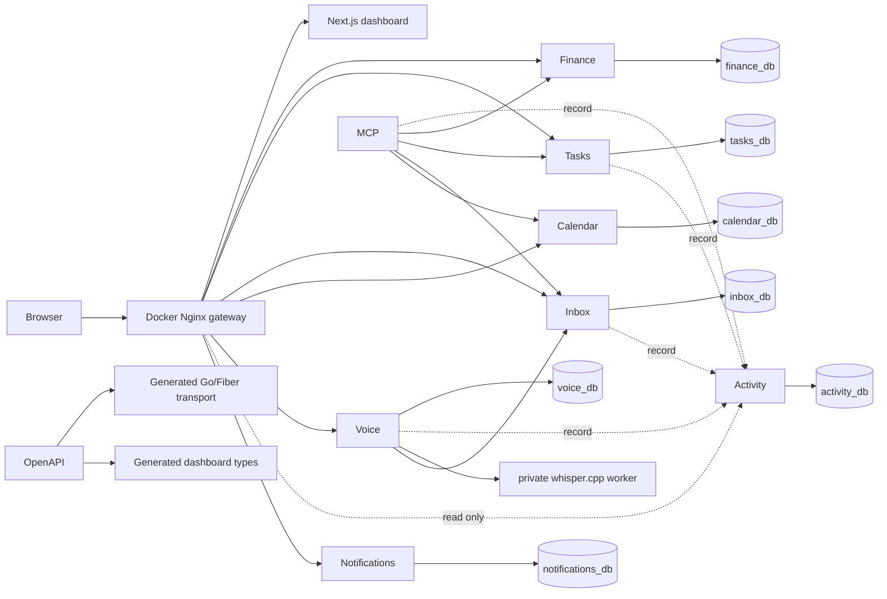

# Architecture overview

Life OS separates domain ownership from presentation. Finance, Tasks, Inbox, Calendar, and Voice are independently deployable Go + Fiber services; each owns its OpenAPI contract, migrations, sqlc queries, database, credentials, and domain types. Services never read each other's tables. Shared `pkg/` code is infrastructure only: configuration, database/runtime helpers, request IDs, logging, errors, health/readiness, and graceful shutdown.

The dashboard consumes API contracts rather than databases. OpenAPI is the cross-language transport source of truth; generated DTOs may differ from internal domain types. PostgreSQL is one server for local simplicity, not a shared application database.

MCP uses service APIs to perform semantic actions and records an Inbox audit trail; it must not bypass ownership with database access. When an entity becomes editable, its lifecycle is implemented once in the owning service and shared by the Dashboard and MCP. Tasks are the reference implementation; other domains are not retrofitted ahead of their own tickets. See [Editable entities and UI/agent parity](editable-entities.md). Voice/STT asynchronously turns an uploaded recording into an Inbox item, then uses that same MCP path. The Voice worker is intentionally separate from web request handling, so audio transcription does not hold a browser request open.

Activity stores user-facing activity events. Each owning service records its own meaningful operations (capture, processing, MCP actions, Task changes) over HTTP. Correlation, causation, and actor headers travel with each call, so a whole Voice → Inbox → MCP → Task workflow can be reconstructed from one API. See [Activity](../services/activity.md).

Notifications is the one path by which any service lets the owner know about something. Producers post a notification over HTTP (`pkg/notify`); Notifications stores it for the Dashboard and delivers it through the channels configured on its server, so no producer talks to ntfy or a phone app itself. See [Notifications](../services/notifications.md).
