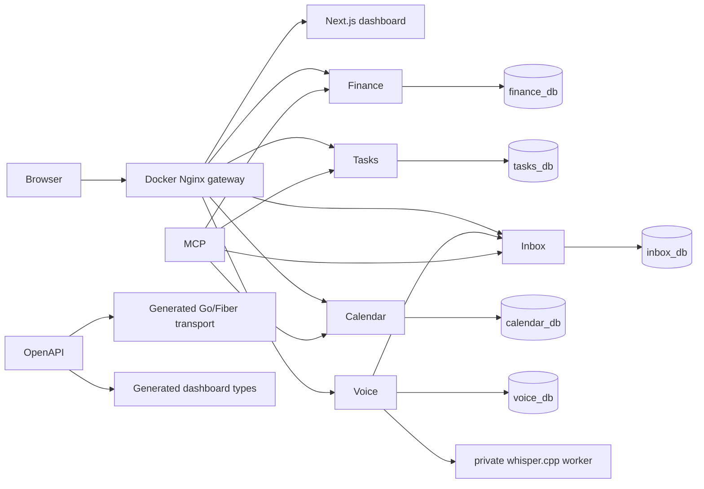

# Architecture overview

Life OS separates domain ownership from presentation. Finance, Tasks, Inbox, Calendar, and Voice are independently deployable Go + Fiber services; each owns its OpenAPI contract, migrations, sqlc queries, database, credentials, and domain types. Services never read each other's tables. Shared `pkg/` code is infrastructure only: configuration, database/runtime helpers, request IDs, logging, errors, health/readiness, and graceful shutdown.

The dashboard consumes API contracts rather than databases. OpenAPI is the cross-language transport source of truth; generated DTOs may differ from internal domain types. PostgreSQL is one server for local simplicity, not a shared application database.

MCP uses service APIs to perform semantic actions and records an Inbox audit trail; it must not bypass ownership with database access. Voice/STT asynchronously turns an uploaded recording into an Inbox item, then uses that same MCP path. The Voice worker is intentionally separate from web request handling, so audio transcription does not hold a browser request open.
