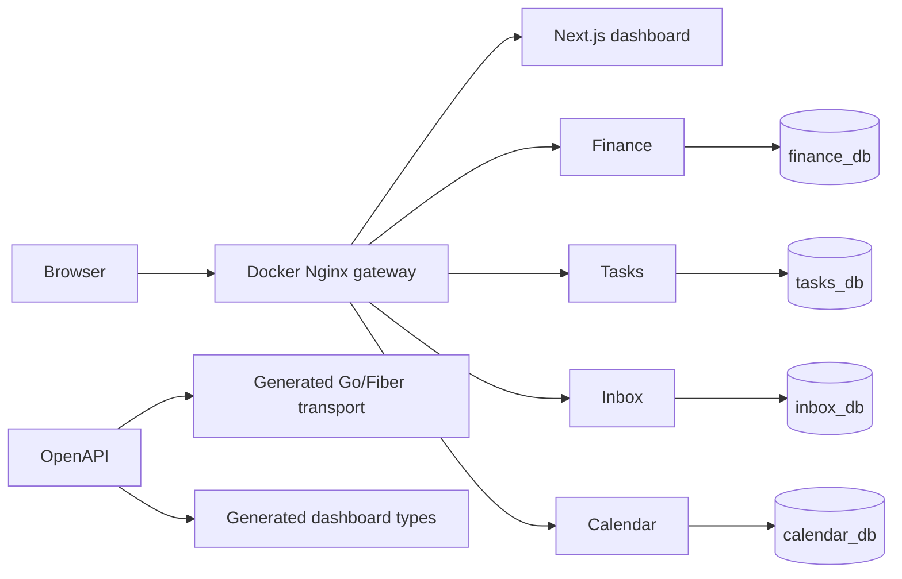

# Architecture overview

Life OS separates domain ownership from presentation. Finance, Tasks, Inbox, and Calendar are independently deployable Go + Fiber services; each owns its OpenAPI contract, migrations, sqlc queries, database, credentials, and domain types. Services never read each other's tables. Shared `pkg/` code is infrastructure only: configuration, database/runtime helpers, request IDs, logging, errors, health/readiness, and graceful shutdown.

The dashboard consumes API contracts rather than databases. OpenAPI is the cross-language transport source of truth; generated DTOs may differ from internal domain types. PostgreSQL is one server for local simplicity, not a shared application database.

Future MCP uses service APIs to perform semantic actions and records an audit trail; it must not bypass ownership with database access. Voice/STT will asynchronously turn an uploaded recording into an Inbox item, then use that same MCP path.
