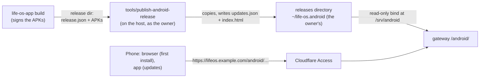

# Android releases: /android/

Life OS serves its Android apps, the phone app and the Wear OS app (built in the separate `life-os-app` repository), from the gateway at `/android/` under its public URL (`LIFE_OS_PUBLIC_URL`, such as `https://lifeos.example.com/android/`), behind Cloudflare Access like every other path. The phone installs the first version from the download page there; after that, the app reads the manifest at `/android/updates` and updates itself. Nothing here builds or signs an app: the server only stores and serves APKs that the app repository built and signed.



## The flow

1. **Build** (in `life-os-app`). Its build script writes a release directory: `lifeos-phone-<versionName>-<versionCode>.apk`, `lifeos-wear-<versionName>-<versionCode>.apk`, and [`release.json`](#releasejson-what-the-build-writes).
2. **Publish** (here, on the host, as the owner): `tools/publish-android-release <release-dir> [--notes "…"]`. It checks the release, copies the APKs into the releases directory, and writes the [manifest](#the-manifest-updatesjson) and the download page. Nothing needs a restart: the gateway serves the new files at once.
3. **Install.** The first time, open `https://lifeos.example.com/android/` (your public URL) on the phone (Access asks for its code if the session has expired), tap **Download**, open the file, and allow installing apps from the browser when Android asks (*Install unknown apps*). The watch APK is listed separately on the page; install it with `adb install` over the watch's wireless debugging.
4. **Update.** The app fetches `/android/updates`, compares `apps.phone.versionCode` with its own, downloads `url`, checks `size` and `sha256`, and hands the APK to Android's package installer, which installs it only if it is signed with the same key as the installed app ([Security model](#security-model)).

## The releases directory

`LIFE_OS_ANDROID_RELEASES_DIR` in `.env`, by default `~/life-os.android` of the user who runs Compose. It belongs to that user, the owner, mode 755; the publish script writes it as the owner and never needs root. The gateway mounts it read-only at `/srv/android` (`compose.yaml`) and only reads it (nginx runs as uid 101 in the container, hence the world-readable modes: the directory 755, the files 644).

It holds `updates.json`, `index.html`, and the APKs (`lifeos-phone-*.apk`, `lifeos-wear-*.apk`); during a publish also temporary `.publish-*` files, which the gateway never serves. Put nothing else there: the gateway would not serve it, and the publish script deletes every APK the manifest no longer lists.

### Setting it up (once)

```sh
install -d -m 755 ~/life-os.android
docker compose up -d --no-build --no-deps --force-recreate gateway
curl -s -o /dev/null -w '%{http_code}\n' http://127.0.0.1:3000/android/updates   # 404 until the first publish, then 200
```

The gateway must be recreated for the new mount (a reload does not add mounts) and for the new `/android/` locations in `infra/nginx/life-os.conf.template`. The `curl` uses the gateway's address and port (`LIFE_OS_GATEWAY_BIND_ADDRESS:LIFE_OS_GATEWAY_PORT`, by default `127.0.0.1:3000`). Create the directory first: if it is missing when the gateway is created, Docker creates it owned by root, so that the gateway still starts, and the publish script then refuses with the fix (`sudo chown "$(id -u):$(id -g)" ~/life-os.android`).

## Publishing

```sh
tools/publish-android-release ~/life-os-app/dist --notes "Tasks open from notifications"
```

Before it changes anything, the script checks:

- `release.json`: every [field](#releasejson-what-the-build-writes) of each app it describes (the phone, the watch, or both);
- the versions: each app's `versionCode` must be greater than the published one. A lower one (a downgrade), or the same one with other bytes, is refused; `--force` publishes it anyway ([Keeping old versions](#keeping-old-versions)). The same release again is not an error: it publishes nothing;
- every APK: present under the name `lifeos-<app>-<versionName>-<versionCode>.apk`, with the size and SHA-256 `release.json` gives.

Then it copies the APKs into the releases directory, writes `updates.json` and `index.html` (each to a temporary file in the directory, renamed into place, so a reader sees the old file or the new one), deletes the APKs older than the newest 5 of each app, and prints what it did:

```text
published phone 0.1.2 (3): /android/lifeos-phone-0.1.2-3.apk, 18234567 bytes, sha256 9f2c…
published wear 0.1.2 (3): /android/lifeos-wear-0.1.2-3.apk, 7345678 bytes, sha256 41d0…
deleted lifeos-phone-0.0.7-1.apk (keeping the newest 5 of each app)
manifest: /home/you/life-os.android/updates.json (served at /android/updates), page: /home/you/life-os.android/index.html (served at /android/)
```

The APKs go in before the manifest, so the manifest never names a file that is not there yet; a publish interrupted at any point (even killed) leaves the old manifest and its APKs as they were, and the next publish removes the temporary files it left. One publish runs at a time (a lock on the directory). `--notes` goes with every app the run publishes and is shown on the page (escaped). Exit status: 0 published (or nothing new), 2 refused (nothing changed), 1 failed. The directory comes from `LIFE_OS_ANDROID_RELEASES_DIR` in the environment, else `.env`, else the default; the page shows times in `LIFE_OS_TIMEZONE` (else Europe/Berlin), and in the browser's own zone once it has loaded.

## release.json: what the build writes

A small contract between the app repository's build and the publish script. One object per app, under `phone` and `wear` (either may be missing; both may also sit under a top-level `apps`):

What `tools/build` in `~/life-os-app` writes (`dist/release.json`):

```json
{"schema": 1, "apps": {
  "phone": {"file": "lifeos-phone-0.3.0-3.apk", "applicationId": "com.gamch1k.lifeos", "versionCode": 3, "versionName": "0.3.0", "minSdk": 34, "sha256": "acfd…", "size": 12085080, "builtAt": "2026-10-12T19:40:00Z", "gitCommit": "b18a6d1…"},
  "wear": {"file": "lifeos-wear-0.3.0-3.apk", "applicationId": "com.gamch1k.lifeos", "versionCode": 3, "versionName": "0.3.0", "minSdk": 33, "sha256": "b684…", "size": 15829290, "builtAt": "2026-10-12T19:40:00Z", "gitCommit": "b18a6d1…"}
}}
```

The script reads `gitCommit` as `commit` (either name works) and ignores `schema`, `file`, and `applicationId`; the APK files are found by their versioned names.

| Field         | Required | Form                                                                                                     |
| ------------- | -------- | -------------------------------------------------------------------------------------------------------- |
| `versionCode` | yes      | whole number, 1 to 2100000000 (Android's limit); must grow with every release                            |
| `versionName` | yes      | 1–64 letters, digits, `.`, `_`, `+`, `-`, starting with a letter or digit; part of the APK's file name   |
| `minSdk`      | yes      | whole number, the APK's minimum API level                                                                |
| `sha256`      | yes      | the APK's SHA-256, 64 lowercase hexadecimal digits (`sha256sum`)                                         |
| `size`        | yes      | the APK's size in bytes                                                                                  |
| `builtAt`     | yes      | RFC 3339 time of the build, such as `2026-10-12T10:00:00Z`                                               |
| `commit`      | yes      | the app repository's commit, 1–64 letters, digits, `.`, `_`, `+`, `-` (such as `0123abc` or `0123abc-dirty`) |

Other keys are ignored. Should the build ever write other names, the publish script maps them in one place (the `release=$(jq …)` filter near its top), not here.

## The manifest: updates.json

Served at `/android/updates` (and `/android/updates.json`) as `application/json` with `Cache-Control: no-cache`. The publish script writes it; nothing else does.

```json
{
  "formatVersion": 1,
  "updatedAt": "2026-10-12T14:03:00Z",
  "apps": {
    "phone": {
      "versionCode": 3,
      "versionName": "0.1.2",
      "minSdk": 34,
      "sha256": "9f2c…",
      "size": 18234567,
      "url": "/android/lifeos-phone-0.1.2-3.apk",
      "publishedAt": "2026-10-12T14:03:00Z",
      "builtAt": "2026-10-12T10:00:00Z",
      "commit": "0123abc",
      "notes": "Tasks open from notifications",
      "previous": [
        {"versionCode": 2, "versionName": "0.1.1", "minSdk": 34, "sha256": "…", "size": 18100000, "url": "/android/lifeos-phone-0.1.1-2.apk", "publishedAt": "…", "builtAt": "…", "commit": "…", "notes": ""}
      ]
    },
    "wear": {"versionCode": 3, "versionName": "0.1.2", "…": "…"}
  }
}
```

- `formatVersion` is 1; a change that breaks readers raises it.
- `updatedAt` is when the last publish changed the manifest (UTC); `publishedAt` is when that app's version was published.
- `url` is a path on the same host (the public URL, such as `https://lifeos.example.com`, from the app; the WireGuard address, such as `http://10.8.0.1:3000`, over WireGuard). A URL's file never changes content.
- `versionCode`, `versionName`, `minSdk`, `sha256`, `size`, `builtAt`, `commit` are copied from `release.json`; `notes` is the publish's `--notes`, or empty.
- `previous` lists the up to 4 versions kept before the current one, newest publish first, in the same form. The app does not need them.
- An app that was never published is absent from `apps`.

What the app does with it: if `apps.phone.versionCode` is greater than its own and the device's API level is at least `minSdk`, download `url` (it may resume with a `Range` request), refuse it unless its size is `size` and its SHA-256 is `sha256`, then install it.

## What the gateway serves

`location /android/` in `infra/nginx/life-os.conf.template`, on the Life OS server only, behind the same Access requirement as everything else:

| Path                                                       | Serves                       | Content type                                | Caching                                 |
| ---------------------------------------------------------- | ---------------------------- | ------------------------------------------- | --------------------------------------- |
| `/android/`                                                | `index.html`, the download page | `text/html; charset=utf-8`               | `no-cache`                              |
| `/android/updates`, `/android/updates.json`                | `updates.json`, the manifest | `application/json`                          | `no-cache`                              |
| `/android/lifeos-(phone\|wear)-<versionName>-<versionCode>.apk` | the APK, as an attachment (`Content-Disposition: attachment`; ranges supported) | `application/vnd.android.package-archive` | `private, max-age=31536000, immutable` |
| `/android`                                                 | a redirect to `/android/`    |                                             |                                         |

Every other path under `/android/` is a 404 (there is no directory listing, and no other file is served, `release.json` included); a method other than GET or HEAD is a 405; a symbolic link in the directory is refused (403). nginx resolves `.` and `..` segments before it picks a location, so `/android/../…` leaves `/android/` (and reaches the Dashboard) instead of the directory, and encoded ones that climb above the root are a 400. The download page and the manifest are revalidated on every load (an `ETag` makes that cheap); an APK's name carries its version, so it is cached for good, but only by the phone: `private` keeps Cloudflare, which caches `.apk` files by default, from storing a copy at its edge. Downloads use the general API rate limit (30 requests a second per client, a burst of 60): a download is one request, however long, and `send_timeout` (60 s) bounds a pause in it, not its length.

## Keeping old versions

The newest 5 versions of each app stay in the directory: the current one and the 4 in its `previous` list, newest publish first. A publish deletes every APK the new manifest no longer lists, and the page lists the kept older versions.

Android does not install an older `versionCode` over a newer one (only after uninstalling, which loses the app's data on the phone). So a bad release is rolled back by publishing a fixed build with a higher `versionCode`. The older APKs are for reference: a fresh install of an older build, or a comparison. `--force` publishes a lower or equal `versionCode` (the manifest then names it as current, for fresh installs); installed apps keep their newer version.

## Security model

- **Behind Access, never public.** `/android/` is a path of the public hostname (`LIFE_OS_PUBLIC_HOSTNAME`) like the Dashboard: Cloudflare Access's login comes first, the connector validates the Access token, and the gateway refuses a tunnel request without one ([Cloudflare Tunnel and Access](cloudflare.md#origin-trust-and-access-paths)). There is no bypass for the page, the manifest, or the APKs. The app reaches them through Access, like its other Life OS requests. Over WireGuard (the gateway's WireGuard address, such as `http://10.8.0.1:3000/android/`) the usual peer trust applies.
- **Android's signature check guards every update.** The package installer installs an update only if it is signed with the same certificate as the installed app (the phone and watch apps share one key; see the `life-os-app` README). A replaced or tampered APK on the server cannot take over the installed app; a downgrade is refused by Android too. The signing key never comes to the server: the publish script handles signed APKs only.
- **The manifest's `sha256` and `size`** let the app refuse a broken or truncated download before it reaches the installer, and the page shows the SHA-256 for checking a first install by hand.
- **The first install** trusts the download page, which only the Access-authenticated owner reaches.
- **The gateway only reads.** The directory is mounted read-only; only the page, the manifest, and APK names are served; symbolic links are refused; nothing in the directory executes. The publish script refuses a `versionName` that is not a plain file name part, so a `release.json` cannot place a file outside the directory.
- **The verification stack never sees the owner's releases.** `tools/verify-compose` mounts a scratch directory of its own (`LIFE_OS_VERIFY_ANDROID_RELEASES_DIR`, by default an empty one under `TMPDIR`) and refuses a plan that mounts the owner's.

## Checks

- `tools/test-publish-android-release` (no Docker, scratch directories only): a release publishes, the same release again publishes nothing, a downgrade and a SHA-256 or size mismatch are refused with nothing changed, invalid releases and directories are refused, the newest 5 versions are kept, and a publish killed midway (at an APK's rename and at the manifest's) leaves the old manifest and its APKs intact.
- `tools/test-android-gateway` (throwaway containers of the gateway's image, never the deployed gateway): `nginx -t`; the manifest, page, and APK headers; a 20 MB APK arrives whole and by range; missing files, other names, symbolic links, other methods, and traversal get nothing; and on the Cloudflare path `/android/` needs Access's token.
- `apps/dashboard/e2e/android-updates.spec.ts`, run by `tools/browser-e2e`, which publishes a made-up release (`tools/fixtures/android-release`) into the verification stack's own directory: the manifest, both APKs, and the page with its download.

## Troubleshooting

| Symptom | Likely cause | Fix |
| --- | --- | --- |
| `/android/updates` is 404 | Nothing published yet, or the gateway was not recreated with the mount | Publish; `docker compose exec gateway ls -l /srv/android` must list the files |
| `/android/` is the Dashboard's 404 page | The gateway runs the old configuration | `docker compose up -d --no-build --no-deps --force-recreate gateway` |
| 403 for every file | The gateway cannot read them | `chmod 755` the directory; the script writes files 644 |
| `the releases directory … is not writable` | Docker created it, owned by root | `sudo chown "$(id -u):$(id -g)" ~/life-os.android` (or your `LIFE_OS_ANDROID_RELEASES_DIR`) |
| `refusing a downgrade` / `already published with a different APK` | The build's `versionCode` did not grow | Bump `versionCode` in the app and build again (`--force` only on purpose) |
| `the SHA-256 of … is …` | The APK changed after `release.json` was written, or the copy is incomplete | Build again, or copy the release directory again |
| `the published manifest … is unreadable` | `updates.json` was edited by hand | Repair it, or remove it to start over (the next publish then deletes the APKs it no longer lists) |
