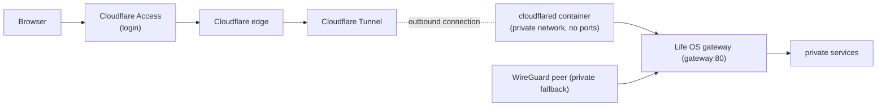

# Cloudflare Tunnel and Access

Life OS can be reached from outside the private network at `https://lifeos.gamch1k.com`. Cloudflare authenticates the person, and a Cloudflare Tunnel then carries the request to the Life OS gateway. Nothing on the server listens publicly for this path: the `cloudflared` connector only dials out to Cloudflare.



## The tunnel (deployment path)

- **Connector.** The `cloudflared` service in `compose.yaml` runs `cloudflare/cloudflared:2026.10.0`. It is on the dedicated `edge` network only (see [Origin trust](#origin-trust-and-access-paths)), publishes no port, runs as a non-root user with a read-only filesystem and no capabilities, and does not auto-update (bump the pinned image deliberately). Its health check is `cloudflared tunnel ready` against its local metrics endpoint (`127.0.0.1:20241`, inside the container only).
- **Opt-in.** The service belongs to the `cloudflare` Compose profile, so a stack without a tunnel token never starts it. To run it with the normal stack, set `COMPOSE_PROFILES=cloudflare` in `.env`, as the deployment does. It then starts with `make life-up` and every `docker compose up`. To start it once, use `docker compose --profile cloudflare up -d cloudflared`.
- **Never in the verification stack.** `tools/verify-compose` clears `COMPOSE_PROFILES` and refuses any plan that contains `cloudflared`. The disposable stack reads the same `.env`, and a second connector holding the real tunnel token would receive production traffic.
- **Token.** The tunnel is managed remotely in the Cloudflare Zero Trust dashboard, and the connector authenticates with the tunnel token in `LIFE_OS_CLOUDFLARE_TUNNEL_TOKEN` in the ignored `.env`. The token is a credential: anyone holding it can run a connector for this tunnel. Never commit it or paste it into tickets or chat.
- **Route.** The tunnel's public hostname `lifeos.gamch1k.com` points to the service URL `http://gateway:80`, the gateway's Docker DNS name on the private network. The route is configured in Cloudflare, not in the repository. The gateway serves the same Dashboard and `/api/*` routes as on every other path; no service is exposed on its own.
- **Ingress check.** `tools/check-ingress` asserts, for the full Compose plan including the `cloudflare` profile, that only the gateway publishes a host port and that `cloudflared` stays on the private network without ports.

The WireGuard-bound gateway port (`LIFE_OS_GATEWAY_BIND_ADDRESS`) is unchanged and remains the private path.

## Security ordering

The Access application for the hostname must exist before the connector serves traffic. A tunnel route without a running connector returns a Cloudflare error, never Life OS. So the connector is started only after anonymous requests to the hostname are confirmed to be redirected to the Cloudflare login. See [Cloudflare Access](#cloudflare-access) below.

## Origin trust and access paths

The public path is designed so that Cloudflare Access cannot be bypassed:

- **The connector reaches only the gateway.** `cloudflared` sits on the `edge` network (`10.255.249.0/29`), which it shares with the gateway and nothing else. A tunnel route pointing anywhere but `gateway:80`, for example `tasks:8080`, cannot reach a service; from that network every service, Postgres, MCP, and the Dashboard are unreachable. `tools/check-ingress` enforces the membership.
- **No public origin.** The gateway publishes only on the WireGuard address (`10.66.66.1:3001`, IPv4). The server's public IP refuses that port. The pre-existing host Nginx (`:80`/`:443`, other applications) has no route to Life OS, and `lifeos.gamch1k.com` resolves to Cloudflare, not to this server.
- **Cloudflare headers are trusted from the edge network only.** For requests from `10.255.249.0/29`, the gateway takes the visitor's address from `CF-Connecting-IP`; rate limits and logs then see the real client. It also reports `https` as `X-Forwarded-Proto`. From WireGuard or anywhere else, the header is ignored, so a spoofed value has no effect. The gateway never forwards `CF-Connecting-IP`, `Cf-Access-Jwt-Assertion`, or `Cf-Access-Authenticated-User-Email` to services: none of them authenticates with Cloudflare, so nothing can trust a forged copy.
- **Protect with Access** (recommended). When it is enabled on the tunnel route, the connector also validates the Access token (the application's AUD) before forwarding. A route to this tunnel without Access is then rejected, even one added by mistake. To enable it: Tunnels → `life-os` → Configure → Public hostname → edit the route → Additional application settings → Access → **Protect with Access**, and select the `Life OS` application. It was not enabled at the Phase 9 sign-off; once it is, the connector's `Updated to new configuration` log line shows an `access` block under `originRequest`.

Intended paths:

| Path | Address | Authentication |
| --- | --- | --- |
| Public | `https://lifeos.gamch1k.com` → Access → Tunnel → `gateway:80` | Cloudflare Access (email PIN, group `Life OS users`) |
| Private fallback | `http://10.66.66.1:3001` from WireGuard peers | WireGuard peer trust; no Life OS login (unchanged model) |
| Maintenance | On the host: `docker compose …`, or `curl http://10.66.66.1:3001` (the host is on the WireGuard network) | Host access |

## Cloudflare Access

Cloudflare Access is the login in front of the hostname. It runs at Cloudflare's edge before the tunnel, so no request reaches the server without passing it.

| Setting | Value |
| --- | --- |
| Zero Trust team domain | `damp-surf-d6be.cloudflareaccess.com` |
| Application | `Life OS`: Self-hosted → Public DNS → `lifeos.gamch1k.com`, session 24 h |
| Login method | One-time PIN (a code sent by email), with instant authentication |
| Policy `Owner` | **Allow**, Include → Access group `Life OS users` |
| Access group `Life OS users` | Include → Emails → the owner's address |
| Policy `Acceptance test` (temporary) | **Service Auth**, Include → Service Token `life-os-acceptance` |

Access denies by default, so only addresses in `Life OS users` receive a code. To add a person, add their email to the group; to remove one, delete it. Life OS has no user accounts of its own, so everyone admitted shares the same data.

The temporary service token lets automated checks authenticate without a mailbox, using the headers `CF-Access-Client-Id` and `CF-Access-Client-Secret`. Its values live only in `.env` (`LIFE_OS_CF_ACCESS_CLIENT_ID`, `LIFE_OS_CF_ACCESS_CLIENT_SECRET`). The token and its policy are removed after the Phase 9 sign-off.

`tools/check-cloudflare-access` checks the public path from wherever it runs:
- anonymous requests to every page and API, including writes and requests with a forged `CF_Authorization` cookie or `Cf-Access-Jwt-Assertion` header, must be redirected to the Access login;
- with the service token, the pages and APIs must reach Life OS.

The detailed setup, debugging, and recovery guide for this deployment is kept in Notion: **Phase 9 — Cloudflare Access → Cloudflare Access & Tunnel — Setup, Debugging, Recovery**.

## Operating the public path

### Resources and where they live

| Resource | Value | Where |
| --- | --- | --- |
| Domain | `gamch1k.com` | Cloudflare → Websites |
| Public hostname | `lifeos.gamch1k.com` (proxied DNS record created by the tunnel route) | Cloudflare DNS |
| Zero Trust team | `damp-surf-d6be.cloudflareaccess.com` | Zero Trust → Settings → Team name and domain |
| Tunnel | `life-os`, ID `7492ccf1-3f9d-4237-82a0-cf52ab7ac038`, remotely managed | Zero Trust → Networks → Tunnels |
| Route | `lifeos.gamch1k.com` → HTTP → `gateway:80` | Tunnel → Configure → Public hostname |
| Access application, policies, group, login | See [Cloudflare Access](#cloudflare-access) | Zero Trust → Access controls |
| Tunnel token | `LIFE_OS_CLOUDFLARE_TUNNEL_TOKEN` | `~/life-os/.env` (ignored) |
| Connector switch | `COMPOSE_PROFILES=cloudflare` | `~/life-os/.env` |
| Service token (checks only) | `LIFE_OS_CF_ACCESS_CLIENT_ID`, `LIFE_OS_CF_ACCESS_CLIENT_SECRET` | `~/life-os/.env` |

### Verify

```sh
cd ~/life-os
./tools/check-cloudflare-access   # anonymous → 302 everywhere; service token → 200
./tools/check-ingress             # only the gateway publishes; edge = cloudflared + gateway
docker compose ps cloudflared     # Up … (healthy)
docker compose logs cloudflared | grep 'Registered tunnel connection' | tail -4
docker compose logs cloudflared | grep 'Updated to new configuration' | tail -1   # route + Access validation
```

For the human check, open `https://lifeos.gamch1k.com` from a phone on mobile data with WireGuard off. Log in with the email code; Life OS Home must load.

### Diagnose

| Symptom | Likely cause | Fix |
| --- | --- | --- |
| Cloudflare error 1033 / HTTP 530 | Access passed, but no connector is connected | `docker compose up -d cloudflared`; read `docker compose logs cloudflared`; check the tunnel status in Zero Trust |
| 502 after login | The connector is up but the gateway is unreachable, or it holds stale upstream addresses after a redeploy | `docker compose up -d --force-recreate --no-deps gateway`; the route must be `http://gateway:80` |
| Connector restarts, "Unauthorized" / invalid tunnel secret | Wrong, rotated, or deleted tunnel token | Put the current token in `.env`, then `docker compose up -d cloudflared` |
| No PIN email | Address not in `Life OS users`, or mail filtering | Check the group; allow `noreply@notify.cloudflare.com`. PINs are sent only to allowed addresses and expire after 10 minutes |
| "You don't have access" after the code | Policy or group mismatch | `Owner` must be Allow with Include → group `Life OS users` |
| Service token gets 401 | Partial ID or secret (the ID ends with `.access`), expired token, or the policy action is Allow | Regenerate the token; the policy must be **Service Auth** with that token |
| Service token gets 302 | No Service Auth policy matches it | Repair the `Acceptance test` policy |
| All public visitors share one IP in logs | The connector is not on `lifeos-edge` | `./tools/check-ingress`; `docker inspect lifeos-cloudflared-1` must show only `lifeos-edge` |
| Works on one path only (public vs WireGuard) | The paths differ before the gateway | Test each path; a gateway fault breaks both |

### Day-to-day changes

- **Add or remove a person:** edit the emails in the Access group `Life OS users`. Sessions last up to 24 hours. To cut someone off immediately, revoke their sessions in Zero Trust. Everyone admitted shares the same Life OS data.
- **Pause public access** and keep WireGuard: `docker compose stop cloudflared`. To keep it off across deploys, remove `COMPOSE_PROFILES=cloudflare` from `.env`.
- **Update the connector:** bump the pinned image in `compose.yaml`, then `docker compose up -d cloudflared`.
- **After redeploying services,** recreate the gateway (`docker compose up -d --force-recreate --no-deps gateway`) so it resolves the new container addresses. The connector keeps working.

### Rotate and revoke

- **Tunnel token** (leaked, or a scheduled rotation): create a new tunnel, or rotate the token if the dashboard offers it, and add the same route `lifeos.gamch1k.com → http://gateway:80`. Put the new token in `.env`, run `docker compose up -d cloudflared`, check that the old tunnel shows no connectors, and delete it. The Access application belongs to the hostname, so protection is unaffected.
- **Service token:** after the Phase 9 sign-off, delete `life-os-acceptance` and the `Acceptance test` policy, and remove the two `LIFE_OS_CF_ACCESS_CLIENT_*` lines from `.env`. To rotate it instead, regenerate it and update `.env`.
- **Logins:** the one-time PIN has no secret to rotate. In an emergency, revoke all Access sessions in Zero Trust.

### Recover

- **Server rebuilt or `.env` lost:** restore `.env`, or recreate it from `.env.example`. Copy the tunnel token from the tunnel's connector page, or rotate it. Set `COMPOSE_PROFILES=cloudflare` and run `make life-up`.
- **Cloudflare outage or broken Access configuration:** use the WireGuard path `http://10.66.66.1:3001`, which does not depend on Cloudflare.
- **Access application deleted by mistake:** stop the connector first (`docker compose stop cloudflared`) so nothing is exposed. Recreate the application and policies (see [Cloudflare Access](#cloudflare-access)), confirm that an anonymous request gets a 302 to the team login, then start the connector.

### Never commit or share

The tunnel token, service-token secrets, Cloudflare API tokens, identity-provider client secrets (for example a future Google login), and the real `.env`. The repository holds only variable names and placeholders.

A step-by-step rebuild of the Cloudflare side, with dashboard menu paths, is in the Notion runbook named under [Cloudflare Access](#cloudflare-access).
