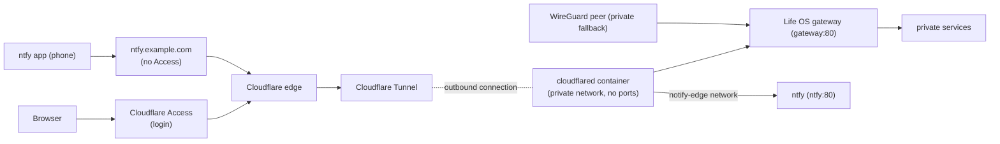

# Cloudflare Tunnel and Access

Life OS can be reached from outside the private network at its public hostname, here `https://lifeos.example.com` (`LIFE_OS_PUBLIC_HOSTNAME`, the host of `LIFE_OS_PUBLIC_URL`). Cloudflare authenticates the person, and a Cloudflare Tunnel then carries the request to the Life OS gateway. Nothing on the server listens publicly for this path: the `cloudflared` connector only dials out to Cloudflare.

The same tunnel has a second, separate entry point: ntfy's hostname, here `https://ntfy.example.com` (`LIFE_OS_NTFY_PUBLIC_URL`), without Access, straight to the self-hosted ntfy server that pushes notifications to the owner's phone. It never touches the gateway or Life OS's networks ([Two entry points](#two-entry-points-life-os-and-ntfy)).



## The tunnel (deployment path)

- **Connector.** The `cloudflared` service in `compose.yaml` runs `cloudflare/cloudflared:2026.10.7`, pinned by digest. It is on the dedicated `edge` network (to the gateway) and the `notify-edge` network (to ntfy) only (see [Origin trust](#origin-trust-and-access-paths)), publishes no port, runs as a non-root user with a read-only filesystem and no capabilities, and does not auto-update: Dependabot's weekly pull request moves the pinned image within the year's versions, and the first version of a new year (a major version to Dependabot, which it leaves out) is a bump by hand. Its health check is `cloudflared tunnel ready` against its local metrics endpoint (`127.0.0.1:20241`, inside the container only).
- **Opt-in.** The service belongs to the `cloudflare` Compose profile, so a stack without a tunnel token never starts it. To run it with the normal stack, set `COMPOSE_PROFILES=cloudflare` in `.env`, as the reference deployment does. It then starts with the first `make life-up`, and on its own with `docker compose up -d --no-build --no-deps cloudflared`. To start it once without the profile in `.env`, use `docker compose --profile cloudflare up -d --no-build --no-deps cloudflared`.
- **Never in the verification stack.** `tools/verify-compose` clears `COMPOSE_PROFILES` and refuses any plan that contains `cloudflared`. The disposable stack reads the same `.env`, and a second connector holding the real tunnel token would receive production traffic.
- **Token.** The tunnel is managed remotely in the Cloudflare Zero Trust dashboard, and the connector authenticates with the tunnel token in `LIFE_OS_CLOUDFLARE_TUNNEL_TOKEN` in the ignored `.env`. The token is a credential: anyone holding it can run a connector for this tunnel. Never commit it or paste it into tickets or chat.
- **Routes.** The tunnel's public hostname `lifeos.example.com` points to the service URL `http://gateway:80`, the gateway's Docker DNS name on the `edge` network. The gateway serves the same Dashboard and `/api/*` routes as on its other listed hosts, so the route's hostname must be `LIFE_OS_PUBLIC_HOSTNAME` (any other Host gets no answer); no service is exposed on its own. The second route, `ntfy.example.com`, points to `http://ntfy:80` on the `notify-edge` network ([below](#two-entry-points-life-os-and-ntfy)). Routes are configured in Cloudflare, not in the repository.
- **Ingress check.** `tools/check-ingress` asserts, for the full Compose plan including the `cloudflare` and `ntfy` profiles, that only the gateway publishes a host port, that `edge` holds only `cloudflared` and the gateway, that `notify-edge` holds only `cloudflared` and `ntfy`, that the internal `notify-internal` holds only `ntfy` and `notifications`, that ntfy is on those two networks only, and (through `tools/check-gateway-hosts`) that the gateway answers only its listed hosts.

The WireGuard-bound gateway port (`LIFE_OS_GATEWAY_BIND_ADDRESS`) is unchanged and remains the private path.

## Security ordering

The Access application for the hostname must exist before the connector serves traffic. A tunnel route without a running connector returns a Cloudflare error, never Life OS. So the connector is started only after anonymous requests to the hostname are confirmed to be redirected to the Cloudflare login. See [Cloudflare Access](#cloudflare-access) below.

## Origin trust and access paths

The public path is designed so that Cloudflare Access cannot be bypassed:

- **The connector reaches only the gateway and ntfy.** `cloudflared` sits on the `edge` network (`10.255.249.0/29`), which it shares with the gateway and nothing else, and on `notify-edge` (`10.255.249.16/29`), which it shares with ntfy and nothing else. A tunnel route pointing anywhere else, for example `tasks:8080` or `notifications:8080`, cannot reach a service; Postgres, MCP, the Dashboard, Notifications, and every other service are unreachable from both networks. Notifications publishes to ntfy over the separate internal `notify-internal` network, which the connector is not on. `tools/check-ingress` enforces the memberships.
- **The gateway answers only its listed hosts.** `LIFE_OS_PUBLIC_HOSTNAME` (`lifeos.example.com`), the address it is published on (`LIFE_OS_GATEWAY_BIND_ADDRESS`, such as a WireGuard address), `127.0.0.1`, and `localhost`; any other Host gets no answer (444). See [Networking → Gateway hosts](../architecture/networking.md#gateway-hosts).
- **No public origin.** The gateway publishes only on loopback or a WireGuard address (`LIFE_OS_GATEWAY_BIND_ADDRESS`, such as `10.8.0.1:3000`), never on the server's public IP. On the reference deployment, a pre-existing host Nginx (`:80`/`:443`, other applications) has no route to Life OS, and the public hostname resolves to Cloudflare, not to the server.
- **Cloudflare headers are trusted from the edge network only.** For requests from `10.255.249.0/29`, the gateway takes the visitor's address from `CF-Connecting-IP`; rate limits and logs then see the real client. It also reports `https` as `X-Forwarded-Proto`. From WireGuard or anywhere else, the header is ignored, so a spoofed value has no effect. The gateway never forwards `CF-Connecting-IP`, `Cf-Access-Jwt-Assertion`, or `Cf-Access-Authenticated-User-Email` to services: none of them authenticates with Cloudflare, so nothing can trust a forged copy.
- **A tunnel request without Access never reaches Life OS.** The gateway refuses (403) a request from the `edge` network that carries no `Cf-Access-Jwt-Assertion`, the token Access adds to every request it lets through.
- **Enforce Access JWT validation** (enabled on the reference deployment 2026-10-10; formerly called "Protect with Access"; on the Life OS route only, never on the ntfy route). The connector validates every request's Access token (present, correctly signed, and issued for the `Life OS` application's AUD tag) before forwarding, so a route to this tunnel without Access is rejected, even one added by mistake. Where: Networks → Tunnels → `life-os` → **Published application routes** → edit `lifeos.example.com` → Access → **Enforce Access JSON Web Token (JWT) validation**, application `Life OS`. The connector's `Updated to new configuration` log line then shows `originRequest.access` with `required: true`, `teamName: <team>`, and the AUD tag; `tools/check-cloudflare-access` still passes (anonymous → 302, service token → 200).

Intended paths:

| Path | Address | Authentication |
| --- | --- | --- |
| Public | `https://lifeos.example.com` → Access → Tunnel → `gateway:80` | Cloudflare Access (email PIN, group `Life OS users`) |
| Private fallback | `http://10.8.0.1:3000` (`LIFE_OS_GATEWAY_BIND_ADDRESS` and `LIFE_OS_GATEWAY_PORT`) from WireGuard peers | WireGuard peer trust; no Life OS login (unchanged model) |
| Maintenance | On the host: `docker compose …`, or `curl` to the gateway's address (a host on the WireGuard network uses the WireGuard address) | Host access |
| Phone notifications | `https://ntfy.example.com` → Tunnel → `ntfy:80` (not the gateway) | ntfy's own accounts (deny-all; the phone's read-only user) |

## Two entry points: Life OS and ntfy

The tunnel carries two hostnames to two different containers on two different networks:

| Hostname | Route | Network | Cloudflare Access | Protected by |
| --- | --- | --- | --- | --- |
| `lifeos.example.com` (`LIFE_OS_PUBLIC_HOSTNAME`) | HTTP `gateway:80` | `edge` (cloudflared + gateway) | Yes, plus JWT validation at the connector | Access login; the gateway's host list and Access-token check |
| `ntfy.example.com` (`LIFE_OS_NTFY_PUBLIC_URL`) | HTTP `ntfy:80` | `notify-edge` (cloudflared + ntfy) | No | ntfy's deny-all accounts and rate limits |

The ntfy hostname cannot use Access: the ntfy Android app talks to its server directly with a username and password and cannot complete an Access login. It is safe without it because it is structurally separate from Life OS. Its route points at ntfy, not at the gateway, and the connector shares `notify-edge` with ntfy alone (Notifications reaches ntfy over the internal `notify-internal`, without the connector), so nothing arriving on that hostname can reach the gateway or any Life OS service, whatever its Host header. ntfy itself allows nothing anonymous. Setup, accounts, and operations are in [ntfy](ntfy.md).

After a deploy that touches ntfy, the gateway, or the tunnel, run `./tools/check-ntfy-route`: ntfy's hostname must answer as ntfy (its `/v1/health` JSON) and never as Life OS, anonymous reads and writes on the topic must be refused, and Life OS's hostname must still redirect to the Access login. It takes the hostnames from `LIFE_OS_NTFY_PUBLIC_URL` and `LIFE_OS_PUBLIC_HOSTNAME`, and the Access team from `LIFE_OS_CF_ACCESS_TEAM_DOMAIN`, in the environment or `.env`, and refuses without them.

## Cloudflare Access

Cloudflare Access is the login in front of the hostname. It runs at Cloudflare's edge before the tunnel, so no request reaches the server without passing it.

| Setting | Value |
| --- | --- |
| Zero Trust team domain | `<team>.cloudflareaccess.com` (`LIFE_OS_CF_ACCESS_TEAM_DOMAIN` in `.env`) |
| Application | `Life OS`: Self-hosted → Public DNS → `lifeos.example.com`, session 24 h |
| Login method | One-time PIN (a code sent by email), with instant authentication |
| Policy `Owner` | **Allow**, Include → Access group `Life OS users` |
| Access group `Life OS users` | Include → Emails → the owner's address |
| Policy `Acceptance test` (temporary) | **Service Auth**, Include → Service Token `life-os-acceptance` |

Access denies by default, so only addresses in `Life OS users` receive a code. To add a person, add their email to the group; to remove one, delete it. Life OS has no user accounts of its own, so everyone admitted shares the same data.

**The installed phone app** ([Dashboard → Install on your phone](../frontend/dashboard.md#install-on-your-phone)) stays behind Access: its manifest (`/app.webmanifest`, linked with `crossorigin="use-credentials"` so the Access cookie goes with it), icons (`/icons/`), and service worker (`/sw.js`) are same-origin paths of the public hostname with no bypass. When the 24-hour session has expired, the app opens on the Access login: enter the code once. A share sent to Life OS while the session had expired is lost (Access turns its POST into the login) and must be shared again.

The temporary service token lets automated checks authenticate without a mailbox, using the headers `CF-Access-Client-Id` and `CF-Access-Client-Secret`. Its values live only in `.env` (`LIFE_OS_CF_ACCESS_CLIENT_ID`, `LIFE_OS_CF_ACCESS_CLIENT_SECRET`). The token and its policy are removed after the Phase 9 sign-off.

`tools/check-cloudflare-access` checks the public path from wherever it runs. It takes the hostname from `LIFE_OS_PUBLIC_HOSTNAME` (or its argument) and the Access team from `LIFE_OS_CF_ACCESS_TEAM_DOMAIN`, in the environment or `.env`, and refuses without them:
- anonymous requests to every page and API, including writes and requests with a forged `CF_Authorization` cookie or `Cf-Access-Jwt-Assertion` header, must be redirected to the Access login;
- with the service token, the pages and APIs must reach Life OS.

The detailed setup, debugging, and recovery guide for this deployment is kept in Notion: **Phase 9 — Cloudflare Access → Cloudflare Access & Tunnel — Setup, Debugging, Recovery**.

## Operating the public path

### Resources and where they live

| Resource | Value | Where |
| --- | --- | --- |
| Domain | `example.com` | Cloudflare → Websites |
| Public hostname | `lifeos.example.com` (proxied DNS record created by the tunnel route; `LIFE_OS_PUBLIC_HOSTNAME`) | Cloudflare DNS |
| Zero Trust team | `<team>.cloudflareaccess.com` (`LIFE_OS_CF_ACCESS_TEAM_DOMAIN`) | Zero Trust → Settings → Team name and domain |
| Tunnel | `life-os`, remotely managed (its ID is on the tunnel's page) | Zero Trust → Networks → Tunnels |
| Route | `lifeos.example.com` → HTTP → `gateway:80` | Tunnel → Published application routes |
| Route (ntfy) | `ntfy.example.com` → HTTP → `ntfy:80`, no Access application, no JWT validation | Tunnel → Published application routes |
| Access application, policies, group, login | See [Cloudflare Access](#cloudflare-access) | Zero Trust → Access controls |
| Tunnel token | `LIFE_OS_CLOUDFLARE_TUNNEL_TOKEN` | `~/life-os/.env` (ignored) |
| Connector switch | `COMPOSE_PROFILES=cloudflare` | `~/life-os/.env` |
| Hostnames and team, for the checks | `LIFE_OS_PUBLIC_HOSTNAME`, `LIFE_OS_NTFY_PUBLIC_URL`, `LIFE_OS_CF_ACCESS_TEAM_DOMAIN` | `~/life-os/.env` |
| Service token (checks only) | `LIFE_OS_CF_ACCESS_CLIENT_ID`, `LIFE_OS_CF_ACCESS_CLIENT_SECRET` | `~/life-os/.env` |

### Verify

```sh
cd ~/life-os
./tools/check-cloudflare-access   # anonymous → 302 everywhere; service token → 200
./tools/check-ingress             # only the gateway publishes; edge = cloudflared + gateway; notify-edge = cloudflared + ntfy; notify-internal = ntfy + notifications
./tools/check-ntfy-route          # ntfy's hostname is ntfy, never Life OS; anonymous refused
docker compose ps cloudflared     # Up … (healthy)
docker compose logs cloudflared | grep 'Registered tunnel connection' | tail -4
docker compose logs cloudflared | grep 'Updated to new configuration' | tail -1   # route + Access validation
```

For the human check, open `https://lifeos.example.com` from a phone on mobile data with WireGuard off. Log in with the email code; Life OS Home must load.

### Diagnose

| Symptom | Likely cause | Fix |
| --- | --- | --- |
| Cloudflare error 1033 / HTTP 530 | Access passed, but no connector is connected | `docker compose up -d --no-build --no-deps cloudflared`; read `docker compose logs cloudflared`; check the tunnel status in Zero Trust |
| 502 after login | The connector is up but the gateway is unreachable, or the service behind the page is not running (the gateway answers 502 while its name does not resolve) | `docker compose ps`: start what is down; if it is the gateway, `docker compose up -d --no-build --no-deps --force-recreate gateway`. The route must be `http://gateway:80` |
| Connector restarts, "Unauthorized" / invalid tunnel secret | Wrong, rotated, or deleted tunnel token | Put the current token in `.env`, then `docker compose up -d --no-build --no-deps cloudflared` |
| No PIN email | Address not in `Life OS users`, or mail filtering | Check the group; allow `noreply@notify.cloudflare.com`. PINs are sent only to allowed addresses and expire after 10 minutes |
| "You don't have access" after the code | Policy or group mismatch | `Owner` must be Allow with Include → group `Life OS users` |
| Service token gets 401 | Partial ID or secret (the ID ends with `.access`), expired token, or the policy action is Allow | Regenerate the token; the policy must be **Service Auth** with that token |
| Service token gets 302 | No Service Auth policy matches it | Repair the `Acceptance test` policy |
| All public visitors share one IP in logs | The connector is not on `lifeos-edge` | `./tools/check-ingress`; `docker inspect lifeos-cloudflared-1` must show only `lifeos-edge` and `lifeos-notify-edge` |
| `ntfy.example.com` answers 502 | ntfy is not running, or the connector is not on `lifeos-notify-edge` | See [ntfy → Troubleshooting](ntfy.md#troubleshooting) |
| Works on one path only (public vs WireGuard) | The paths differ before the gateway | Test each path; a gateway fault breaks both |

### Day-to-day changes

- **Add or remove a person:** edit the emails in the Access group `Life OS users`. Sessions last up to 24 hours. To cut someone off immediately, revoke their sessions in Zero Trust. Everyone admitted shares the same Life OS data.
- **Pause public access** and keep WireGuard: `docker compose stop cloudflared`. To keep it off across deploys, remove `COMPOSE_PROFILES=cloudflare` from `.env`.
- **Update the connector:** bump the pinned image in `compose.yaml`, then `docker compose up -d --no-build --no-deps cloudflared`.
- **After redeploying services,** nothing more is needed: the gateway resolves service names at request time (within 10 seconds of a redeploy; see [Networking → Upstream addresses](../architecture/networking.md#upstream-addresses)). Recreate it (`docker compose up -d --no-build --no-deps --force-recreate gateway`) only after changing `infra/nginx/life-os.conf.template` or its settings in `.env` (`LIFE_OS_PUBLIC_HOSTNAME`, `LIFE_OS_GATEWAY_BIND_ADDRESS`, `LIFE_OS_GATEWAY_PORT`). The connector keeps working.

### Rotate and revoke

- **Tunnel token** (leaked, or a scheduled rotation): create a new tunnel, or rotate the token if the dashboard offers it, and add the same routes `lifeos.example.com → http://gateway:80` (with JWT validation) and `ntfy.example.com → http://ntfy:80` (without Access). Put the new token in `.env`, run `docker compose up -d --no-build --no-deps cloudflared`, check that the old tunnel shows no connectors, and delete it. The Access application belongs to the hostname, so protection is unaffected.
- **Service token:** after the Phase 9 sign-off, delete `life-os-acceptance` and the `Acceptance test` policy, and remove the two `LIFE_OS_CF_ACCESS_CLIENT_*` lines from `.env`. To rotate it instead, regenerate it and update `.env`.
- **Logins:** the one-time PIN has no secret to rotate. In an emergency, revoke all Access sessions in Zero Trust.

### Recover

- **Server rebuilt or `.env` lost:** restore `.env`, or recreate it from `.env.example`. Copy the tunnel token from the tunnel's connector page, or rotate it, and set `COMPOSE_PROFILES=cloudflare`. On a rebuilt server with no Life OS containers yet, run `make life-up`. On a server that still runs Life OS, start only the connector: `docker compose up -d --no-build --no-deps cloudflared` (`make life-up` refuses there).
- **Cloudflare outage or broken Access configuration:** use the WireGuard path (`http://10.8.0.1:3000`, the gateway's `LIFE_OS_GATEWAY_BIND_ADDRESS` and port), which does not depend on Cloudflare.
- **Access application deleted by mistake:** stop the connector first (`docker compose stop cloudflared`) so nothing is exposed. Recreate the application and policies (see [Cloudflare Access](#cloudflare-access)), confirm that an anonymous request gets a 302 to the team login, then start the connector.

### Never commit or share

The tunnel token, service-token secrets, Cloudflare API tokens, identity-provider client secrets (for example a future Google login), and the real `.env`. The repository holds only variable names and placeholders.

A step-by-step rebuild of the Cloudflare side, with dashboard menu paths, is in the Notion runbook named under [Cloudflare Access](#cloudflare-access).
