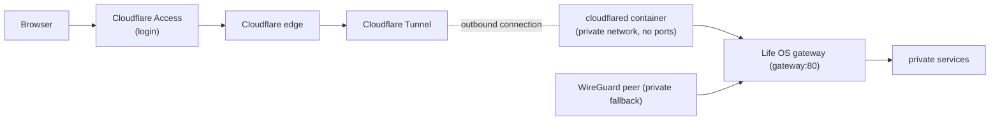

# Cloudflare Tunnel and Access

Life OS can be reached from outside the private network at `https://lifeos.gamch1k.com`. Cloudflare authenticates the person, and a Cloudflare Tunnel then carries the request to the Life OS gateway. Nothing on the server listens publicly for this path: the `cloudflared` connector only dials out to Cloudflare.

## The tunnel (deployment path)

- **Connector.** The `cloudflared` service in `compose.yaml` runs `cloudflare/cloudflared:2026.10.0`. It is on the private `backend` network only, publishes no port, runs as a non-root user with a read-only filesystem and no capabilities, and does not auto-update (bump the pinned image deliberately). Its health check is `cloudflared tunnel ready` against its local metrics endpoint (`127.0.0.1:20241`, inside the container only).
- **Opt-in.** The service belongs to the `cloudflare` Compose profile, so a stack without a tunnel token never starts it. To run it with the normal stack, set `COMPOSE_PROFILES=cloudflare` in `.env`, as the deployment does. It then starts with `make life-up` and every `docker compose up`. To start it once, use `docker compose --profile cloudflare up -d cloudflared`.
- **Never in the verification stack.** `tools/verify-compose` clears `COMPOSE_PROFILES` and refuses any plan that contains `cloudflared`. The disposable stack reads the same `.env`, and a second connector holding the real tunnel token would receive production traffic.
- **Token.** The tunnel is managed remotely in the Cloudflare Zero Trust dashboard, and the connector authenticates with the tunnel token in `LIFE_OS_CLOUDFLARE_TUNNEL_TOKEN` in the ignored `.env`. The token is a credential: anyone holding it can run a connector for this tunnel. Never commit it or paste it into tickets or chat.
- **Route.** The tunnel's public hostname `lifeos.gamch1k.com` points to the service URL `http://gateway:80`, the gateway's Docker DNS name on the private network. The route is configured in Cloudflare, not in the repository. The gateway serves the same Dashboard and `/api/*` routes as on every other path; no service is exposed on its own.
- **Ingress check.** `tools/check-ingress` asserts, for the full Compose plan including the `cloudflare` profile, that only the gateway publishes a host port and that `cloudflared` stays on the private network without ports.

The WireGuard-bound gateway port (`LIFE_OS_GATEWAY_BIND_ADDRESS`) is unchanged and remains the private path.

## Security ordering

The Access application for the hostname must exist before the connector serves traffic. A tunnel route without a running connector returns a Cloudflare error, never Life OS. So the connector is started only after anonymous requests to the hostname are confirmed to be redirected to the Cloudflare login. See [Cloudflare Access](#cloudflare-access) below.

## Cloudflare Access

Cloudflare Access is the login in front of the hostname. It runs at Cloudflare's edge before the tunnel, so no request reaches the server without passing it.

| Setting | Value |
| --- | --- |
| Zero Trust team domain | `damp-surf-d6be.cloudflareaccess.com` |
| Application | `Life OS`: Self-hosted → Public DNS → `lifeos.gamch1k.com`, session 24 h |
| Login method | One-time PIN (a code sent by email), with instant authentication |
| Policy `Owner` | **Allow**, Include → Access group `Life OS users` |
| Access group `Life OS users` | Include → Emails → the owner's address |
| Policy `Acceptance test` (temporary) | **Service Auth**, Include → Service Token `life-os-acceptance` |

Access denies by default, so only addresses in `Life OS users` receive a code. To add a person, add their email to the group; to remove one, delete it. Life OS has no user accounts of its own, so everyone admitted shares the same data.

The temporary service token lets automated checks authenticate without a mailbox, using the headers `CF-Access-Client-Id` and `CF-Access-Client-Secret`. Its values live only in `.env` (`LIFE_OS_CF_ACCESS_CLIENT_ID`, `LIFE_OS_CF_ACCESS_CLIENT_SECRET`). The token and its policy are removed after the Phase 9 sign-off.

`tools/check-cloudflare-access` checks the public path from wherever it runs:
- anonymous requests to every page and API, including writes and requests with a forged `CF_Authorization` cookie or `Cf-Access-Jwt-Assertion` header, must be redirected to the Access login;
- with the service token, the pages and APIs must reach Life OS.

The detailed setup, debugging, and recovery guide for this deployment is kept in Notion: **Phase 9 — Cloudflare Access → Cloudflare Access & Tunnel — Setup, Debugging, Recovery**.
