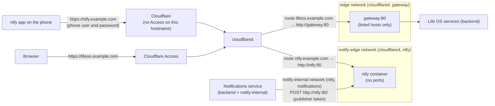

# ntfy: notifications on the owner's phone

Life OS pushes notifications to the owner's Android phone through [ntfy](https://ntfy.sh), self-hosted in the Life OS stack (not the public ntfy.sh). The Notifications service publishes each notification to one private ntfy topic over an internal Docker network; the ntfy Android app on the phone subscribes to that topic at ntfy's public URL, `LIFE_OS_NTFY_PUBLIC_URL` (here `https://ntfy.example.com`), which the Cloudflare Tunnel hands straight to the ntfy container. The Life OS gateway is not involved. Life OS's own Android app later becomes another channel, next to or instead of ntfy. What a notification looks like on the phone (priority, emoji, tap target) is in [Notifications → ntfy](../services/notifications.md#ntfy).



## Security model

The phone reaches ntfy through the same Cloudflare Tunnel as Life OS, on a second hostname and route. That route has **no Cloudflare Access**: the ntfy app talks to its server directly with a user and password and cannot complete an Access login. Life OS itself stays behind Access. What keeps this safe:

- **Structural separation.** The ntfy route points at `http://ntfy:80`, not at the gateway. ntfy is on exactly two Docker networks of its own: `notify-edge` (`10.255.249.16/29`), shared only with the connector (`cloudflared`), and `notify-internal` (`10.255.249.32/29`, internal: no outside access), shared only with the Notifications service, which publishes to it. The connector is on no network with the gateway's services or with Notifications: from the ntfy route, the gateway, the Dashboard, MCP, Postgres, Notifications, and every other service are unreachable, whatever the Host header, the gateway's configuration, or the route's target. `tools/check-ingress` enforces the memberships.
- **ntfy denies everything by default.** `auth-default-access: deny-all`: an anonymous visitor can neither read nor write any topic. Signup, web login, topic reservations, the web app, and attachments are off, and nothing is forwarded to ntfy.sh or Firebase.
- **Only two accounts exist, both provisioned by ntfy itself** from the ignored `.env` at every start (`auth-users`, `auth-access`, `auth-tokens`). ntfy deletes provisioned accounts, rights, and tokens that leave that list. Neither account is an admin.

  | User               | Rights                  | Authenticates with                                                                    | Used by               |
  | ------------------ | ----------------------- | ------------------------------------------------------------------------------------- | --------------------- |
  | `lifeos-publisher` | write-only on the topic | token `LIFE_OS_NTFY_PUBLISHER_TOKEN` (its password is never used)                     | Notifications service |
  | `lifeos-phone`     | read-only on the topic  | password (only its bcrypt hash, `LIFE_OS_NTFY_PHONE_PASSWORD_HASH`, is on the server) | ntfy app on the phone |

  A leaked phone password can only read notifications; the publisher token can only post them.

- **The gateway does not know ntfy, and serves Life OS only for its listed hosts.** Any other Host, the ntfy hostname included, gets no answer (444), so even a mistaken route from the ntfy hostname to the gateway would not reach Life OS; a tunnel request without an Access token is refused as well. See [Networking](../architecture/networking.md#gateway-hosts).
- **Rate limits.** ntfy limits each visitor (requests, subscriptions, messages per day, failed logins), by the visitor address Cloudflare puts in `CF-Connecting-IP`.
- **The container** publishes no port, has a read-only filesystem, no capabilities but binding port 80, `no-new-privileges`, and 128 MB of memory.

## Configuration in the repository

- **Container.** The `ntfy` service in `compose.yaml`, image `binwiederhier/ntfy:v2.37.2` (pinned by digest, which Dependabot keeps current; override with `LIFE_OS_NTFY_IMAGE`), in the opt-in Compose profile `ntfy`, so a stack without the setup never starts it. Its data (message cache `cache.db`, accounts `user.db`) is in the volume `lifeos-ntfy-data` at `/var/lib/ntfy`. The health check is ntfy's `/v1/health`.
- **Networks.** In `compose.yaml`: `notify-edge` (`lifeos-notify-edge`, `10.255.249.16/29`) holds `cloudflared` (next to `edge`) and `ntfy`; `notify-internal` (`lifeos-notify-internal`, `10.255.249.32/29`, `internal: true`) holds `ntfy` and `notifications` (next to `backend`). ntfy joins nothing else.
- **Server settings.** `infra/ntfy/server.yml`, mounted read-only: `behind-proxy` with `CF-Connecting-IP`, messages cached for 12 hours (the phone catches up after being offline), deny-all access, no web app, no attachments, no upstream, and visitor limits (60-request burst refilled every 5 s, 10 subscriptions, 500 messages a day). Nothing secret is in it. Its public URL (ntfy's `base-url`) is not in the file: `compose.yaml` passes `LIFE_OS_NTFY_PUBLIC_URL` from `.env` as `NTFY_BASE_URL`, which ntfy reads at start (it refuses a value that is not an http(s) URL).
- **Accounts.** `compose.yaml` builds `NTFY_AUTH_USERS`, `NTFY_AUTH_ACCESS`, and `NTFY_AUTH_TOKENS` from the `.env` values below.
- **Tunnel route** (in Cloudflare, not in the repository): the host of `LIFE_OS_NTFY_PUBLIC_URL` (`ntfy.example.com`) → HTTP → `ntfy:80`, without an Access application and without Access JWT validation. The connector resolves `ntfy` on `notify-edge`; while ntfy is not running, the hostname answers 502. The ntfy app keeps its subscription open as a WebSocket or a JSON stream, with ntfy's 45 s keepalive under Cloudflare's idle timeout.
- **Channel.** `LIFE_OS_NOTIFICATIONS_CHANNELS=ntfy` makes the Notifications service deliver to it; see [Notifications → ntfy](../services/notifications.md#ntfy).

| `.env` variable                        | Value                                                                                      |
| -------------------------------------- | ------------------------------------------------------------------------------------------ |
| `COMPOSE_PROFILES`                     | add `ntfy`, for example `cloudflare,ntfy`                                                  |
| `LIFE_OS_NOTIFICATIONS_CHANNELS`       | `ntfy`                                                                                     |
| `LIFE_OS_PUBLIC_URL`                   | `https://lifeos.example.com` (required, no default): tapped notifications open their page there |
| `LIFE_OS_NTFY_PUBLIC_URL`              | `https://ntfy.example.com`: the URL the phone uses, ntfy's `base-url`                      |
| `LIFE_OS_NTFY_TOPIC`                   | `lifeos` (default): the one topic; letters, digits, `-`, `_`                               |
| `LIFE_OS_NTFY_PUBLISHER_TOKEN`         | secret: `tk_` and 29 characters                                                            |
| `LIFE_OS_NTFY_PUBLISHER_PASSWORD_HASH` | secret: bcrypt hash of a random password nobody keeps, in single quotes                    |
| `LIFE_OS_NTFY_PHONE_PASSWORD_HASH`     | secret: bcrypt hash of the phone's password, in single quotes                              |
| `LIFE_OS_CF_ACCESS_TEAM_DOMAIN`        | `<team>.cloudflareaccess.com`: for `tools/check-ntfy-route` only                           |

## Setup

### 1. Generate the secrets (on the server)

```sh
cd ~/life-os
# The publisher's token (tk_ and 29 characters):
docker run --rm binwiederhier/ntfy:v2.37.2 token generate
# The publisher's password hash. ntfy needs a password for every user; this
# one is random and thrown away (the service uses the token):
openssl rand -base64 32 | sed p | docker run --rm -i binwiederhier/ntfy:v2.37.2 user hash
# The phone's password: generate one and keep it in your password manager.
openssl rand -base64 18
# Its hash: type that password twice.
docker run --rm -it binwiederhier/ntfy:v2.37.2 user hash
```

Put them in `~/life-os/.env` (never in the repository, tickets, or chat):

```sh
COMPOSE_PROFILES=cloudflare,ntfy
LIFE_OS_NOTIFICATIONS_CHANNELS=ntfy
LIFE_OS_NTFY_PUBLIC_URL=https://ntfy.example.com
LIFE_OS_NTFY_TOPIC=lifeos
LIFE_OS_NTFY_PUBLISHER_TOKEN=tk_...
LIFE_OS_NTFY_PUBLISHER_PASSWORD_HASH='$2a$10$...'
LIFE_OS_NTFY_PHONE_PASSWORD_HASH='$2a$10$...'
```

Bcrypt hashes contain `$`. Keep them in **single quotes**: unquoted or in double quotes, Compose expands `$2a`, `$10`, … as variables and the hash breaks.

### 2. Deploy

Start ntfy first, so the Notifications service's first deliveries find it. Then the Notifications service and the Dashboard, and the connector, which Compose recreates if it is not on `notify-edge` yet (the route to `http://ntfy:80`, step 3, starts working then). The gateway needs nothing: it never serves ntfy.

```sh
docker compose up -d --no-build --no-deps ntfy
docker compose ps ntfy                     # Up … (healthy)
docker compose logs ntfy | tail -20        # no "invalid auth-…" lines
docker compose build --pull notifications && docker compose build --pull dashboard
docker compose up -d --no-build --no-deps notifications dashboard cloudflared
./tools/check-ingress                      # networks, ports, and the gateway's host list
./tools/check-cloudflare-access            # Life OS still behind Access, and still reachable
./tools/check-ntfy-route                   # ntfy answers as ntfy, never as Life OS; anonymous is refused
```

`tools/check-ntfy-route` checks from the outside that `/v1/health` on ntfy's hostname is ntfy's health JSON, that Life OS pages and APIs (`/`, `/tasks`, `/api/tasks/ready`, …) never answer there, that anonymous and made-up-token reads and writes on the topic get 401 or 403, and that Life OS's hostname still redirects to the Access login. It takes the hostnames from `LIFE_OS_NTFY_PUBLIC_URL` and `LIFE_OS_PUBLIC_HOSTNAME` and the Access team from `LIFE_OS_CF_ACCESS_TEAM_DOMAIN`, in the environment or `.env`, and refuses without them. Run it after every deploy that touches ntfy, the gateway, or the tunnel. On a WireGuard deployment, also check that WireGuard still works: `curl -s -o /dev/null -w '%{http_code}\n' http://10.8.0.1:3000/` (your `LIFE_OS_GATEWAY_BIND_ADDRESS` and port) gives 200.

### 3. Cloudflare route (already in place)

The owner has added the route: Cloudflare Zero Trust → **Networks** → **Tunnels** → `life-os` → **Published application routes**: `ntfy.example.com` (the host of `LIFE_OS_NTFY_PUBLIC_URL`) → **HTTP** → `ntfy:80`. It must stay without an Access application and without **Enforce Access JSON Web Token (JWT) validation** (the ntfy app has no Access token, so either would lock the phone out), and with **HTTP Host Header** empty. To rebuild it, add exactly that route.

### 4. The phone (owner)

1. Install **ntfy** from Google Play or F-Droid.
2. In ntfy: **Settings → Manage users → Add user**: service URL `https://ntfy.example.com` (your `LIFE_OS_NTFY_PUBLIC_URL`), username `lifeos-phone`, and the phone password from step 1.
3. Optionally **Settings → Default server**: `https://ntfy.example.com`.
4. On the main screen, **+** (subscribe to topic): topic `lifeos`, tick **Use another server** with `https://ntfy.example.com` (unless it is the default), **Subscribe**.
5. Allow notifications when Android asks. Allow ntfy to run unrestricted in the background (battery optimisation off) when it asks: it keeps its own connection to the server. Android shows a permanent "listening" notification for that connection; hide it in Android's notification settings for ntfy if it bothers you.
6. Optional: let high-importance notifications (ntfy max priority) through Do Not Disturb. In Android's notification settings for ntfy, open the max priority category and allow it to override Do Not Disturb.
7. Galaxy Watch: ntfy notifications mirror to the watch through the Galaxy Wearable app → Watch settings → Notifications → App notifications → turn on ntfy.

### 5. Test

Send a test notification (it arrives silently, with 🧪, and opens the notification list when tapped):

```sh
curl -X POST http://127.0.0.1:3000/api/notifications/v1/notifications -H 'X-Life-OS-Actor: dev:curl' \
  -H 'content-type: application/json' \
  -d '{"title":"Test notification","body":"From Life OS","importance":"low","category":"test.manual","link":"/notifications","dedupeKey":"test.manual:'"$(date +%s)"'"}'
```

Use the gateway's own address and port (`LIFE_OS_GATEWAY_BIND_ADDRESS`, `LIFE_OS_GATEWAY_PORT`). It appears on the phone (and the watch) and in Life OS under Notifications, its delivery `sent`. The Status page's **Notifications** check shows **ntfy (phone)** OK with the time of the last delivery. Use `"importance":"high"` to try the loud one.

## Operations

- **Health.** The Status page's Notifications check (from `GET /api/notifications/v1/channels`) shows the last delivery, the last failure with ntfy's error, and failures in the last 24 hours. It warns, also on Home, while the latest delivery failed, until one succeeds. `docker compose ps ntfy` shows the container health.
- **Logs.** `docker compose logs ntfy`. ntfy logs no tokens or passwords in normal operation; at startup it rejects a malformed account line and prints it, so treat such a log as sensitive and rotate what it shows.
- **Delivery.** A failed delivery stays listed in Life OS. Unreachable ntfy, 429, and 5xx are retried with backoff for up to 24 hours; ntfy refusing a delivery (401, 403, 404, 400) fails it at once. Notifications created while no channel was configured are not sent later.
- **Change the topic.** Set `LIFE_OS_NTFY_TOPIC`, run `docker compose up -d --no-build --no-deps ntfy notifications`, and subscribe the phone to the new topic (unsubscribe the old one).
- **Change the public URL.** Set `LIFE_OS_NTFY_PUBLIC_URL`, run `docker compose up -d --no-build --no-deps ntfy`, change the tunnel route's hostname, and update the user and subscription in the phone's app.
- **Update ntfy.** Dependabot's weekly pull request moves the pinned image (digest, minor, and patch versions; read ntfy's release notes before merging). Then `docker compose up -d --no-build --no-deps ntfy`.
- **Pause phone notifications.** Set `LIFE_OS_NOTIFICATIONS_CHANNELS=` and `docker compose up -d --no-build --no-deps notifications`; notifications are still stored and listed. To stop ntfy too, `docker compose stop ntfy` (keep `ntfy` in `COMPOSE_PROFILES` to pause it; remove it only to retire ntfy).

## Paused since 2026-10-12

The owner moved phone notifications to the Life OS Android app's push (`LIFE_OS_NOTIFICATIONS_CHANNELS=webpush`, see [Notifications → Web push](../services/notifications.md#web-push)) and paused ntfy: the `ntfy` container is stopped, `COMPOSE_PROFILES` still lists `ntfy`, and the `lifeos-ntfy-data` volume and its `.env` settings stay. The ntfy tunnel route answers 502 meanwhile, and the ntfy phone app shows connection errors (unsubscribe or uninstall it). To resume, check that `.env` has `LIFE_OS_NTFY_PUBLIC_URL` (ntfy's `base-url`, no longer in `infra/ntfy/server.yml`), then:

```sh
docker compose up -d --no-build --no-deps ntfy
# .env: LIFE_OS_NOTIFICATIONS_CHANNELS=ntfy,webpush
docker compose up -d --no-build --no-deps notifications
```

ntfy was paused on v2.29.0 and resumes on v2.37.2 (SEC-IMG, 2026-11-10). Nothing in `infra/ntfy/server.yml` or the provisioned accounts changed between them; what the first start does differently:

- **It upgrades its databases in the volume.** The message cache (`cache.db`) gets a new index (schema 16 to 17, v2.31.1) and the accounts (`user.db`) keep the daily counts (v2.36.0, which also starts every count over once). Going back to v2.31.0 or older afterwards needs the cache's version set back by hand first (`UPDATE schemaVersion SET version = 16 WHERE id = 1` in `cache.db`); from v2.31.1 on, an older ntfy only warns about a newer schema.
- **It checks the whole configuration when `base-url` is set** (v2.36.0), as it is here, so a mistake that used to start now stops it: read `docker compose logs ntfy` if it does not become healthy.
- **Smaller behaviour changes:** 429 answers carry `Retry-After` (v2.37.0), each visitor's day for the daily limits starts at its own time rather than at midnight UTC (v2.36.0), and a reconnect may repeat messages from the same second, which the ntfy app drops (v2.31.0).

## Rotate

- **Publisher token** (leaked, or a scheduled rotation): generate a new one, replace `LIFE_OS_NTFY_PUBLISHER_TOKEN`, then `docker compose stop notifications && docker compose up -d --no-build --no-deps ntfy notifications`. Stopping the service first keeps deliveries pending instead of failing them with 401 while only one side has the new token. ntfy deletes the old token when it starts.
- **Phone password:** hash a new one, replace `LIFE_OS_NTFY_PHONE_PASSWORD_HASH`, run `docker compose up -d --no-build --no-deps ntfy`, and change the password in the app (Settings → Manage users).
- **Publisher password hash:** never used to log in; replace it only together with a leaked `.env`.
- **Leaked `.env`:** rotate all three ntfy values with the other secrets ([Cloudflare](cloudflare.md#rotate-and-revoke)).

## Troubleshooting

| Symptom                                                                        | Likely cause                                                                                     | Fix                                                                                                                                                                       |
| ------------------------------------------------------------------------------ | ------------------------------------------------------------------------------------------------ | ------------------------------------------------------------------------------------------------------------------------------------------------------------------------- |
| ntfy restarts; log `invalid auth-users: …, password hash invalid`              | A hash is missing, or broken by `$` expansion (no single quotes)                                 | Put the hash in single quotes in `.env`; `docker compose up -d --no-build --no-deps ntfy`                                                                                 |
| Log `invalid auth-tokens: … token … invalid`                                   | The token is not `tk_` and 29 characters                                                         | Generate one with `ntfy token generate`                                                                                                                                   |
| Status: ntfy failing with `ntfy is unreachable: … lookup ntfy`                 | ntfy is not running: profile missing or container stopped                                        | `COMPOSE_PROFILES` includes `ntfy`; `docker compose up -d --no-build --no-deps ntfy`                                                                                      |
| Status: `401 unauthorized`                                                     | ntfy and Notifications have different tokens                                                     | Same `LIFE_OS_NTFY_PUBLISHER_TOKEN` for both; `docker compose up -d --no-build --no-deps ntfy notifications`                                                              |
| Status: `403 forbidden`                                                        | The topic differs between ntfy's rights and the service                                          | Restart both after changing `LIFE_OS_NTFY_TOPIC`                                                                                                                          |
| The app says unauthorized when subscribing                                     | Wrong username or password, or the server URL in the user differs from the subscription's        | User `lifeos-phone`, URL exactly `LIFE_OS_NTFY_PUBLIC_URL`; re-hash the password if unsure                                                                                |
| Status OK, but nothing arrives on the phone                                    | The phone is not subscribed to this topic on this server, or Android stopped ntfy                | Check the subscription; turn battery optimisation off for ntfy                                                                                                            |
| ntfy's hostname answers 502                                                    | ntfy is not running, or the connector is not on `notify-edge` (not recreated since this change)  | `docker compose up -d --no-build --no-deps ntfy cloudflared`; `docker inspect lifeos-cloudflared-1` must list `lifeos-edge` and `lifeos-notify-edge`                      |
| ntfy's hostname shows the Cloudflare Access login                              | An Access application covers the hostname (for example a wildcard `*.example.com`)               | Exclude ntfy's hostname from it                                                                                                                                           |
| ntfy's hostname gives a Cloudflare error after the connector answered          | The route points somewhere else, such as `gateway:80` (which answers no unlisted host)           | The route must be HTTP `ntfy:80`                                                                                                                                          |
| WireGuard or a script gets an empty reply from the gateway                     | It uses a Host that is not in the gateway's list                                                 | Use `LIFE_OS_PUBLIC_HOSTNAME`, `LIFE_OS_GATEWAY_BIND_ADDRESS`, `127.0.0.1`, or `localhost` ([Networking](../architecture/networking.md#gateway-hosts))                    |
| Cloudflare error 1033 / 530                                                    | The connector is down                                                                            | See [Cloudflare → Diagnose](cloudflare.md#diagnose)                                                                                                                       |
| The app connects nowhere on one network (such as a work Wi-Fi), fine elsewhere | The network resets the TLS handshake to ntfy's hostname: the app sends the hostname in clear SNI | Nothing to change on the server: the network blocks it. Use mobile data there; the planned Android app (P18) gets its notifications through Google's push service instead |

## Verification stack

The disposable verification stack never uses the owner's ntfy and never reaches the phone. `tools/verify-compose` clears `COMPOSE_PROFILES` (no ntfy container), blanks the publisher token, both password hashes, and the channel list (`LIFE_OS_NOTIFICATIONS_CHANNELS`; a smoke may choose its own, such as `log`, with `LIFE_OS_VERIFY_NOTIFICATIONS_CHANNELS`), sets the topic to `verify`, and refuses a plan that contains ntfy or an ntfy token. Its networks are separate, so `ntfy` does not resolve there; the Status page shows Notifications as Not set up. `tools/smoke-e2e` checks there that the gateway gives no answer for ntfy's hostname (the host of `LIFE_OS_NTFY_PUBLIC_URL`) or any other unlisted Host.
