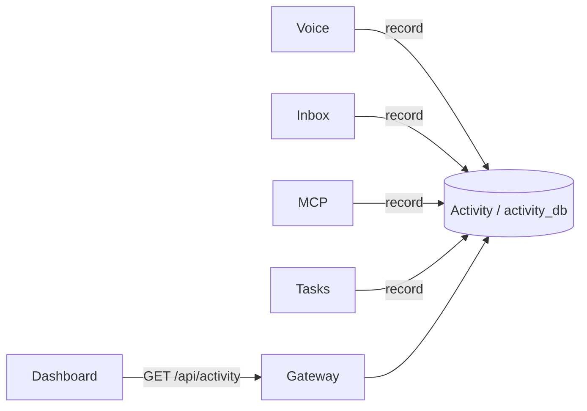

# Activity service

Activity answers “what happened, who did it, and what led to it?” across Life OS. It stores durable, structured, user-facing events in its own `activity_db`. A spoken request can then be followed from the Voice upload, through transcription, Inbox processing, the agent's MCP action, and the Task it created, to the Task's later completion.

It is product/audit data, not a log sink. Services keep their technical `slog` logs. Activity holds only a small set of meaningful operation outcomes, recorded by the service that owns each operation.

## Why a dedicated service

The interesting workflows cross services: Voice → Inbox → processor → MCP → Tasks. Each service owns its database, so no one service can read the others' history. A single append-only store lets the Dashboard query one API for a whole trace. Services send it events over the private network using a small infrastructure client (`pkg/activity`). There is no message bus: each event is one HTTP call to one consumer, and nothing else subscribes.



## Event model

| Field | Meaning |
| --- | --- |
| `id` | Event UUID. Chosen by the emitter; often deterministic (see below). |
| `type` | Dotted name, e.g. `task.completed`. |
| `source` | Emitting service: `voice`, `inbox`, `mcp`, `tasks`. |
| `subject` | The entity the event is about: `{type, id}`, e.g. `{task, <uuid>}`. |
| `correlationId` | The workflow this event belongs to. |
| `causationId` | The event that directly caused this one (optional). |
| `actor` | `user`, `agent` (e.g. `codex-inbox-processor`, `mcp`), or `system` (e.g. `voice-worker`). |
| `outcome` | `succeeded`, `pending` (accepted/scheduled), or `failed`. |
| `summary` | One short human-readable sentence. |
| `data` | Small structured details (titles, tools, errors; ≤16 KB). |
| `occurredAt` / `recordedAt` | When it happened / when Activity stored it. |

Events are append-only. There is no update or delete API.

### Recorded events

| Type | Source | Subject | Notes |
| --- | --- | --- | --- |
| `voice.job.accepted` | voice | `voice_job` | Upload accepted; the job id becomes the workflow correlation. |
| `voice.job.transcribed` | voice | `voice_job` | Includes a transcript preview and the Inbox item id. |
| `voice.job.retry_scheduled` / `voice.job.failed` | voice | `voice_job` | Transcription or Inbox hand-off failed. |
| `inbox.item.captured` | inbox | `inbox_item` | Any capture: Dashboard text, Voice, etc. |
| `inbox.processing.started` | inbox | `processing_attempt` | The processor started an attempt. |
| `inbox.processing.completed` / `.retry_scheduled` / `.failed` | inbox | `processing_attempt` | Attempt outcome recorded by the processor. |
| `inbox.human_review.requested` / `.resolved` | inbox | `inbox_item` | Ambiguous work waiting for, then given, a user decision. |
| `inbox.item.resolved` / `.discarded` | inbox | `inbox_item` | Final Inbox state. |
| `mcp.action.requested` / `.completed` / `.failed` | mcp | `mcp_action` | Every mutation tool call (Tasks, Calendar, Finance). |
| `task.created` / `.updated` / `.completed` / `.reopened` | tasks | `task` | Every Task mutation, from the Dashboard or an agent. |

Other domains (Calendar, Finance) do not record their own events yet. Their agent-driven changes still appear as `mcp.action.*` events.

## Correlation, causation, and subject

Three links reconstruct a workflow:

- **Correlation** groups one workflow. A Voice job's id is the correlation for everything it leads to. A Dashboard text capture starts its own workflow, so the Inbox item id is the correlation. A direct Dashboard Task edit uses the request's correlation id.
- **Causation** names the direct cause. Upload → transcription → capture → processing started → MCP request → `task.created`. Processing started → processing completed → item resolved.
- **Subject** links the same entity across workflows. A Task created by the agent and later completed in the Dashboard has two events with subject `task/<id>` but different correlations.

These travel as HTTP headers between services:

| Header | Carries |
| --- | --- |
| `X-Correlation-ID` | Workflow id (already propagated by the shared HTTP runtime). |
| `X-Causation-ID` | The id of the event that caused the request. |
| `X-Life-OS-Actor` | `agent:<name>` or `system:<name>`; absent means the user. |

Inbox stores an explicit upstream correlation id on the item (`inbox_items.correlation_id`, NULL for self-rooted items). It exposes the effective value as `InboxItem.correlationId`, so the processor can continue the workflow for every MCP call it makes.

### Deterministic event ids

Where an occurrence happens once, its id is a UUIDv5 of its type and identifiers, for example `EventID("task.created", taskId)` or `EventID("inbox.processing.started", attemptId)`. This gives two properties:

- **Idempotent emission.** Recording the same id again returns the stored event (HTTP 200) instead of adding a duplicate, so an idempotent Task-create replay records nothing new.
- **Causation without lookups.** A service can name an upstream event it did not record. For example, the processor names `inbox.processing.started` as the cause of its MCP calls.

Repeatable occurrences (Task updates, MCP calls, review resolutions) get random ids.

## Delivery guarantees

Recording is best effort and never fails the domain operation. The emitter retries briefly (three tries within about half a second), then logs a warning. If Activity is down for longer, those events are missing from the trace; the domain data itself is unaffected. A service with an empty `ACTIVITY_SERVICE_URL` records nothing. Activity events are therefore evidence of what happened, but they are not the system of record for domain state.

## API

The gateway serves `/api/activity/` read-only (non-GET requests return 403). Services record events on the private network at `http://activity:8080`.

- `GET /v1/activity-events`: newest first. Filters: `correlationId`, `subjectType` + `subjectId`, `type`, `source`, `outcome`, `from` (inclusive) / `to` (exclusive) on `occurredAt`, plus `cursor` and `limit` (1–100, default 50). The opaque `nextCursor` is a keyset position (`occurredAt`, `id`).
- `GET /v1/activity-events/{eventId}`
- `POST /v1/activity-events`: internal. `201` when recorded, `200` with the stored event when the id already exists.

Reconstructing the example trace:

```sh
# Everything that happened because of one Voice recording, oldest first
curl "$GATEWAY/api/activity/v1/activity-events?correlationId=$JOB_ID&limit=100" | jq '.items | reverse'
# Everything that ever happened to the resulting Task
curl "$GATEWAY/api/activity/v1/activity-events?subjectType=task&subjectId=$TASK_ID"
```

The contract is `services/activity/api/openapi.yaml`. The Dashboard Event Log (`/activity`, see [Dashboard](../frontend/dashboard.md)) is built only on this API: it lists and filters events, then rebuilds a selected entry's trace from its correlation, causation, and subject.

## Operations

- Database: `activity_db` / `activity_user`, password `LIFE_OS_ACTIVITY_DB_PASSWORD` in `.env`. Fresh volumes are provisioned automatically. For an existing deployment, add the password and run `make db-provision` once before starting the new `activity` and `activity-migrate` services.
- Emitting services (`tasks`, `inbox`, `voice`, `voice-worker`, `mcp`) read `ACTIVITY_SERVICE_URL`.
- Retention: events are kept indefinitely for now; they are small and single-user.
- Verification: `make activity-trace-smoke` speaks a Task request (espeak-ng in a throwaway container). It sends the request through Voice, whisper.cpp, Inbox, the automatic processor with the authenticated Codex CLI, MCP, and Tasks on the disposable verification stack, then completes the Task as the user. It reconstructs and checks the whole chain from the Activity API alone.
