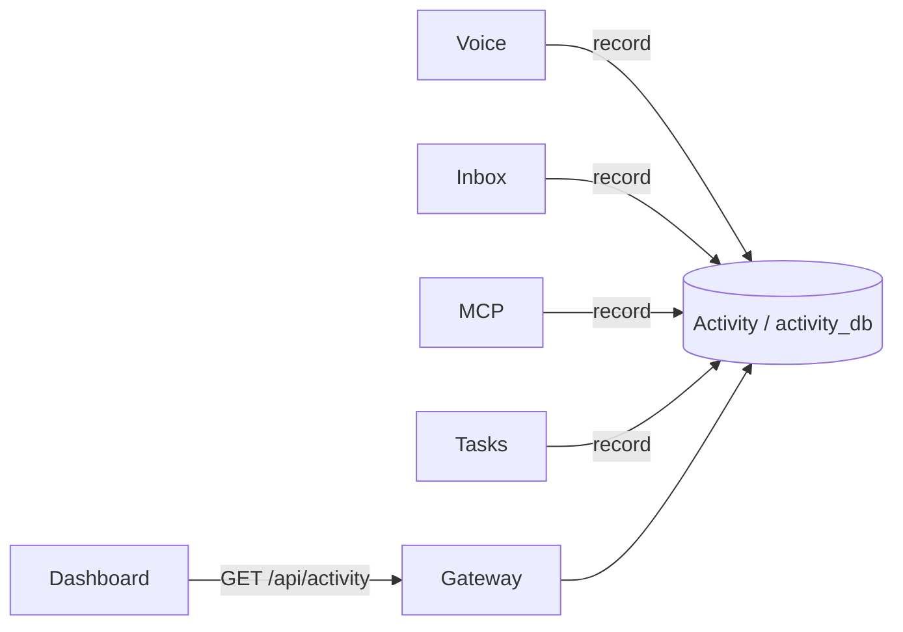

# Activity service

Activity answers “what happened, who did it, and what led to it?” across Life OS. It stores durable, structured, user-facing events in its own `activity_db`. A spoken request can then be followed from the Voice upload, through transcription, Inbox processing, the agent's MCP action, and the Task it created, to the Task's later completion.

It is product/audit data, not a log sink. Services keep their technical `slog` logs. Activity holds only a small set of meaningful operation outcomes, recorded by the service that owns each operation.

## Why a dedicated service

The interesting workflows cross services: Voice → Inbox → processor → MCP → Tasks. Each service owns its database, so no one service can read the others' history. A single append-only store lets the Dashboard query one API for a whole trace. Services send it events over the private network using a small infrastructure client (`pkg/activity`). There is no message bus: each event is one HTTP call to one consumer, and nothing else subscribes.



## Event model

| Field | Meaning |
| --- | --- |
| `id` | Event UUID. Chosen by the emitter; often deterministic (see below). |
| `type` | Dotted name, e.g. `task.completed`. |
| `source` | Emitting service: `voice`, `inbox`, `mcp`, `tasks`, `calendar`, `finance`, `food`, `notifications`. |
| `subject` | The entity the event is about: `{type, id}`, e.g. `{task, <uuid>}`. |
| `correlationId` | The workflow this event belongs to. |
| `causationId` | The event that directly caused this one (optional). |
| `actor` | `user`, `agent` (e.g. `codex-inbox-processor`, `mcp`), `system` (e.g. `voice-worker`), or `dev` (e.g. `claude-code`). See [Actors](#actors). |
| `actorUserId` | The person the action is for (optional): the account that signed in, or the first account under legacy access, also when a development tool or the AI writes for them; none for a service's own work, nor on events from before accounts. `pkg/activity` fills it from the request's verified identity token. |
| `outcome` | `succeeded`, `pending` (accepted/scheduled), or `failed`. |
| `summary` | One short human-readable sentence. |
| `data` | Small structured details (titles, tools, errors; ≤16 KB). |
| `occurredAt` / `recordedAt` | When it happened / when Activity stored it. |

Events are append-only. There is no update or delete API. The history starts when the Activity service was deployed; operations before that were not backfilled.

### Actors

Every write names its actor in `X-Life-OS-Actor`; nothing is attributed to the owner by default (see [The actor gate](#the-actor-gate)).

- `user`: the owner, for example a Dashboard edit. The Dashboard sends `X-Life-OS-Actor: user` on every service call. The Event Log shows it as "You".
- `agent:codex-inbox-processor`: the automatic Inbox processor. Every call it makes carries this actor: processing attempts, Human Review requests, MCP changes, runtime records, and the crash-recovery reconciliation that schedules a `recovered` retry. Older `recovered` retry events, recorded before reconciliation carried this actor, show `agent:mcp`.
- `agent:mcp`: an MCP caller that sent no actor header (or claimed to be `user`), for example an external MCP client. MCP treats every caller as an agent.
- `system:voice-worker`: Voice transcription.
- `dev:<name>`: a development tool or agent working on Life OS, never the owner or the Life OS AI. Claude Code and its subagents use `dev:claude-code`, Playwright specs `dev:e2e`, and `tools/` scripts `dev:<script>`. The Event Log shows "Developer tool (<name>)" with an outline badge. Events recorded before this kind existed (for example the smoke-test cleanup of 2026-10-09) keep their original `user` actor; events are never rewritten.

Names are 1–64 letters, digits, `.`, `_`, or `-`. An event emitted without any actor is attributed to the emitting service (`system:<source>`), never to the owner.

### The actor gate

Finance, Tasks, Inbox, Calendar, Food, Voice, and Notifications reject every write (`POST`, `PUT`, `PATCH`, `DELETE`) without a valid `X-Life-OS-Actor` with `400` and error code `actor_required` (`pkg/activity.RequireActor`). Reads, `/health`, and `/ready` do not need it. Internal callers always send one: the processor and MCP as agents, the Voice worker as `system:voice-worker`, and traces forward `user` explicitly.

Two endpoints are deliberately not gated:

- MCP (`/api/mcp`) is itself the agent. It records an unnamed caller as `agent:mcp` and sends that actor on every downstream call, so the owning services' gate always passes.
- Activity's `POST /v1/activity-events` is internal (the gateway denies it) and carries the actor as a required, validated field of the event body. The emitting service is the messenger, not the actor, so a header would add nothing.

The public gateway passes only `user` and `dev:<name>`: a claim to be the Life OS AI (`agent:`) or a component (`system:`) is dropped, so such a write fails the gate. See [Networking](../architecture/networking.md).

A request through the gateway also carries the identity token of its sign-in (`X-Life-OS-Identity`, verified by `pkg/identity`). When it names a person who signed in, the actor comes from it and the header is not needed (nor read): `user` for a browser's session, a paired device's key, or a personal token; `dev:<name>` for a personal token marked as a development tool (the token's name, P21-06); `agent:mcp` for an MCP client's OAuth grant; under [legacy access](../install/accounts.md#legacy-access), a request with no sign-in, the header still names the actor, as before accounts, so development tools keep their `dev:<name>`. An invalid token is refused with `401 unauthenticated` before the gate.

### Recorded events

| Type | Source | Subject | Notes |
| --- | --- | --- | --- |
| `voice.job.accepted` | voice | `voice_job` | Upload accepted; the job id becomes the workflow correlation. |
| `voice.job.transcribed` | voice | `voice_job` | Includes a transcript preview and the Inbox item id. |
| `voice.job.retry_scheduled` / `voice.job.failed` | voice | `voice_job` | Transcription or Inbox hand-off failed. |
| `inbox.item.captured` | inbox | `inbox_item` | Any capture: Dashboard text, Voice, etc. |
| `inbox.processing.started` | inbox | `processing_attempt` | The processor started an attempt. |
| `inbox.processing.completed` / `.retry_scheduled` / `.failed` | inbox | `processing_attempt` | Attempt outcome recorded by the processor. |
| `inbox.human_review.requested` / `.resolved` | inbox | `inbox_item` | Ambiguous work waiting for, then given, a user decision. |
| `inbox.item.resolved` / `.discarded` | inbox | `inbox_item` | Final Inbox state. |
| `inbox.item.followed_up` | inbox | `inbox_item` (the earlier capture) | A capture's processing changed what an earlier capture, made in the minutes before, created or changed ("actually oat milk" renamed the milk "buy milk" added). Recorded once per earlier capture, in the follow-up's workflow, caused by its `inbox.processing.completed`; `data` holds both captures (`inboxItemId`, `followedItemId`, `followedCorrelationId`, their text) and the `changes`. Its subject links it to the earlier capture's history. See [Inbox → Recent captures](inbox.md#recent-captures). |
| `inbox.item.repeated` | inbox | `inbox_item` (the earlier capture) | A capture sent again (the same text and images as an earlier capture of the minutes before, already resolved or waiting for Human Review) was resolved by the processor without doing anything again (P5-23). Recorded once, in the repeat's workflow, caused by its `inbox.processing.completed`; `data` holds both captures (`inboxItemId`, `repeatedItemId`, `repeatedCorrelationId`, their text) and the earlier one's `repeatedState`. Its subject links it to the earlier capture's history. See [Inbox → Recent captures](inbox.md#recent-captures). |
| `inbox.notification.failed` | inbox | `inbox_item` | The owner could not be notified about a Human Review or a failed capture (Notifications unreachable or refusing), by `system:inbox`, caused by the Inbox event it was about; `data` holds `category`, `dedupeKey`, and `error`. See [Inbox](inbox.md#notifications). |
| `mcp.action.requested` / `.completed` / `.not_done` / `.failed` | mcp | `mcp_action` | Every mutation tool call (Tasks, Calendar, Finance, Food, recipes). Read and search tools are not recorded. `.completed` names what the call created or changed in `resultId` (the answer's `id`, else its one `…Id` field such as `recipeId`, or its one nested entity's id; several different ones go to `resultIds` by field) and, for something saved before, `alreadySaved`. `.not_done` (outcome `failed`) is a call that answered but did not do what was asked, such as `recipe_import` with `saved: false`, with the answer's `reason`; `.failed` is an error, with `error`. The Dashboard shows this domain as "Agent changes". |
| `task.created` / `.updated` / `.completed` / `.reopened` / `.deleted` | tasks | `task` | Every Task mutation, from the Dashboard or an agent (`.deleted` only from the Dashboard or a tool: MCP has no delete tool). `data` holds the title, `completed`, and `dueAt`; a deletion has a deterministic id (`EventID("task.deleted", taskId)`). |
| `tasks.notification.missed` | tasks | `task` (a timed reminder) or `task_notification` (a morning, evening, or summary message; id: its dedupe key) | A Task notification was due while Tasks was down and is past the grace window, by `system:tasks`, outcome `failed`, `occurredAt` the time it was due; recorded once. See [Tasks](tasks.md#notifications). |
| `calendar.event.created` / `.updated` / `.rescheduled` / `.cancelled` / `.restored` / `.deleted` | calendar | `calendar_event` | One per event change through the Calendar API, from the Dashboard (`user`), an agent, or a tool, with the request's correlation and causation; an update that changes nothing records nothing. `data` holds the title, times, status, source, and for updates the changed fields. See [Calendar](calendar.md#activity). |
| `calendar.source.refreshed` / `.refresh_failed` | calendar-feeds (a feed; before P11-08 calendar), google-calendar (a Google calendar; before P11-07 calendar) | `calendar_source` | One per refresh of a subscribed feed (scheduled or "Refresh now"), also when nothing changed, by the feed as `system:ics-<name>` (for example `system:ics-zaw`), about the feed's Calendar source; `data` holds `sourceId`, `feedId`, `sourceName`, `outcome`, the counts (inserted, updated, removed, restored) or the error, and `requestedBy` for a manual refresh. Never the feed URL, and no events per imported event. Google syncs record these too (see [Calendar](calendar.md#google-calendar-sync)). |
| `calendar.source.removed` | google-calendar | `calendar_source` | A synced Google calendar's events left Life OS (switched off, unlisted by Google, disconnected, or another account connected), with `reason` and `removedEvents`. |
| `calendar.google.connected` / `.disconnected` / `.expired` / `.calendar_created` / `.export_failed` / `.conflict` | google-calendar (before P11-07 calendar) | `google_connection`, or `calendar_event` for an export failure or conflict | The Google connection, the Life OS calendar, a Life OS event that could not be exported (once per failure streak), and a change not written because Google's version was newer (Google's version is kept). See [google-calendar](google-calendar.md#activity). |
| `notification.created` | notifications | `notification` | A notification was sent through the one path, by its producer (for example `system:calendar`); `data` holds `importance`, `category`, `source`, `link`, and the channels; the title is in the summary, never the body. A repeat with a known dedupe key records nothing. See [Notifications](notifications.md#activity). |
| `notification.delivered` / `.delivery_failed` | notifications | `notification` | One per channel, by `system:notifications`, in the producer's workflow (caused by `notification.created`); `data` holds `channel`, `attempts`, and for a failure the `error`. Retries record nothing. |

| `finance.account.*`, `finance.transaction.*`, `finance.category.*`, `finance.category_rule.*` | finance | `finance_account`, `finance_transaction`, `finance_category`, `finance_category_rule` | One per change through the Finance API (created, updated, archived/restored or deleted), by the request's actor, with its correlation and causation; transaction summaries name the amount and account ("Spent €12.00 at Bäckerei (Cash)"); never the owner's notes. Creating the built-in Cash account at startup is `system:finance`. See [Finance](finance.md#activity). |
| `finance.category_rules.applied`, `finance.ai_categories.applied`, `finance.import.completed` / `.failed`, `finance.bank_import.completed`, `finance.bank_connection.removed` | finance | `finance_category_rules`, `finance_ai_categories`, `finance_import`, `finance_bank_connection` | One summary event per re-apply of the rules, batch of AI category choices that categorized something (by `agent:codex-finance-categories`, with counts per category), CSV import, bank sync (by `system:banking`), or removed bank connection, with counts only; imported transactions and the AI's single choices get no events of their own. |
| `food.shopping_item.added` / `.merged` / `.updated` / `.bought` / `.reopened` / `.deleted`, `food.shopping_items.cleared`, `food.store.*`, `food.aisle_rule.created` / `.deleted`, `food.pantry_item.added` / `.updated` / `.used_up` / `.thrown_away` / `.restocked` / `.deleted` | food | `food_shopping_item`, `food_shopping_list`, `food_store`, `food_aisle_rule`, `food_pantry_item` | One per change through the Food API, by the request's actor, with its correlation and causation ("Added “Vollmilch” (2 l, Lidl) to the shopping list", "“Vollmilch” was already on the shopping list: amount updated"); an add that merges into a needed item is `merged`, clearing bought items is one event with the count, and a change that changes nothing records nothing. Never the owner's notes. See [Food](food.md#activity). |
| `food.recipe.imported` | recipe-import | `food_recipe` | A recipe saved from a link by the recipe-import integration, by whoever asked (the owner, the AI), with `title`, `method`, `site`, `sourceUrl`, and the ingredient count; Food's `food.recipe.created` (by `system:recipe-import`) is caused by it. See [Recipe import](recipe-import.md#activity). |

## Correlation, causation, and subject

Three links reconstruct a workflow:

- **Correlation** groups one workflow. A Voice job's id is the correlation for everything it leads to. A Dashboard text capture starts its own workflow, so the Inbox item id is the correlation. A direct Dashboard Task edit uses the request's correlation id.
- **Causation** names the direct cause. Upload → transcription → capture → processing started → MCP request → `task.created`. Processing started → processing completed → item resolved.
- **Subject** links the same entity across workflows. A Task created by the agent and later completed in the Dashboard has two events with subject `task/<id>` but different correlations.

These travel as HTTP headers between services:

| Header | Carries |
| --- | --- |
| `X-Correlation-ID` | Workflow id (already propagated by the shared HTTP runtime). |
| `X-Causation-ID` | The id of the event that caused the request. |
| `X-Life-OS-Actor` | `user`, `agent:<name>`, `system:<name>`, or `dev:<name>`. Required on writes. |

The gateway clears `X-Correlation-ID` and `X-Causation-ID` on public traffic, so only services link events to workflows.

Inbox stores an explicit upstream correlation id on the item (`inbox_items.correlation_id`, NULL for self-rooted items). It exposes the effective value as `InboxItem.correlationId`, so the processor can continue the workflow for every MCP call it makes.

### Deterministic event ids

Where an occurrence happens once, its id is a UUIDv5 of its type and identifiers, for example `EventID("task.created", taskId)` or `EventID("inbox.processing.started", attemptId)`. This gives two properties:

- **Idempotent emission.** Recording the same id again returns the stored event (HTTP 200) instead of adding a duplicate, so an idempotent Task-create replay records nothing new.
- **Causation without lookups.** A service can name an upstream event it did not record. For example, the processor names `inbox.processing.started` as the cause of its MCP calls.

Repeatable occurrences (Task updates, MCP calls, review resolutions) get random ids.

## Delivery guarantees

Recording is best effort and never fails the domain operation. The emitter retries briefly (three tries within about half a second), then logs a warning. If Activity is down for longer, those events are missing from the trace; the domain data itself is unaffected. A service with an empty `ACTIVITY_SERVICE_URL` records nothing. Activity events are therefore evidence of what happened, but they are not the system of record for domain state.

## API

The gateway serves `/api/activity/` read-only (non-GET requests return 403). Services record events on the private network at `http://activity:8080`.

- `GET /v1/activity-events`: newest first. Filters: `correlationId`, `subjectType` + `subjectId`, `type`, `source`, `outcome`, `from` (inclusive) / `to` (exclusive) on `occurredAt`, plus `cursor` and `limit` (1–100, default 50). The opaque `nextCursor` is a keyset position (`occurredAt`, `id`).
- `GET /v1/activity-events/{eventId}`
- `POST /v1/activity-events`: internal. `201` when recorded, `200` with the stored event when the id already exists.

Reconstructing the example trace:

```sh
# Everything that happened because of one Voice recording, oldest first
curl "$GATEWAY/api/activity/v1/activity-events?correlationId=$JOB_ID&limit=100" | jq '.items | reverse'
# Everything that ever happened to the resulting Task
curl "$GATEWAY/api/activity/v1/activity-events?subjectType=task&subjectId=$TASK_ID"
```

The contract is `services/activity/api/openapi.yaml`. The Dashboard Event Log (`/activity`, see [Dashboard](../frontend/dashboard.md)) is built only on this API: it lists and filters events, then rebuilds a selected entry's trace from its correlation, causation, and subject.

## Server diagnostics

Activity also keeps the server's diagnostics (`diagnostic_events`; [Multi-user design → Logs](../architecture/multi-user.md#logs)): each service's server errors, counted by code, route pattern, and status. They are for the server's admins and carry no content: a service name, a code from a fixed list, a route pattern such as `/v1/tasks/:taskId`, an HTTP status, a count, the longest duration, the first and last time, and at most a subject id and the last request id (UUIDs). The Go type (`pkg/diagnostics`) has no free-text field, and Activity checks every field again, so a title, an amount, or a message cannot be stored.

- Every Go service sends them through `pkg/httpserver` when its `ACTIVITY_SERVICE_URL` is set: answers 500 to 599 are counted in memory and sent once a minute (and at shutdown) as one row per code, route, and status. `ACTIVITY_DIAGNOSTICS=off` turns a service's off. A failed send keeps the counts for the next one; the service's work never waits for it.
- `POST /v1/diagnostic-events` (`{"events": [...]}`, at most 1,000): internal, like recording events; a request with a person's identity token is refused (`403 services_only`). `202 {"recorded": n}`, or `400` when any field is not what it must be.
- `GET /v1/diagnostic-events` (newest first by `lastAt`; filters `service`, `code`, `from`, `to`, `cursor`, `limit` 1–200) and `GET /v1/diagnostic-events/summary?hours=24` (counts by service and code): for owners and admins who signed in in a browser with two-factor (the identity token's `mfa`, P21-06). A member's token, a device key, a personal token, or an MCP grant gets `403 admin_only`, an admin's session without two-factor `403 second_factor_required`, legacy access `401 sign_in_required`; a request without a token is an internal caller (the Dashboard's Diagnostics page, after its own admin check).
- Rows older than 90 days are deleted at start and once a day, and as new ones are recorded (at most once an hour).

The codes are `internal_error`, `bad_gateway`, `service_unavailable`, `gateway_timeout`, `server_error`, `panic`, `not_ready`, and the services' own 5xx codes (`provider_unavailable`, `media_unavailable`, `google_rejected`, `google_unavailable`, `google_not_configured`, `banking_not_configured`, `food_unavailable`, `calendar_unavailable`); an unlisted service code counts under its status's generic one.

## Operations

- Database: `activity_db` / `activity_user`, password `LIFE_OS_ACTIVITY_DB_PASSWORD` in `.env`. Fresh volumes are provisioned automatically. For an existing deployment, add the password and run `make db-provision` once before starting the new `activity` and `activity-migrate` services.
- Emitting services (`tasks`, `inbox`, `voice`, `voice-worker`, `mcp`, `calendar`, `finance`, `food`) read `ACTIVITY_SERVICE_URL`.
- Retention: events are kept indefinitely for now; they are small and single-user. Diagnostics are kept 90 days.
- Verification: `make activity-trace-smoke` speaks a Task request (espeak-ng in a throwaway container). It sends the request through Voice, whisper.cpp, Inbox, the automatic processor with the authenticated Codex CLI, MCP, and Tasks on the disposable verification stack, then completes the Task itself (recorded as `dev:smoke-activity-trace`). It reconstructs and checks the whole chain from the Activity API alone.
