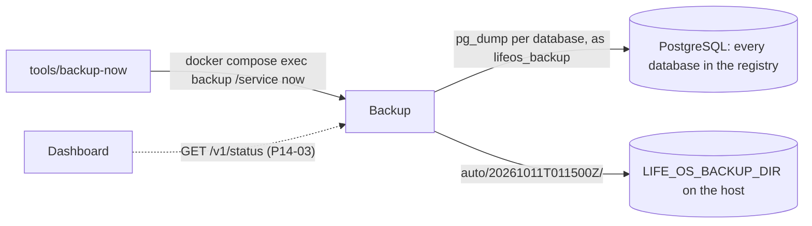

# Backup service

The backup service backs up every service database each night. At 03:15 in the owner's timezone it dumps each database in the database registry with `pg_dump`, from one consistent snapshot per database, into a run directory on the host with a manifest, and rotates old runs. It has no database of its own and no gateway route. Its code is in `services/backup`.



## What is backed up

Every database in `infra/postgres/service-databases.conf`, read again at every run: a service added to the registry (Food, for example) is backed up from the first run after its database is provisioned, without a change here. `GET /v1/status` lists the databases the registry names now.

Each dump is a whole database: schemas, data, sequences, owners, and privileges, with `schema_migrations`, so a restored database knows its migration version. Roles and their passwords live outside the databases; provisioning (`infra/postgres/provision-service-databases.sh`) recreates them from `.env`.

Not backed up, on purpose:

- **`.env` and `~/life-os.secrets`.** They hold every secret: database passwords, the Google OAuth client, the token keys that seal the bank session and the Google refresh token, the ntfy token and hashes, the Cloudflare tunnel token. Secrets do not belong next to the data they unlock; the owner keeps them separately. Without `LIFE_OS_BANKING_TOKEN_KEY` or `LIFE_OS_GOOGLE_TOKEN_KEY`, a restored bank session or Google connection cannot be decrypted and has to be connected again; everything else restores without them.
- **The Enable Banking key file and the Codex session** (`LIFE_OS_ENABLE_BANKING_KEY_FILE`, `~/.codex`). Host secrets, as above.
- **Voice audio** (volume `lifeos-voice-audio`). Recordings are transient: they are deleted after `LIFE_OS_VOICE_RETENTION_HOURS` (7 days), and what they said is already in `inbox_db` and `voice_db`.
- **Whisper models** (volume `lifeos-whisper-models`). The worker downloads its model again from `LIFE_OS_WHISPER_MODEL_URL`.
- **ntfy's data** (volume `lifeos-ntfy-data`). Its `user.db` holds only the two accounts, which ntfy provisions from `.env` at every start, deleting any other; a copy holds nothing `.env` does not, and restoring it would change nothing. Its `cache.db` keeps 12 hours of messages that were delivered and are stored in Notifications anyway. Copying `user.db` from a read-only mount would work (it uses SQLite's rollback journal, and file locks work across containers), but it would add a SQLite driver to put the publisher token, in plain text, into every backup for no gain.
- **The repository**: code, migrations, and `infra/` are in Git.

The backups stay on this server for now, so they protect against mistakes, bad migrations, and corruption, not against losing the server. An encrypted copy to Cloudflare R2 is planned (P14-04). It plugs in as a target (`internal/backup/target.go`): the service hands every completed run to each target and passes on the runs the rotation deletes; a target that fails is recorded in the run history but does not fail the run. The backup directory is the only target today.

## Consistency

Each database is dumped from one snapshot, the same one its row counts and migration version are read from:

1. The service opens a connection and a `REPEATABLE READ`, `READ ONLY` transaction, and exports its snapshot (`SELECT pg_export_snapshot()`).
2. In that snapshot it counts the rows of every user table (`count(*)` of each plain table and partition, without inheritance children) and reads `schema_migrations` (version and dirty flag).
3. While the transaction stays open, `pg_dump --format=custom --snapshot=<id>` dumps the same snapshot. Its output streams to `<database>.dump.partial` through a SHA-256 hash and is flushed to disk.
4. `pg_restore --list` must read the archive back. The file is then renamed to `<database>.dump`.

A write committed while the backup runs is in neither the counts nor the dump; the integration test commits rows between the snapshot and `pg_dump` and checks that a restore has exactly the manifest's counts. Each database has its own snapshot: PostgreSQL has no transactions across databases, and Life OS services keep no cross-database invariants (they exchange data only through APIs and catch up after an outage).

While a database is backed up, its tables hold `ACCESS SHARE` locks, as `pg_dump` takes anyway: reads and writes go on, and a migration that alters a table waits until the dump is done. One database may take at most 30 minutes.

## Layout

```text
LIFE_OS_BACKUP_DIR/                 the host directory (mode 700), such as ~/life-os.backups
  auto/                             the service's own; it touches nothing outside it
    20261011T011500Z/               one completed run, named by its start in UTC
      manifest.json
      finance_db.dump               pg_dump custom format, one per database
      tasks_db.dump
      …
    .partial-20261012T011500Z/      a run in progress, renamed when complete
    history.json                    the latest 100 runs, including those that left no files
    .lock                           locked (flock) while a run writes
  finance_db-before-p11-09.dump     anything else, such as manual dumps, is left alone
```

Files are mode 600 and directories 700, owned by `LIFE_OS_BACKUP_RUNTIME_UID`. A run writes everything into `.partial-<id>/`, then its `manifest.json` (written to a temporary file, flushed, and renamed), and finally renames the directory to `<id>`, flushing the directory each time. A directory named like a run therefore always has a complete manifest, and a crash leaves at most a `.partial-` directory.

## Manifest

```json
{
  "formatVersion": 1,
  "id": "20261011T011500Z",
  "trigger": "schedule",
  "scope": "all",
  "result": "succeeded",
  "startedAt": "2026-10-11T01:15:00.012Z",
  "finishedAt": "2026-10-11T01:15:07.430Z",
  "durationSeconds": 7.418,
  "serverVersion": "18.6",
  "pgDumpVersion": "pg_dump (PostgreSQL) 18.6",
  "databases": [
    {
      "service": "finance",
      "name": "finance_db",
      "result": "succeeded",
      "file": "finance_db.dump",
      "bytes": 482113,
      "sha256": "9f2c…",
      "tables": [
        { "schema": "public", "name": "accounts", "rows": 6 },
        { "schema": "public", "name": "schema_migrations", "rows": 1 },
        { "schema": "public", "name": "transactions", "rows": 1834 }
      ],
      "migration": { "version": 14, "dirty": false },
      "startedAt": "2026-10-11T01:15:00.031Z",
      "finishedAt": "2026-10-11T01:15:01.212Z"
    }
  ]
}
```

- `trigger`: `schedule` (the nightly run), `catch-up` (run at start because the nightly run was missed), or `manual` (asked for through the API; `actor` says by whom).
- `scope`: `all` (every database in the registry) or `subset` (a manual run of only the databases it named).
- `result`: `succeeded` when every database was dumped and checked; `failed` when at least one was not, with `error` ("1 of 10 databases failed") and the database's own `error`. A failed database has no file; the others keep theirs.
- `migration` is absent for a database without `schema_migrations`.

## Runs and failures

- **One database failing does not stop the others.** The run goes on and ends `failed`; its directory keeps the dumps that worked and is deleted after `BACKUP_KEEP_FAILED_DAYS`.
- **One run at a time.** A run holds `auto/.lock` (`flock`), so neither a second request nor a second container can start one while it lasts; the kernel drops the lock if the service dies, so a crash never leaves it locked.
- **Interrupted runs.** When the service stops during a run (a deployment), it stops `pg_dump`, removes the run's files, and records the run as `interrupted`. After a crash, the leftover `.partial-` directory is removed and recorded the same way at the next start, or before the next run.
- **Durable status.** Every run, including one that left no files (interrupted, or failed before any database because the registry could not be read), is recorded in `auto/history.json`, so the status survives restarts.

## Schedule

The nightly run starts at `BACKUP_TIME` (`03:15`) in `LIFE_OS_TIMEZONE`, on the owner's wall clock: it stays at 03:15 when the clocks change. A time the clocks skip (02:30 on the night they go forward) runs when they jump, at 03:00; a time that happens twice (02:30 on the night they go back) runs once, the first time.

When the service starts, it checks for a missed night: if no successful full run started since an hour before the latest scheduled time (the newest is older than one schedule interval plus that margin, counted from the run it missed), it runs a catch-up a minute later, giving the rest of a deployment time to come up. A first start, with no backups yet, always catches up. A nightly run that comes first stands in for the catch-up.

A run that is due while another run is going (a manual one, for example) starts within a minute after that run ends. Manual runs never move the schedule.

## Rotation

After every run the service deletes the runs its retention no longer keeps:

- **Successful full runs** (scope `all`): the newest run of each of the last `BACKUP_KEEP_DAILY` (7) days that have one, of each of the last `BACKUP_KEEP_WEEKLY` (4) ISO weeks, and of each of the last `BACKUP_KEEP_MONTHLY` (12) months, in `LIFE_OS_TIMEZONE`. A run kept for any of these stays. Counting days, weeks, and months that have a run means backups that stopped for a while are not all deleted while nothing new arrives.
- **Successful runs of only some databases** never take such a place; they are kept for `BACKUP_KEEP_DAILY` days.
- **Failed runs** are kept for `BACKUP_KEEP_FAILED_DAYS` (3) days.
- **The newest successful run, and the newest successful full run, are never deleted.**

It deletes only directories under `auto/` named like a run id (`20261011T011500Z`) with a readable manifest; anything else in the backup directory, `auto/` included, is never touched. At the defaults, about 20 full runs are kept, covering a year.

## API

The service listens on port 8080 on the private `backend` network only (`http://backup:8080`); there is no gateway route. The Dashboard will use it for the Status page (P14-03). The contract is `services/backup/api/openapi.yaml`.

| Endpoint | |
| --- | --- |
| `GET /v1/status` | The latest run (`lastRun`, including interrupted and failed runs), the latest successful full run (`lastSuccess`), the run in progress (`running`: its databases, how many are done, the one being dumped), the schedule (`time`, `timeZone`, `nextRunAt`, `nextTrigger`), the retention, the storage (`runs`, `totalBytes` under `auto/`, `freeBytes` and `sizeBytes` of the file system), and the databases in the registry now. |
| `GET /v1/backups` | The completed runs on disk, newest first, each with its manifest summarised (per database: result, file, size, SHA-256, tables, rows, migration, error). `cursor` and `limit` (1–100, default 50) page through them. |
| `POST /v1/backups` | Runs a backup now: every database, or with `{"databases": ["finance", "tasks_db"]}` only those (service or database names). 202 with the run in progress; with `waitSeconds` (up to 3600) it waits and answers 200 with the finished run if it ends in time. 409 `backup_running` while a run is going, 422 `unknown_database` for a name that is not in the registry. |

`POST` must say who asks in `X-Life-OS-Actor` (400 `actor_required` otherwise); the actor is recorded in the run. Run ids are start times in UTC; every timestamp in the API is UTC.

## Running a backup now

```sh
tools/backup-now                 # every database; waits and prints the result
tools/backup-now finance tasks   # only these (service or database names)
tools/backup-now -timeout 3h     # flags go before names
```

It runs the binary's client inside the deployed container (`docker compose exec -T backup /service now -actor dev:backup-now …`), which calls the service on `127.0.0.1:8080`, waits in the request for up to ten minutes and then follows the status, and prints one line per database. It exits 0 when the run succeeded, 1 when it failed, and 2 when it could not start one (a run is already going, an unknown name). A run of only some databases never stands in for the nightly run.

## The lifeos_backup role

The service logs in as `lifeos_backup`. It is a member of `pg_read_all_data` (it reads every table, but can change nothing), has `CONNECT` on every database in the registry (provisioning revokes it from `PUBLIC`), and has `CREATEDB` for restore checks into scratch databases (P14-02). It is not a superuser, owns nothing, and cannot create roles, replicate, or bypass row-level security. Its password is `LIFE_OS_BACKUP_DB_PASSWORD`.

`infra/postgres/provision-backup-role.sh` provisions it, idempotently: it creates the role if missing, always sets its password and attributes, and grants `pg_read_all_data` and `CONNECT` on every registry database that exists. `provision-service-databases.sh` runs it last, so a fresh volume gets the role, and a reapply (`make db-provision`, which revokes database grants from every role but the owner) restores its grants and covers a database it just added. Without `LIFE_OS_BACKUP_DB_PASSWORD` an existing role keeps its password and a missing one is skipped.

On a running server, apply it on its own; no restart is needed (`infra/postgres` is mounted into the PostgreSQL container as a directory):

```sh
make db-provision-backup
# which runs, with the password read from .env:
docker compose exec -T -e LIFE_OS_BACKUP_DB_PASSWORD postgres bash /opt/lifeos/postgres/provision-backup-role.sh
```

## Configuration

| Variable | Default | Compose |
| --- | --- | --- |
| `BACKUP_DATABASE_URL` | required: the server and login, no database | `postgres://lifeos_backup@postgres:5432/?sslmode=disable` |
| `BACKUP_DATABASE_PASSWORD` | empty (backups fail until it is set) | `LIFE_OS_BACKUP_DB_PASSWORD` |
| `BACKUP_DATABASES_FILE` | `/etc/lifeos/postgres/service-databases.conf` | `infra/postgres` mounted read-only as a directory, so a pulled registry is read at the next run |
| `BACKUP_DIR` | `/backups` | the host directory `LIFE_OS_BACKUP_DIR` (required; must exist) |
| `BACKUP_TIME` | `03:15` | `LIFE_OS_BACKUP_TIME` |
| `LIFE_OS_TIMEZONE` | `UTC` | `LIFE_OS_TIMEZONE` |
| `BACKUP_KEEP_DAILY`, `BACKUP_KEEP_WEEKLY`, `BACKUP_KEEP_MONTHLY` | `7` (1–366), `4` (0–520), `12` (0–1200) | `LIFE_OS_BACKUP_KEEP_DAILY`, `…_WEEKLY`, `…_MONTHLY` |
| `BACKUP_KEEP_FAILED_DAYS` | `3` (1–366) | `LIFE_OS_BACKUP_KEEP_FAILED_DAYS` |
| `BACKUP_PG_DUMP`, `BACKUP_PG_RESTORE` | `pg_dump`, `pg_restore` | the image's own |
| `SERVICE_NAME`, `PORT`, `LOG_LEVEL` | `backup`, `8080`, `info` | |

The container runs as `LIFE_OS_BACKUP_RUNTIME_UID` (default 1000), which must own the backup directory, with a read-only root file system. Its image is built on the PostgreSQL image (`LIFE_OS_POSTGRES_IMAGE`), so `pg_dump` and `pg_restore` are exactly the server's version; rebuild it (`docker compose build backup`) when that image changes.

## Operations

- **Setting it up on an existing deployment.** The backup directory must exist, owned by the runtime UID with mode 700 (`install -d -m 700 ~/life-os.backups`; check with `stat -c '%a %U' ~/life-os.backups`). Add `LIFE_OS_BACKUP_DIR` (its absolute path), `LIFE_OS_BACKUP_RUNTIME_UID` (`id -u`), and `LIFE_OS_BACKUP_DB_PASSWORD` (letters and digits, such as `openssl rand -hex 24`) to `.env`; compose refuses every command until `LIFE_OS_BACKUP_DIR` is set. Provision the role (`make db-provision-backup`), then build and start the service alone: `docker compose build backup && docker compose up -d --no-build --no-deps backup`. A minute later it runs its first (catch-up) backup.
- **Checking it.** `docker compose logs backup` shows `backup started` and `backup finished` (with `result`, `duration_seconds`, `bytes`), `database backup failed` with the error, `deleted an expired backup run`, and `removed an interrupted backup run`. `tools/backup-now` runs one and prints it; `ls ~/life-os.backups/auto` lists the runs.
- **A failed database.** The error is in the run's manifest and in `GET /v1/status`. `permission denied for database` or `must have CONNECT` means the role lacks a grant (a database added without reprovisioning): run `make db-provision-backup`. `password authentication failed` means `LIFE_OS_BACKUP_DB_PASSWORD` and the role differ: run it with the current `.env`, then `docker compose up -d --no-build --no-deps backup`.
- **Looking into a dump.** `pg_restore --list <file>` lists its contents. Restoring, and the regular restore check, are P14-02.
- **Verification stack.** `tools/verify-compose` gives the backup service a scratch directory of its own (`LIFE_OS_VERIFY_BACKUP_DIR`, by default `$TMPDIR/lifeos-verify-backups`) and refuses a plan that would write to the owner's backup directory (the one in `.env`, or `~/life-os.backups`).
- **Tests.** `cd services/backup && GOWORK=off go test ./...` covers the registry parser, the schedule (daylight saving time, catch-up), the rotation, the run directory and its atomic completion, the lock, the history, the runner (a failing database, interruption, recovery), the API, and the client. The integration test runs against a throwaway PostgreSQL 18 (see `services/backup/README.md`): it backs up two databases, commits a write between the snapshot and `pg_dump`, checks the manifest's counts, restores a dump into a scratch database with the same counts, owners, and privileges, and shows that a database the role cannot reach fails alone.

## Limits

- The backups are on the same disk as the database until the off-site copy (P14-04).
- Nothing notifies the owner of a failed backup yet: the Status card and the monitor's check come with P14-03. Until then, look at `GET /v1/status` or the logs.
- A backup is as fresh as the last run: up to a day of changes can be lost.
