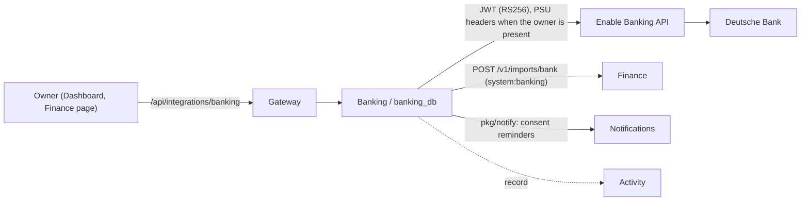

# Banking service

Banking is the bank integration. It connects the owner's bank accounts through [Enable Banking](https://enablebanking.com/docs/), a licensed PSD2 provider, and pushes their balances and transactions into [Finance](finance.md). Gateway base: `/api/integrations/banking` (every integration gets `/api/integrations/<name>/`). The contract is `services/banking/api/openapi.yaml`; `/health` and `/ready` are available. Setup, reconnecting, and revoking are in [Banking operations](../operations/banking.md).

## Boundaries

- **Read-only.** Banking asks only for account information consent (balances and transactions; the Enable Banking application has the AIS service only). It never asks for payments.
- **Banking owns everything bank-side**: the provider adapter, the consent and the provider session, the sync schedule within the banks' limits, the consent reminders, and the reconnect. Its state lives in its own `banking_db`.
- **Finance never calls a bank, and Banking never touches Finance** beyond its bank import API: `POST /v1/imports/bank` for each sync and `DELETE /v1/imports/bank/{connectionId}` when the owner removes a connection (Finance's `importBankSync` and `removeBankConnection`), as `system:banking`. Banking does not read Finance's database or import its code; its client mirrors the contract's types (`internal/finance`).
- **Secrets stay in Banking.** The provider session id (the credential for reading the accounts) is stored only sealed (AES-256-GCM with `LIFE_OS_BANKING_TOKEN_KEY`, the approach of Calendar's Google refresh token) and wiped on disconnect. The session id, the application's private key, its JWTs, and full IBANs never appear in responses, logs, activity events, or notifications; accounts carry a masked IBAN (`DE89…3000`) and a hash of the IBAN as their id.

## Connections

A connection is one consent at one bank (`bank_connections`):

| Status | Meaning |
| --- | --- |
| `pending` | Consented; the first sync has not succeeded yet (it is retried automatically). |
| `connected` | Syncing. |
| `expired` | The consent ran out, or the provider says the session ended (expired or revoked at the bank). Not synced again: reconnect. |
| `error` | The bank needs the owner to act (`ASPSP_PSU_ACTION_REQUIRED`), or the stored session no longer decrypts (the token key changed). Reconnect. |
| `disconnected` | The owner removed it. Kept as history (accounts, last sync), never synced again. |

There is at most one live (not disconnected) connection per bank (`provider`, `institution`, `country`). **Reconnecting** a live connection, after it expired, went into error, or while it is still valid, is the same consent flow: it renews the connection in place, keeps its id, so Finance keeps the same accounts (Finance keys bank accounts by connection id and account id), keeps its sync cursor and any import still waiting for Finance, and ends the replaced session at the provider. After a **disconnect** Finance has archived the accounts; connecting the bank again creates a new connection with new Finance accounts, and the archived ones keep their history.

Stored per connection: the consent's end (`consent_valid_until`), the sealed session id, the consented accounts (`[{uid, key, name, product, currency, cashAccountType, ibanMasked}]`: `uid` is the provider's per-session account id, `key` the stable id sent to Finance), the last attempt and last success, the next sync, failures in a row and the last error, the last sync's counts, the sync cursor, the mapping version of its last full read, the earliest booking date Finance holds from it, the last history read (status, start, end, transactions imported, error), the day's unattended reads, the last owner-started sync, an import Finance did not take yet, whether Finance still has to archive the accounts, and which consent notice was sent. Pending authorizations (`bank_auth_states`) keep only the SHA-256 of the state, for 10 minutes, single use, with the connection a reconnect renews.

**Failed consents** (`bank_consent_failures`): when the bank or provider sends the owner back to the callback with an `error` instead of a `code` (for example Deutsche Bank's `server_error`), the Dashboard reports it and Banking keeps it durably, so the reason survives container restarts: when, the error, its description (whitespace collapsed, session-like ids and IBANs removed, at most 300 characters), the bank and connection of the authorization the state belonged to, and whether the state matched a pending authorization, had expired, or was unknown. The state is used up like a completed one; the state itself and any code are never stored or logged. The newest failure is listed as `lastConsentFailure` until a connection succeeds, which marks all of them cleared (they stay as history; the newest 100 are kept).

## API

Writes need `X-Life-OS-Actor` (the Dashboard sends `user`).

| Operation | Meaning |
| --- | --- |
| `GET /v1/connections` | Every connection (live first), whether banking is configured (`configured`, and `setupProblem` naming what is missing, never values), the schedule (`times`, `timeZone`, `unattendedPerDay`, `manualSyncMinutes`, `historyDays`: how far back the history read asks, 0 when off), and `lastConsentFailure` (`{at, error, description, institution, stateMatched}`, the newest consent the bank did not complete since a connection last succeeded, or null). |
| `POST /v1/connections/authorize` `{institution?, country?}` | Starts a consent (Deutsche Bank, DE by default) and returns the bank's page (`{url}`). The consent asks for balances and transactions, `psu_type` personal, valid as long as the bank allows (its `maximum_consent_validity`, at most 180 days, less 10 minutes), with the redirect URI `LIFE_OS_BANKING_REDIRECT_URI` (`https://lifeos.gamch1k.com/finance/bank/callback`). `422 unknown_bank` when the provider does not offer the bank. |
| `POST /v1/connections` `{code, state}` | The callback exchange (the Dashboard's `/finance/bank/callback` posts what the bank returned). Checks the state (`400 invalid_state` when unknown, used, or older than 10 minutes), creates the provider session (`400 bank_code_rejected`), stores it sealed, creates or renews the connection, and runs the first sync while the owner waits (owner-present, 90 days back, bounded to 45 s). A first sync that fails leaves the connection `pending` with `lastError`; the scheduler retries it. Then, owner-present only, it starts the [history read](#history-read) in the background and answers with `historyRead` `running`. `422 no_accounts` when the consent covers no account. |
| `POST /v1/connections/consent-failure` `{state?, error, errorDescription?}` | The callback's report when the bank returned an error instead of a code: records it (above), uses the state up (an unknown or expired state is accepted and recorded as such), and records `banking.consent.failed`. Anything else in the body, such as a code, is ignored. `204`; `400 bad_request` without an error, or with an error over 100, a state over 256, or a description over 2000 characters. |
| `POST /v1/connections/{id}/sync` | "Sync now". From the owner (actor `user`) with the owner's address and browser, the read is owner-present and does not count against the daily limit. At most once every 10 minutes (`429 sync_throttled` with `Retry-After`). `409 sync_in_progress`, `409 connection_inactive` (expired, error, or disconnected), `429 daily_limit` (a non-owner sync with no unattended read left), `502 bank_unavailable` / `bank_expired` / `bank_refused` / `finance_unavailable` / `finance_refused` with a plain message. |
| `DELETE /v1/connections/{id}` | Disconnects: ends the session at the provider (which closes the bank consent where it can; one already ended is fine), wipes it, stops syncing, and asks Finance to archive the connection's accounts (keeping their transactions). When Finance is unavailable, the archive is retried by the scheduler. Idempotent. `204`. |

A connection in a response has its status, consent end, accounts (`id` = the stable key, name, product, currency, `kind` bank/card/savings, `ibanMasked`), last attempt and success, next sync (null unless live), failures in a row, last error, last counts, unattended reads today, `manualSyncAvailableAt`, `waitingForFinance`, `transactionsSince` (the earliest booking date of a booked transaction Finance took from it, normal syncs and history reads alike; null before the first), and `historyRead` (`{status: running|completed|failed, startedAt, finishedAt, transactions, error}`, the last history read; null when none ran). Never the session id or the provider's account uids.

### Owner presence (PSU headers)

PSD2 lets a bank refuse more than about four reads a day made without the account holder present. A read made while the owner uses Life OS carries PSU headers and is not counted: Banking sends `Psu-Ip-Address` and `Psu-User-Agent` (and `Psu-Accept-language` when known) only when the request comes from the owner (`X-Life-OS-Actor: user`) with an IP address in `X-Real-IP` (the gateway sets it from the visitor's address; through Cloudflare, from `CF-Connecting-IP`) and a `User-Agent`. A development tool (`dev:…`) is never owner-present, whatever it sends. When the bank refuses the headers (`PSU_HEADER_NOT_PROVIDED` / `PSU_HEADER_INVALID`), the sync falls back to an unattended read if one is left.

## Syncing

**Schedule.** The scheduler checks every connection once a minute (`BANKING_TICK_SECONDS`). Scheduled syncs run at `BANKING_SYNC_TIMES`, owner-local (`LIFE_OS_TIMEZONE`), by default `06:00,12:00,18:00,23:00`: at most four times, all within one local day.

**Four unattended reads a day.** Every read without the owner present (scheduled syncs, their retries, a non-owner "sync now") takes one of the day's reads (`BANKING_MAX_UNATTENDED_PER_DAY`, 1–4, default 4; the counter is per owner-local day and is taken atomically in the database before the bank is read). With none left, the next sync waits for the first sync time of the next day; nothing is read and nothing is lost.

**Window.** The first sync reads 90 days back (`BANKING_INITIAL_DAYS`), and so does the first sync after a mapping change (see [Mapping changes](#mapping-to-finances-bank-import)). Later syncs start 7 days (`BANKING_OVERLAP_DAYS`) before the latest booking date of a booked transaction synced so far (the cursor), never further back than 90 days, up to today (dates in UTC, as the provider takes them). Every sync reads all consented accounts: balances, then every page of transactions (`continuation_key`, until none is returned). A bank that does not serve the whole window (`WRONG_TRANSACTIONS_PERIOD`) is asked again with `strategy=longest`. Older transactions come only from the [history read](#history-read) after a bank login.

**Never losing data.** The cursor moves only when Finance accepted a sync, so a failed sync is covered by the next one.

| Failure | What happens |
| --- | --- |
| The bank or provider fails (5xx, timeout, `ASPSP_ERROR`) | Retried after 15 minutes, doubling up to 2 hours, never later than the next sync time; each retry is an unattended read. |
| Too many reads (`429`, `ASPSP_RATE_LIMIT_EXCEEDED`) | The next attempt is the first sync time at least 6 hours later, as the provider recommends. |
| The application is refused (`UNAUTHORIZED_ACCESS`, `ACCESS_DENIED`) | Retried at the next sync time; check the application id and key. |
| The session ended (`EXPIRED_SESSION`, `REVOKED_SESSION`, `CLOSED_SESSION`) | The connection expires; the Status check needs attention, so the monitor tells the owner. |
| The bank needs the owner (`ASPSP_PSU_ACTION_REQUIRED`) | The connection goes into `error`: reconnect. |
| Finance unavailable (5xx, no answer) | What was read is kept (`pending_import`) and sent again after 1 minute, doubling up to 30, without reading the bank again. |
| Finance refuses the import (400 `currency_mismatch`, `unknown_account`, `invalid_request`) | Not retried in a loop: the import is dropped, the error recorded, and the next sync time reads again. |

### History read

PSD2 lets a bank serve transactions older than 90 days only with fresh strong customer authentication, so banks share them only shortly after the owner logged in at the bank. Right after every connect or reconnect (`POST /v1/connections`), once the first sync is done, Banking reads the older history in the background:

- **Owner-present only.** It sends the PSU headers of the callback request and never takes one of the day's unattended reads: a connect without the owner present (a development tool) runs none, and a bank that refuses the headers fails it rather than reading without them.
- **Window.** It asks for `BANKING_HISTORY_DAYS` (default 730, at most 3650, 0 turns it off) back to the day before the first sync's 90 days start (UTC), reading every page of every account, transactions only (the balances stay the first sync's). A bank that refuses the period (`WRONG_TRANSACTIONS_PERIOD`) is asked again with `strategy=longest`, which, as Enable Banking documents it, "tries to find the longest possible period of transactions", from `date_from` on and ignoring `date_to` (so it sends up to today). The provider's bank list carries no maximum history to ask for instead (only `maximum_consent_validity`).
- **What goes to Finance.** Only booked transactions before the first sync's window, mapped as usual. The normal syncs keep their 90 days, pending transactions included, as before.
- **In parts.** Finance takes a request of at most 4 MB (its default body limit) and applies each in one database transaction, so the history goes in imports of about 500 transactions (a day is never split), newest first: when a part fails, what Finance holds stays contiguous back from today. Finance removes the connection's pending transactions booked inside an import's `window` that the import does not carry, so the windows are chosen to never remove anything wrongly: they never reach into the normal sync's window (where pending transactions live), they neither overlap nor leave gaps (each runs from its earliest booking date to the day before the next newer part's, the newest up to the end of the history window), and the oldest starts at the earliest date the bank actually returned, not at the date asked for (a bank asked for `longest` may have served less). A Finance that does not answer gets a part again after 5 and 15 seconds; a refusal ends the read.
- **Never degrading the connection.** It has its own 10-minute bound and runs beside the scheduled syncs (Finance applies one connection's imports one at a time, and their windows do not meet). Any failure (the bank, the provider, Finance, a reconnect or disconnect meanwhile, banking restarting) is logged and recorded in `historyRead` (`failed`, with a plain `error`) and nothing else: the connection's status, failures, cursor, counts, and its 90 days stay. The sync cursor never moves for it; `transactionsSince` moves back with every part Finance took. A reconnect while one runs replaces it (the older one's outcome is no longer recorded). A history read that banking's restart interrupted is marked failed when banking starts.
- **Again later.** The Dashboard's **Load older history** explains that the bank shares older history only right after a login and starts the reconnect, which reads it again; transactions Finance already holds are unchanged.

### Mapping to Finance's bank import

One sync is one `POST /v1/imports/bank` (Finance applies it in one transaction): `connectionId` (the connection's id), `provider` `enablebanking`, `institution`, `window` (`from` = the first day read, `to` = today), every account, and every transaction read.

| Finance field | From Enable Banking |
| --- | --- |
| account `externalId` | `iban-` + SHA-256 of the normalised IBAN (never the IBAN), so reconnecting keeps the same Finance account; without an IBAN, a hash of the provider's `identification_hash` (stable across sessions) or of another account number; only as a last resort the per-session `uid`. |
| account `name` | `details`, else `product` (such as "Das Junge Konto"), else "<bank> account". The provider's `name` is the account holder and is never used. |
| account `kind` | `cash_account_type`: `CARD` card; `SVGS`, `LLSV`, `ONDP`, `MOMA` savings; otherwise bank. |
| `ibanMasked` | The IBAN's first and last four characters, `DE89…3000`. |
| `bookedBalance` | `CLBD` (else `ITBD`, `OPBD`); date `reference_date`, else the date of `last_change_date_time`, else today. |
| `availableBalance` | `ITAV` (else `CLAV`, `XPCD`, `OPAV`). Balances in another currency than the account are left out. |
| transaction `externalId` | `entry_reference`, which the provider documents as the stable reference (its `transaction_id` may change between reads), else `transaction_id`, else `h-` + a hash of the transaction's content. A reference the bank repeats within the sync gets `~` + a content hash, identical twins `~2`, `~3`; at most 200 characters. |
| `status` | `BOOK` booked; `PDNG`, `HOLD`, `OTHR` pending; `CNCL`, `RJCT`, `SCHD` are not sent. |
| `amount` | Minor units from the decimal string without floating point (the currency's ISO 4217 digits: cents for EUR), negative for `credit_debit_indicator` `DBIT`, positive for `CRDT`. A transaction in another currency than its account, or with an unreadable amount, is not sent (counted as ignored), so one odd transaction cannot block every sync. |
| `bookingDate` | `booking_date`, else `transaction_date`, else `value_date`, else today (pending transactions often have none). |
| `valueDate` | `value_date`. |
| `counterparty` | `creditor.name` for a debit, `debtor.name` for a credit; for a card settlement or a PayPal purchase, the merchant (below). |
| `description` | `remittance_information` joined with spaces (else `note`), whitespace collapsed, card numbers removed, at most 1000 characters; for a card settlement or a PayPal purchase, as below. |
| `merchantCategoryCode`, `bankReference` | `merchant_category_code` (up to 8 characters), `reference_number`. Deutsche Bank sends no merchant category code: none of the 182 transactions of the first sync (October 2026) had one. |

**Merchants.** Deutsche Bank books every card payment with the counterparty `ABRECHNUNG KARTE` (card settlement) and names the merchant only in the remittance text, and PayPal payments name PayPal Europe; so Finance's merchant rules, which match the counterparty, would never see the merchant. Banking therefore rewrites these two shapes (bank-specific normalization, `internal/banking/merchant.go`; Finance stays provider-agnostic):

| Bank sends (counterparty, text; made-up values) | Finance gets (counterparty, description) |
| --- | --- |
| `ABRECHNUNG KARTE`, `REWE Markt Muster//Darmstadt/DE 08-10-2026T20:51:57 Kartennr. 4999XXXXXXXX0042` | `REWE Markt Muster`, `Card payment · Darmstadt, DE · 2026-10-08 20:51:57` |
| `ABRECHNUNG KARTE`, `DESIGNTOOL//SAN FRANCISCO/US 28-09-2026T08:27:54 Kartennr. … Entgelt 0,24 EUR` | `DESIGNTOOL`, `Card payment · SAN FRANCISCO, US · 2026-09-28 08:27:54 · Entgelt 0,24 EUR` |
| `PayPal Europe S.a.r.l. et Cie S.C.A`, `1234567890123/PP.1234.PP/. Muster Shop, Ihr Einkauf bei Muster Shop` | `Muster Shop`, `via PayPal · 1234567890123/PP.1234.PP/. Muster Shop, Ihr Einkauf bei Muster Shop` |

- A **card settlement** is a counterparty whose words are "abrechnung karte" (any case, punctuation, or digits). The merchant is the text before `//`, trimmed with spaces collapsed, in the bank's spelling (`WWW.AMAZON.. NK9QC7SM4` stays so). The description is "Card payment", the place and country, the card's local time (as `YYYY-MM-DD HH:MM:SS`), and whatever followed the card number (such as a foreign currency fee, `Entgelt 0,24 EUR`), joined with ` · `. A card settlement without `//` or without a merchant before it keeps its counterparty and text.
- A **PayPal** counterparty (the word "paypal" in it) with `Ihr Einkauf bei <merchant>` in the text gets the merchant (to the end of the text, as the bank spells it) as its counterparty and `via PayPal · ` before its text. Without it, such as a refund, it stays as sent.
- **Card numbers** never reach Finance, from any transaction: `Kartennr.` (also `Karten-Nr.`, `Kartennummer`) with the number after it, even split across text lines, and masked numbers such as `4999XXXXXXXX0042` on their own are removed. Nothing else in the text is.
- Everything else (salaries, direct debits, the bank's fees) keeps its counterparty and text. Pending card holds come with neither (only an amount) and are replaced by the booked payment; the Dashboard calls such a row "Card payment".

**Mapping changes.** `banking.MappingVersion` (2 since card settlements and PayPal name the merchant) is the version of this mapping. Each connection keeps the version of its last full read (`mapping_version`); while it is older, the next sync reads the whole 90-day window instead of the days since the cursor, and once Finance accepted that read the version is recorded, so later syncs read from the cursor again. Finance updates what it holds by external id (counterparty and description included) and lets the rules choose again for every category not chosen by hand. That read is the sync that was due anyway: no extra unattended read, and no bank login (90 days need none).

Finance answers with its account ids and counts (`accounts.created/updated`, `transactions.created/updated/unchanged/removedPending/skipped`). Banking stores them as the connection's `lastCounts`, with how many transactions were read (`fetched`) and left out (`ignored`). Finance removes pending transactions of the connection booked inside `window` that the sync no longer has, and replaces a pending one by its booked transaction.

## Consent

A consent lasts as long as the bank allows (Deutsche Bank: 180 days). The owner hears of each consent event exactly once.

- **Before it ends, Banking reminds the owner** through [Notifications](notifications.md) (`pkg/notify`, importance `medium`, category `banking.consent`, link `/finance`, a dedupe key per connection, consent end, and reminder):
  - 7 days before `consent_valid_until`: "Deutsche Bank access expires on Sat 7 Apr 2027";
  - 1 day before: "Deutsche Bank access expires within a day".

  A reminder that fails to send is tried again at the next check; the dedupe key prevents doubles. Reconnecting starts the reminders over for the new consent. Meanwhile the Status page shows the coming end ("Deutsche Bank access ends on …") but the Bank connection check stays OK, so the [monitor](monitor.md) sends nothing.
- **When it has ended** (the connection becomes `expired`: the consent ran out, or the provider says the session ended or was revoked at the bank), Banking sends no notice of its own. The Bank connection check turns to Needs attention, so the monitor sends "Bank connection needs attention" (medium, link `/status`) with the check's summary and "Reconnect the bank in Finance …", and a low "Bank connection recovered" once the owner has reconnected. Banking records `banking.consent.expired` in Activity.

## Activity

Events (source `banking`, subject `bank_connection`), never with transaction details, amounts, counterparties, or account numbers:

| Type | When | Data |
| --- | --- | --- |
| `banking.connected` | A consent completed (also a reconnect) | institution, number of accounts, consent end, `reconnected` |
| `banking.disconnected` | The owner disconnected | institution, `endedAtProvider` |
| `banking.sync.completed` | A sync changed something in Finance, or succeeded after failures | Finance's counts, `fetched`, `ignored`, trigger (`connect`, `manual`, `scheduled`), window, `afterFailures` |
| `banking.sync.failed` | The first failure of a streak | institution, trigger, the plain error, the provider's or Finance's error code |
| `banking.consent.expiring` | The 7-day and 1-day notices | institution, notice, consent end |
| `banking.consent.expired` | The connection expired | institution, reason (`consent_ended`, `ended_at_bank`), consent end |
| `banking.consent.failed` | The bank returned a consent with an error instead of a code | the error and its description only (subject: the connection a reconnect was for, else `bank_consent` with the failure's id) |

Connect, disconnect, and owner-started syncs carry the owner as actor; scheduled work is `system:banking`. The history read records no event of its own: its outcome is on the connection (`historyRead`), and Finance records each of its imports.

## Configuration

| Variable | Meaning |
| --- | --- |
| `LIFE_OS_ENABLE_BANKING_APP_ID` | The Enable Banking application id (the JWT's `kid`). |
| `LIFE_OS_ENABLE_BANKING_KEY_FILE` | Inside the container, the application's private key (PEM): Compose bind-mounts the host file named by the same variable in `.env` read-only at `/run/secrets/enablebanking.pem` (an empty `/dev/null` when unset). |
| `LIFE_OS_BANKING_TOKEN_KEY` | 32 bytes in base64 (`openssl rand -base64 32`): seals the provider session id. A new key means reconnecting. |
| `LIFE_OS_BANKING_REDIRECT_URI` | The Dashboard callback registered on the application (default `https://lifeos.gamch1k.com/finance/bank/callback`; https, http only for localhost). |
| `ENABLE_BANKING_API_URL` | The provider's API (default `https://api.enablebanking.com`; the verification stack points it nowhere). |
| `FINANCE_SERVICE_URL`, `NOTIFICATIONS_SERVICE_URL`, `ACTIVITY_SERVICE_URL` | Finance (receives every sync), consent reminders, activity events. |
| `LIFE_OS_TIMEZONE` | The owner's timezone: sync times and the daily read counter follow it. |
| `BANKING_SYNC_TIMES` | Scheduled syncs, HH:MM, at most four (`.env`: `LIFE_OS_BANKING_SYNC_TIMES`). |
| `BANKING_MAX_UNATTENDED_PER_DAY`, `BANKING_MANUAL_SYNC_MINUTES`, `BANKING_INITIAL_DAYS`, `BANKING_OVERLAP_DAYS`, `BANKING_TICK_SECONDS` | 4, 10, 90, 7, 60. |
| `BANKING_HISTORY_DAYS` | How far back the [history read](#history-read) after a bank login asks: 730 by default, at most 3650; 0 turns it off. |

Not configured (no application id, key, or token key), Banking still runs: it lists connections, reports `configured: false` with the missing settings in `setupProblem`, sends consent reminders and expires ended consents of stored connections, disconnects, and refuses the rest with `503 banking_not_configured`. The JWT is RS256 with header `{typ: JWT, alg: RS256, kid: <app id>}` and claims `{iss: enablebanking.com, aud: api.enablebanking.com, iat, exp}`, valid for one hour and renewed 5 minutes before it expires.

## Tests

`internal/enablebanking/fakebank` is an in-memory Enable Banking API: it verifies every request's JWT against a test key and serves `/aspsps`, `/auth`, `/sessions`, balances, and paged transactions, with failures on demand (401/403/429/5xx, expired or revoked sessions, or any request a test picks), a limited history (an earliest day, and older than 90 days only for a while after the session's login) with `strategy=longest`. `internal/finance/fakefinance` records the imports and removals and removes pending transactions inside an import's window like Finance. Integration tests (`BANKING_TEST_DATABASE_URL`, one schema per test) cover the connect flow with its state checks, the first sync's mapping, the incremental window, the four reads a day, owner-present sync with its throttle and PSU fallback, the card settlement and PayPal mapping and the one full read after a mapping change, the history read (full history, a refused period then `longest`, failures that leave the connection and its 90 days alone, a reconnect reading it again, parts that never overlap, no unattended read, none without the owner, a restart marking one failed), consent reminders and expiry, reconnecting, disconnecting with the archive retried, bank and Finance failures without data loss, and that no session id, IBAN, token, or transaction detail leaves through logs, activity, notifications, or responses. The browser test `apps/dashboard/e2e/bank-connection.spec.ts` stubs the banking API in the page; the verification stack never reaches a bank.
