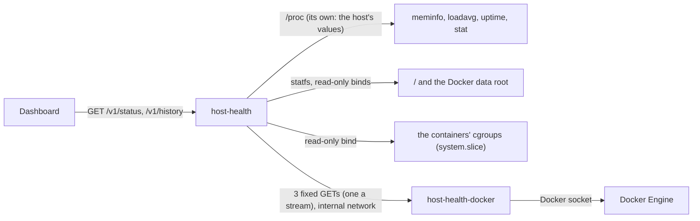

# Host health service

The host-health service tells the Status page how the server is doing: its memory, load, disks, uptime, every container on it, from all compose projects (Life OS, Home Assistant, n8n, the forgejo runner, and the rest), and how much of its memory and CPU Life OS itself takes. It samples once a minute, keeps the last 24 hours in memory, and reports findings: memory running out, a disk filling up, a sustained load, a container restarting in a loop or unhealthy. The verification stack's containers are left out of the findings (see [Restart loops and the test stack](#restart-loops-and-the-test-stack)). The Dashboard turns them into the Server check, which the [monitor](monitor.md) watches. Its code is in `services/host-health`.

The server is small and shared (7.7 GiB of memory, no swap, 6 CPUs) and crashed once when heavy jobs overlapped, so memory is what this watches most closely.

## What it reads, and why it only reads

The owner's rule is that Life OS does not change the host's other infrastructure. host-health has no writes at all, and every source it uses is read-only:

- **Memory, load, uptime, CPUs: its own `/proc`.** Docker does not namespace `/proc/meminfo`, `/proc/loadavg`, `/proc/uptime`, or `/proc/stat`: a container reads the host's values there. host-health therefore needs neither a bind of the host's `/proc` at `/host/proc` nor `pid: host`. Both would also show it every host process and its command line, which some programs fill with secrets. Memory is `MemAvailable` (what can be used without swapping, page cache included) of `MemTotal`; the CPUs are the `cpuN` lines of `/proc/stat`, the host's whatever the container may use. If a runtime ever virtualises these files (LXCFS), mount the host's `/proc` read-only and point `HOST_HEALTH_PROC_DIR` at it.
- **Disks: statfs on read-only, non-recursive bind mounts** of the host's `/` (at `/host`) and of the Docker data root (`LIFE_OS_DOCKER_ROOT`, `/var/lib/docker`, at `/host-docker`). Each filesystem is reported once, so on this server, where Docker's data is on `/`, there is one disk, `root`. Free space is what an unprivileged user may still write (df's Avail). statfs needs no permission on the mounted directory itself. The service runs as `nobody` with no capabilities, so it can open only what any local unprivileged user could; `/var/lib/docker` (mode 710, root) stays closed to it. Non-recursive means the binds show only those filesystems, not `/proc`, `/sys`, or anything else mounted below `/`.
- **Life OS's use of the server: the containers' cgroups**, on a read-only, non-recursive bind of `/sys/fs/cgroup/system.slice` at `/host-cgroup` (below).
- **Containers: the docker gateway**, below. host-health never mounts the Docker socket.

## The docker gateway

The Docker socket controls every container on the host, so whatever reads it must be trusted with the host. A generic read-only socket proxy is not enough: `tecnativa/docker-socket-proxy` with `CONTAINERS=1, POST=0` allows every GET under `/containers/`. That includes inspect, which holds every container's environment (the database passwords and tokens of Life OS, Home Assistant, n8n, and the rest), `/logs`, `/archive` (any file in a container), and `/export` (its whole filesystem).

Instead, `host-health-docker` runs the same image as `/service docker-gateway`. It is the only container that mounts the socket, and it is not a proxy. It answers exactly three GET requests, each with a fixed request of its own to the Docker Engine API, built from validated parameters only, and re-encodes only the fields host-health needs:

| host-health asks | The gateway asks the engine | It answers with |
| --- | --- | --- |
| `GET /containers` | `GET /containers/json?all=1` | name, compose project and service, image, state, health (from the status text) |
| `GET /events?since=` (unix seconds, not in the future, at most a day ago) | `GET /events?since=` filtered to container `die`, `start`, `kill`, `stop`, and `destroy`, with no end: a stream that stays open | the events, one JSON object per line as they happen: time, container id (short), name, compose project, action, and a `die`'s exit code; an action outside the filter is dropped |
| `GET /containers/{id}/memory` (a hex id) | `GET /containers/{id}/stats?stream=false&one-shot=true` | memory in use (usage less inactive page cache, as `docker stats`) and limit |

Everything else is 404, any other method 405, and nothing else reaches the engine. Restart loops are counted from these events (below), so no inspect is needed for restart counts. The engine applies the filter to the stream itself, so the health checks' exec events, most of what it logs, never reach the gateway. The event stream lifts the server's read and write deadlines for itself, and ends when host-health hangs up or the gateway stops. Container stats need no permission beyond the socket: `one-shot=true` reads the cgroup once, without the second's wait for CPU figures, so it is cheap. host-health reads them every 5 minutes, and every minute while memory is low, four containers at a time.

**Security posture.** The gateway runs as `nobody` in the socket's group (`LIFE_OS_DOCKER_GID`, `stat -c %g /var/run/docker.sock`; 988 on this server), with a read-only root, no capabilities, and `no-new-privileges`. The socket's `:ro` does not limit the API; the gateway's three routes do. It sits alone with host-health on `host-docker`, an internal network: nothing else can reach it, and it can reach nothing outside. Someone who took over host-health could learn the containers' names, images, states, health, events (with exit codes), and memory use, and through the cgroup bind the memory and CPU use of the containers and the host's services, but not their environments, logs, or files, and could change nothing. Someone who took over the gateway itself would hold the socket, which is why it is one small Go handler that proxies no client input (`internal/docker/gateway.go`, tested against a fake engine that records every request it receives).

## Life OS's use of the server

The owner asked how much of the server Life OS takes. Each minute host-health reads the cgroups of the running containers of the compose project `lifeos` (`HOST_HEALTH_LIFEOS_PROJECT`) and of the test stack (`HOST_HEALTH_IGNORE_PROJECTS`), and reports three shares, each as bytes and cores and as a percentage of the server's memory and CPUs:

- **Life OS**: the sum over its containers, and its five compose services using the most memory, replicas summed (`voice-worker ×2`).
- **Tests**: the verification stack, only while any of its containers runs.
- **Everything else**: the server's use less both, never below zero. That is the other compose projects, containers outside any project (such as an agent's throwaway Postgres), the host's own services, and the kernel.

**Memory** is counted as for the whole server, whose memory in use is total less `MemAvailable`, so the percentages compare. `MemAvailable` counts free memory, the page cache on the file lists, and reclaimable kernel memory as available. A container's `memory.current` holds all three kinds that are its own, so its memory in use is `memory.current` less `active_file`, `inactive_file`, and `slab_reclaimable` from its `memory.stat`. Shared memory and tmpfs stay in: their pages are on the anon lists, so `MemAvailable` does not count them as available either. This is less than `docker stats` shows, which subtracts `inactive_file` only (the "Most memory" users, read through the gateway, use that), so a service's figure here can be lower than its line there.

**CPU** is the CPU time a container used between two readings (`cpu.stat` `usage_usec`) over the time in between: 1 core is one CPU busy all the time. The server's is the busy share of the `cpu` line of `/proc/stat` (user, nice, system, irq, softirq, and steal of all its time) times the CPUs. A container that is new since the last reading, or whose CPU time went back (it restarted), adds no CPU for that interval; one that stopped is simply gone. A share whose containers are all new (a stack just started or redeployed) has no CPU figure for one interval, and neither has everything else then; after host-health restarts, CPU needs two samples.

**How the cgroups are found.** Docker on this server uses the systemd cgroup driver with cgroup v2: each container's cgroup is `/sys/fs/cgroup/system.slice/docker-<full id>.scope`. host-health matches the short ids in the container list it already gets from the gateway (with each container's compose project and service) to those directories, so the gateway needs no new question. The cgroupfs driver's `/sys/fs/cgroup/docker/<id>` works too, with `LIFE_OS_DOCKER_CGROUP_DIR` pointing there. Only the Life OS and test stack containers are read; everything else is computed, not read.

**The mount, and why only system.slice.** The bind of `/` is non-recursive, so `/sys` is not visible through it; compose adds a read-only, non-recursive bind of `system.slice` alone (`LIFE_OS_DOCKER_CGROUP_DIR`, `/sys/fs/cgroup/system.slice`) at `/host-cgroup` (`HOST_HEALTH_CGROUP_DIR`). Not all of `/sys/fs/cgroup`: that would add the logged-in users' sessions (`user.slice`) and the root cgroup's files, which host-health does not need. The files it reads are mode 0444, readable by any local user, so it stays `nobody` with no capabilities; the control files are root's and the bind is read-only, so nothing can be written (checked on this server: writing `memory.max` through the bind fails with "Read-only file system"). What the bind shows besides the containers is the host's system services' cgroups: their names and resource use, no command lines, environments, or files.

**When it cannot be read** (the bind is missing, a file cannot be read, the gateway cannot be read, or none of the running Life OS containers has a cgroup in the directory: a wrong directory, or a custom `cgroup_parent`), the usage is unavailable and says why; everything else on the card works as before, and it is never a finding. Without `HOST_HEALTH_CGROUP_DIR` it is not measured.

## Findings and thresholds

host-health applies the thresholds and lists what needs attention, problems first. The Dashboard words them; it does not decide them.

| Finding | Warning | Problem |
| --- | --- | --- |
| `memory_low` | available below 15% for 3 samples in a row | available below 7% |
| `disk_low` (per filesystem) | less than 10 GiB or 10% free | less than 3 GiB free |
| `load_high` | 15-minute load above the CPUs (× 1) | |
| `container_restarting` | restarted by Docker itself 3 times within 15 minutes (below) | |
| `container_unhealthy` | unhealthy for 5 minutes (from when host-health first saw it unhealthy) | |
| `containers_unavailable` | the gateway is set up but cannot be read, or the container events cannot be followed for 5 minutes ("restart loops are not watched") | |

All of them are configurable (`LIFE_OS_HOST_HEALTH_*`, below). A sample's memory reading also decides how often container memory is read, so that a low-memory finding names the biggest users.

### Restart loops and the test stack

A restart loop is a container that Docker keeps starting again by itself, as a restart policy does after a crash. host-health tracks containers by id, not name, and counts a death only when it is followed by a start of the **same container id** with no intentional stop around it. From the events Docker reports:

| What happened | Events | Counts? |
| --- | --- | --- |
| A crash under a restart policy (the forgejo runner exiting 1) | `die` (exit code 1), `start` of the same id | yes |
| An out-of-memory kill under a restart policy | `die` (137, no `kill` event), `start` of the same id | yes |
| `docker stop`, `compose stop` | `kill`, `die`, `stop` | no: killed first, and stopped |
| `compose down` (the verification stack after every test run) | `kill`, `die`, `stop`, `destroy` | no |
| A redeploy, `compose up --force-recreate` | `kill`, `die`, `stop`, `destroy` of the old id; `start` of a new id with the same name | no: the new container is another id |
| `docker restart`, `compose restart` | `kill`, `die`, `stop`, `start` of the same id | no: killed and stopped |
| A crash that stays down | `die` | no: nothing started it again |

So a `die` counts when no `kill` of that id came within the 5 minutes before it (Docker kills when stopping; it waits the stop timeout before the final kill) and a `start` of that id follows with no `stop` or `destroy` in between; it then counts at the time it died, within the window. A `die` still waiting for its start (the start in the next sample) counts once the start arrives. The finding carries the last death's exit code ("runner (forgejo) keeps restarting: 3 times in 15 min, last exit code 1"). The exit code is not part of the rule: a container that keeps exiting 0 under `restart: always` is a loop too, and `docker stop` often exits 143 without being one.

### Following the events, and the first 15 minutes

host-health keeps one stream of these events open through the gateway and counts each event as it happens, in memory. It cannot count them from the past instead: the Docker Engine answers a `since` query only from its last 256 events of any kind, and filters after that. On this server each health check logs three exec events (`exec_create`, `exec_start`, `exec_die`), about 2 events a second in all, so 256 reach back about two minutes. Checked on 16 Oct 2026 (Docker 29.4.3): `docker events --since 15m --until 0s` returned exactly 256 events, the oldest 119 s old, and the same query filtered to `exec_die` reached back the same 118 s. Before BUG-44, host-health asked for the last 15 minutes when it started, and for the minute since its last sample after that. After a start it saw a loop's last two minutes only, and a busy minute (the test stack coming up) could lose events in between.

So, when it opens the stream, host-health asks for the events of the whole window, gets what the engine still holds (the last two minutes or so), and then every event as it happens, with no gap between the two. Its restart counts are **complete** only once the stream has been open for the whole window (`HOST_HEALTH_RESTART_LOOP_MINUTES`, 15). Until then a count can be too low: a loop seen dying three times is a finding as always, but no finding does not mean that a loop has stopped. `GET /v1/status` says so (`containers.restartsWatchedSince`, `containers.restartsComplete: false`), and the Dashboard makes an ok Server check **provisional** for that time ("Watching for restart loops since 20:39 CEST; the 15-min count is complete at 20:54 CEST."). The [monitor](monitor.md#when-it-notifies) never takes a provisional ok as a recovery, so a restart of host-health during a loop no longer sends a false "Server recovered". This window covers memory too: the low-memory warning needs three samples in a row, and a restart starts the samples again.

When the stream breaks (the gateway restarts, Docker restarts), host-health opens it again after 1 s, then up to every 30 s while that fails, asking for the events from 5 s before the break on (an event it already counted counts once). What happened in between is again only what the engine still holds, so the 15 minutes start again. A stream that stays closed for 5 minutes is a `containers_unavailable` warning, "restart loops are not watched".

**The test stack.** `HOST_HEALTH_IGNORE_PROJECTS` (comma-separated compose projects, default `lifeos-verify`) names compose projects whose containers come and go on purpose: the verification stack, which test runs bring up and tear down every few minutes. Their containers are never a finding (no restart loop, no unhealthy container) and never among the biggest memory users, whose memory is not even read. They still count in `total` and `running`, and on their own in `testStack` ("52 in all, 20 of the test stack" on the Status card), but not in `unhealthy` or `restarting`; each such container is marked `testStack: true` in the list. Set it empty to watch every project.

## History

One sample a minute (memory available and total, the three load averages, each disk's free space, and Life OS's memory and CPU when they were read) is kept for 24 hours in memory. A restart starts the history again; there is no database and no file. The Status card draws memory available and Life OS's memory and CPU from it (`GET /v1/history`).

## API

On the private `backend` network only (`http://host-health:8080`), with no gateway route. The contract is `services/host-health/api/openapi.yaml`.

| Endpoint | |
| --- | --- |
| `GET /v1/status` | The latest sample (at most a minute old): memory, load and CPUs, uptime, each disk, the containers (counts, the test stack's among them, each one's state, health, restarts in the window and the last one's exit code, memory, the five biggest memory users, and since when the restart counts are watched and whether they are complete yet), Life OS's use (`usage`: Life OS, the tests while they run, and everything else, with Life OS's five biggest services), the thresholds, and the findings. 503 `not_ready` before the first sample. |
| `GET /v1/history?hours=24` | The samples of the last 1–24 hours, oldest first. |

`/ready` fails before the first sample and when the last one is more than three minutes old.

## The verification stack

The verification stack never reads the host. Its host-health reports a made-up server (`HOST_HEALTH_FIXTURE`): `healthy` by default, or `low-memory` (520 MiB available of 7.7 GiB, a problem) when a test sets `LIFE_OS_VERIFY_HOST_HEALTH_FIXTURE`. The made-up server has a day of history and six containers with fixed memory and no events (its restart counts are complete from the first sample), and a made-up Life OS use (its three containers, 2.3 GiB and 0.4 cores, with CPU from the first sample on, and a busier middle of the day in the history), so the Server check is the same on every run. Its binds of `/`, the Docker root, and the cgroups are reset, and the gateway sits behind a profile that stack never enables, so nothing there holds the Docker socket. `tools/verify-compose` refuses a plan that mounts the Docker socket, the host's root, `/proc`, or `/sys`, or the Docker data root into any service. The Status card says "Source: a made-up server" in this mode.

## Configuration

| Variable | Default | Compose |
| --- | --- | --- |
| `HOST_HEALTH_PROC_DIR` | `/proc` | |
| `HOST_HEALTH_DISKS` | `root=/host,docker=/host-docker` | the same; `LIFE_OS_DOCKER_ROOT` is the host path bound at `/host-docker` |
| `HOST_HEALTH_DOCKER_URL` | empty: no container facts (not a finding) | `http://host-health-docker:8080` |
| `HOST_HEALTH_CGROUP_DIR` | empty: Life OS's use is not measured | `/host-cgroup`; `LIFE_OS_DOCKER_CGROUP_DIR` (`/sys/fs/cgroup/system.slice`) is the host path bound there |
| `HOST_HEALTH_LIFEOS_PROJECT` | `lifeos`: the compose project counted as Life OS; never one of the ignored projects | |
| `HOST_HEALTH_FIXTURE` | empty: the real host | `healthy` on the verification stack |
| `HOST_HEALTH_INTERVAL_SECONDS` | `60` (10–600) | |
| `HOST_HEALTH_MEMORY_WARNING_PERCENT`, `…_SAMPLES`, `…_PROBLEM_PERCENT` | `15`, `3`, `7` | `LIFE_OS_HOST_HEALTH_MEMORY_*` |
| `HOST_HEALTH_DISK_WARNING_GIB`, `…_WARNING_PERCENT`, `…_PROBLEM_GIB` | `10`, `10`, `3` | `LIFE_OS_HOST_HEALTH_DISK_*` |
| `HOST_HEALTH_LOAD_WARNING_PER_CPU` | `1` | `LIFE_OS_HOST_HEALTH_LOAD_WARNING_PER_CPU` |
| `HOST_HEALTH_RESTART_LOOP_COUNT`, `…_MINUTES`, `HOST_HEALTH_UNHEALTHY_MINUTES` | `3`, `15`, `5` | `LIFE_OS_HOST_HEALTH_RESTART_LOOP_*`, `LIFE_OS_HOST_HEALTH_UNHEALTHY_MINUTES` |
| `HOST_HEALTH_IGNORE_PROJECTS` | `lifeos-verify`: compose projects left out of findings and the top memory users | `LIFE_OS_HOST_HEALTH_IGNORE_PROJECTS` |
| `SERVICE_NAME`, `PORT`, `LOG_LEVEL` | `host-health`, `8080`, `info` | |

The gateway reads `PORT` and `DOCKER_GATEWAY_SOCKET` (`/var/run/docker.sock`). Compose runs it as `65534:${LIFE_OS_DOCKER_GID:-999}`.

## Operations

- **Setting it up.** Add `LIFE_OS_DOCKER_GID` (the socket's group: `stat -c %g /var/run/docker.sock`) to `.env`, and `LIFE_OS_DOCKER_ROOT` if Docker's data is not in `/var/lib/docker`. Build and start both containers, then the Dashboard. See [deployment](../operations/deployment.md#server-health).
- **Life OS's use unavailable.** "Life OS: CPU and RAM not available: …" names why. `cgroups: open /host-cgroup: …` means the bind is missing (recreate host-health); "none of the N running lifeos containers has a cgroup in /host-cgroup" means Docker puts the containers' cgroups elsewhere: `cat /proc/$(docker inspect -f '{{.State.Pid}}' lifeos-postgres-1)/cgroup` shows where a container's is (below `/sys/fs/cgroup`); set `LIFE_OS_DOCKER_CGROUP_DIR` to its parent directory and recreate host-health.
- **Container facts unavailable.** "The containers cannot be read: … the docker socket refused the gateway" means `LIFE_OS_DOCKER_GID` is not the socket's group. Set it and recreate `host-health-docker`. `docker compose logs host-health-docker` shows each failed engine request.
- **A finding.** The Status card names the cause and what to do: for memory, the biggest users and to stop heavy jobs (`docker stats` shows them all); for a disk, what usually fills it; for a restart loop, `docker logs <name>`. The thresholds are in `.env`.
- **Tests.** `cd services/host-health && GOWORK=off go test ./...` covers the `/proc` and statfs parsing (one report per filesystem), the gateway against a fake engine (what it passes on: ids, a die's exit code, and only the filtered actions; the event stream staying open past the server's timeouts and ending when host-health hangs up; and that everything else is refused before the engine), the finding rules and their thresholds, the restart and unhealthy tracking (compose down and up with new ids, a force-recreate, a user's stop, start, and restart: no finding; a restart-policy loop exiting 1 three times in 15 minutes: a finding; an ignored project crash-looping: none), the event watcher against a fake gateway (`watcher_test.go`: a start during a loop is not complete until 15 minutes of watching, while three deaths are a finding at once; a broken stream opened again from just before the break, an event counted once, and the 15 minutes starting again; a stream that stays closed for 5 minutes is a finding), the 24-hour ring, the sampler (memory read cadence, unavailable containers, a disk that fails alone), Life OS's use against a fake cgroup tree (memory less the reclaimable caches, the CPU delta, a container appearing, restarting, and disappearing, other projects not read, the test stack on its own, everything else never below zero, unreadable files, a wrong directory) and the CPU time of `/proc/stat`, the fixtures, the API, and the configuration.

## Limits

- The history lives in memory: after a restart, the card's sparkline starts again.
- So do the restart counts: for the first 15 minutes after host-health starts, or after its event stream reopens, they hold only what it has seen since (and the engine's last two minutes or so), and an ok Server check is provisional (above).
- Findings are about the host; they say which container uses memory, not why. Use `docker stats` and the container's logs.
- Life OS's use counts its containers only: nothing the owner runs for Life OS outside them (such as an agent building it). Containers with a custom `cgroup_parent` outside the bound directory are not found, and CPU comes one interval after a container starts.
- When host-health itself is down, Services says so and the Server card is left out. When the whole host is in trouble, so is everything that would report it; an external check is later work.
