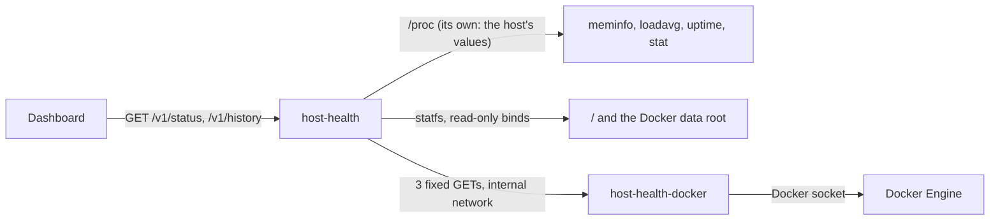

# Host health service

The host-health service tells the Status page how the server is doing: its memory, load, disks, uptime, and every container on it, from all compose projects (Life OS, Home Assistant, n8n, the forgejo runner, and the rest). It samples once a minute, keeps the last 24 hours in memory, and reports findings: memory running out, a disk filling up, a sustained load, a container restarting in a loop or unhealthy. The Dashboard turns them into the Server check, which the [monitor](monitor.md) watches. Its code is in `services/host-health`.

The server is small and shared (7.7 GiB of memory, no swap, 6 CPUs) and crashed once when heavy jobs overlapped, so memory is what this watches most closely.

## What it reads, and why it only reads

The owner's rule is that Life OS does not change the host's other infrastructure. host-health has no writes at all, and every source it uses is read-only:

- **Memory, load, uptime, CPUs: its own `/proc`.** Docker does not namespace `/proc/meminfo`, `/proc/loadavg`, `/proc/uptime`, or `/proc/stat`: a container reads the host's values there. host-health therefore needs neither a bind of the host's `/proc` at `/host/proc` nor `pid: host`. Both would also show it every host process and its command line, which some programs fill with secrets. Memory is `MemAvailable` (what can be used without swapping, page cache included) of `MemTotal`; the CPUs are the `cpuN` lines of `/proc/stat`, the host's whatever the container may use. If a runtime ever virtualises these files (LXCFS), mount the host's `/proc` read-only and point `HOST_HEALTH_PROC_DIR` at it.
- **Disks: statfs on read-only, non-recursive bind mounts** of the host's `/` (at `/host`) and of the Docker data root (`LIFE_OS_DOCKER_ROOT`, `/var/lib/docker`, at `/host-docker`). Each filesystem is reported once, so on this server, where Docker's data is on `/`, there is one disk, `root`. Free space is what an unprivileged user may still write (df's Avail). statfs needs no permission on the mounted directory itself. The service runs as `nobody` with no capabilities, so it can open only what any local unprivileged user could; `/var/lib/docker` (mode 710, root) stays closed to it. Non-recursive means the binds show only those filesystems, not `/proc`, `/sys`, or anything else mounted below `/`.
- **Containers: the docker gateway**, below. host-health never mounts the Docker socket.

## The docker gateway

The Docker socket controls every container on the host, so whatever reads it must be trusted with the host. A generic read-only socket proxy is not enough: `tecnativa/docker-socket-proxy` with `CONTAINERS=1, POST=0` allows every GET under `/containers/`. That includes inspect, which holds every container's environment (the database passwords and tokens of Life OS, Home Assistant, n8n, and the rest), `/logs`, `/archive` (any file in a container), and `/export` (its whole filesystem).

Instead, `host-health-docker` runs the same image as `/service docker-gateway`. It is the only container that mounts the socket, and it is not a proxy. It answers exactly three GET requests, each with a fixed request of its own to the Docker Engine API, built from validated parameters only, and re-encodes only the fields host-health needs:

| host-health asks | The gateway asks the engine | It answers with |
| --- | --- | --- |
| `GET /containers` | `GET /containers/json?all=1` | name, compose project and service, image, state, health (from the status text) |
| `GET /events?since=&until=` (unix seconds, at most a day apart, not in the future) | `GET /events` filtered to container `die`, `start`, and `health_status` | time, name, compose project, action |
| `GET /containers/{id}/memory` (a hex id) | `GET /containers/{id}/stats?stream=false&one-shot=true` | memory in use (usage less inactive page cache, as `docker stats`) and limit |

Everything else is 404, any other method 405, and nothing else reaches the engine. Restart loops are counted from `die` events, so no inspect is needed for restart counts. Container stats need no permission beyond the socket: `one-shot=true` reads the cgroup once, without the second's wait for CPU figures, so it is cheap. host-health reads them every 5 minutes, and every minute while memory is low, four containers at a time.

**Security posture.** The gateway runs as `nobody` in the socket's group (`LIFE_OS_DOCKER_GID`, `stat -c %g /var/run/docker.sock`; 988 on this server), with a read-only root, no capabilities, and `no-new-privileges`. The socket's `:ro` does not limit the API; the gateway's three routes do. It sits alone with host-health on `host-docker`, an internal network: nothing else can reach it, and it can reach nothing outside. Someone who took over host-health could learn the containers' names, images, states, health, events, and memory use, but not their environments, logs, or files, and could change nothing. Someone who took over the gateway itself would hold the socket, which is why it is one small Go handler that proxies no client input (`internal/docker/gateway.go`, tested against a fake engine that records every request it receives).

## Findings and thresholds

host-health applies the thresholds and lists what needs attention, problems first. The Dashboard words them; it does not decide them.

| Finding | Warning | Problem |
| --- | --- | --- |
| `memory_low` | available below 15% for 3 samples in a row | available below 7% |
| `disk_low` (per filesystem) | less than 10 GiB or 10% free | less than 3 GiB free |
| `load_high` | 15-minute load above the CPUs (× 1) | |
| `container_restarting` | died 3 times within 15 minutes | |
| `container_unhealthy` | unhealthy for 5 minutes (from its health event when that is within the last 15 minutes, else from when host-health first saw it unhealthy) | |
| `containers_unavailable` | the gateway is set up but cannot be read | |

All of them are configurable (`LIFE_OS_HOST_HEALTH_*`, below). A sample's memory reading also decides how often container memory is read, so that a low-memory finding names the biggest users.

## History

One sample a minute (memory available and total, the three load averages, each disk's free space) is kept for 24 hours in memory. A restart starts the history again; there is no database and no file. The Status card draws memory available from it (`GET /v1/history`).

## API

On the private `backend` network only (`http://host-health:8080`), with no gateway route. The contract is `services/host-health/api/openapi.yaml`.

| Endpoint | |
| --- | --- |
| `GET /v1/status` | The latest sample (at most a minute old): memory, load and CPUs, uptime, each disk, the containers (counts, each one's state, health, deaths in the window, memory, and the five biggest memory users), the thresholds, and the findings. 503 `not_ready` before the first sample. |
| `GET /v1/history?hours=24` | The samples of the last 1–24 hours, oldest first. |

`/ready` fails before the first sample and when the last one is more than three minutes old.

## The verification stack

The verification stack never reads the host. Its host-health reports a made-up server (`HOST_HEALTH_FIXTURE`): `healthy` by default, or `low-memory` (520 MiB available of 7.7 GiB, a problem) when a test sets `LIFE_OS_VERIFY_HOST_HEALTH_FIXTURE`. The made-up server has a day of history and six containers with fixed memory, so the Server check is the same on every run. Its binds of `/` and the Docker root are reset, and the gateway sits behind a profile that stack never enables, so nothing there holds the Docker socket. `tools/verify-compose` refuses a plan that mounts the Docker socket, the host's root or `/proc`, or the Docker data root into any service. The Status card says "Source: a made-up server" in this mode.

## Configuration

| Variable | Default | Compose |
| --- | --- | --- |
| `HOST_HEALTH_PROC_DIR` | `/proc` | |
| `HOST_HEALTH_DISKS` | `root=/host,docker=/host-docker` | the same; `LIFE_OS_DOCKER_ROOT` is the host path bound at `/host-docker` |
| `HOST_HEALTH_DOCKER_URL` | empty: no container facts (not a finding) | `http://host-health-docker:8080` |
| `HOST_HEALTH_FIXTURE` | empty: the real host | `healthy` on the verification stack |
| `HOST_HEALTH_INTERVAL_SECONDS` | `60` (10–600) | |
| `HOST_HEALTH_MEMORY_WARNING_PERCENT`, `…_SAMPLES`, `…_PROBLEM_PERCENT` | `15`, `3`, `7` | `LIFE_OS_HOST_HEALTH_MEMORY_*` |
| `HOST_HEALTH_DISK_WARNING_GIB`, `…_WARNING_PERCENT`, `…_PROBLEM_GIB` | `10`, `10`, `3` | `LIFE_OS_HOST_HEALTH_DISK_*` |
| `HOST_HEALTH_LOAD_WARNING_PER_CPU` | `1` | `LIFE_OS_HOST_HEALTH_LOAD_WARNING_PER_CPU` |
| `HOST_HEALTH_RESTART_LOOP_COUNT`, `…_MINUTES`, `HOST_HEALTH_UNHEALTHY_MINUTES` | `3`, `15`, `5` | `LIFE_OS_HOST_HEALTH_RESTART_LOOP_*`, `LIFE_OS_HOST_HEALTH_UNHEALTHY_MINUTES` |
| `SERVICE_NAME`, `PORT`, `LOG_LEVEL` | `host-health`, `8080`, `info` | |

The gateway reads `PORT` and `DOCKER_GATEWAY_SOCKET` (`/var/run/docker.sock`). Compose runs it as `65534:${LIFE_OS_DOCKER_GID:-999}`.

## Operations

- **Setting it up.** Add `LIFE_OS_DOCKER_GID` (the socket's group: `stat -c %g /var/run/docker.sock`) to `.env`, and `LIFE_OS_DOCKER_ROOT` if Docker's data is not in `/var/lib/docker`. Build and start both containers, then the Dashboard. See [deployment](../operations/deployment.md#server-health).
- **Container facts unavailable.** "The containers cannot be read: … the docker socket refused the gateway" means `LIFE_OS_DOCKER_GID` is not the socket's group. Set it and recreate `host-health-docker`. `docker compose logs host-health-docker` shows each failed engine request.
- **A finding.** The Status card names the cause and what to do: for memory, the biggest users and to stop heavy jobs (`docker stats` shows them all); for a disk, what usually fills it; for a restart loop, `docker logs <name>`. The thresholds are in `.env`.
- **Tests.** `cd services/host-health && GOWORK=off go test ./...` covers the `/proc` and statfs parsing (one report per filesystem), the gateway against a fake engine (what it passes on, and that everything else is refused before the engine), the finding rules and their thresholds, the restart and unhealthy tracking, the 24-hour ring, the sampler (memory read cadence, unavailable containers, a disk that fails alone), the fixtures, the API, and the configuration.

## Limits

- The history lives in memory: after a restart, the card's sparkline starts again.
- Findings are about the host; they say which container uses memory, not why. Use `docker stats` and the container's logs.
- When host-health itself is down, Services says so and the Server card is left out. When the whole host is in trouble, so is everything that would report it; an external check is later work.
