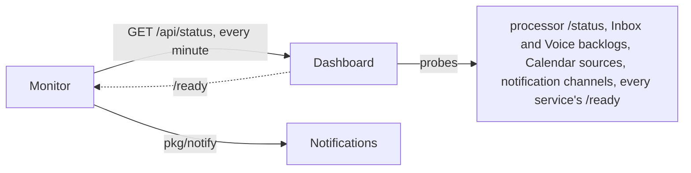

# Monitor service

The monitor tells the owner when Life OS breaks or recovers. It reads the Status page's checks once a minute. When a check holds a new state, it sends a notification through the [Notifications](notifications.md) service, the one path for telling the owner anything. A problem is high importance, a warning medium, and a recovery low. The monitor has no database, no public API, and no gateway route; it serves only `/health` and `/ready`. Its code is in `services/monitor`.



## What it watches

The rules that decide whether something is ok, a warning, or a problem live in one place, the Dashboard's `src/lib/runtime-status.ts` (see [Dashboard](../frontend/dashboard.md)). The monitor never re-implements them. It reads their result from the Dashboard's `GET /api/status` on the private network (`MONITOR_STATUS_URL`, `http://dashboard:3000/api/status` in Compose). That route returns `getRuntimeStatus()`, the checks the Status page renders, as JSON. It is evaluated on every request (`cache-control: no-store`) and contains nothing the Status page does not show:

```json
{
  "checkedAt": "2026-10-10T12:03:00.000Z",
  "timeZone": "Europe/Berlin",
  "overall": "problem",
  "checks": [
    {
      "id": "processing",
      "title": "Automatic processing",
      "state": "problem",
      "summary": "Codex is not signed in.",
      "detail": "…raw error from the processor…",
      "action": "Sign in with `codex login` on the host as the Life OS user, then restart the processor so it picks up the new session.",
      "facts": [{ "label": "Model", "value": "gpt-5.6-luna" }]
    }
  ]
}
```

The monitor uses each check's `id`, `title`, `state`, `summary`, and `action`. The states are `ok`, `neutral` (nothing to do, such as no delivery channel set up), `warning`, and `problem`; `neutral` and any other value are treated like `ok`. The checks today are `processing` (Automatic processing), `inbox` (Inbox backlog), `voice` (Voice transcription), `calendar` (Calendar sources, with the Google connection and calendars), `notifications` (delivery channel health), and `services` (every service's `/ready`, the monitor's own included). A check the Dashboard adds later is watched without a change here. The endpoint itself counts as one more check, `dashboard`: it is a problem while the status cannot be read (no answer within 10 s, an error status, or a payload that is not a runtime status).

## When it notifies

- The monitor evaluates the status when it starts and then every `MONITOR_INTERVAL_SECONDS` (60).
- A check's state is notified once the monitor has seen it in `MONITOR_CONFIRMATIONS` (2) evaluations in a row and it differs from the state last notified for that check. A recovery needs the same confirmations. At the defaults, a change is notified one to two minutes after it begins. Anything shorter than an evaluation interval is never notified, and neither is a check that flaps faster than the confirmations.
- Changes between warning and problem are notified too: warning to problem with high importance, problem to warning with medium.
- An evaluation that cannot read the status neither confirms nor interrupts a check's run; only the `dashboard` check moves. A check that disappears from the status loses its run.

| Change | Importance | Title | Body |
| --- | --- | --- | --- |
| to problem | high | "Automatic processing has a problem" | The check's summary, then its action. |
| to warning | medium | "Inbox backlog needs attention" | The check's summary, then its action. |
| to ok | low | "Automatic processing recovered" | The check's summary, then "Back to normal after about 12 min." |
| status unreadable | high | "Life OS status is unreachable" | Why it could not be read, and to check the dashboard service. |
| status readable again | low | "Life OS status is reachable again" | As for a recovery. |

Every notification has the category `status.<check>` (`status.processing`, `status.inbox`, `status.voice`, `status.calendar`, `status.notifications`, `status.services`, `status.dashboard`), links to `/status`, and has the source `monitor` (actor `system:monitor`). Its `occurredAt` is when the monitor first saw the new state. The dedupe key is `status:<check>:<state>:<since>`, for example `status:processing:problem:2026-10-10T12:03:00Z`, with `since` the same moment in UTC. A failed send is retried at every evaluation with the same key, so the owner never gets the same change twice.

## Restarts

The monitor keeps its state in memory. The Notifications history is its memory across restarts. Before it notifies anything for a check, it reads the newest `status.<check>` notification it sent (`pkg/notify` `Client.Latest`: `GET /v1/notifications?category=status.<check>&source=monitor&limit=1`). The state in that notification's dedupe key (its importance, if the key cannot be read) is the state last notified. After that, the one rule above applies: a confirmed state that differs from the last notified one is notified. As a result:

- **A restart never repeats an episode.** A problem notified before the restart is the newest notification, so the same problem after the restart is not new.
- **A restart never loses an outage.** A problem that began before or during the restart and was not notified differs from the last notified state, so it is notified after the confirmations. A first deployment has no history, so a problem already present is notified too. A recovery that happened while the monitor was restarting is notified as well, so the owner never keeps believing something is broken.
- **New episodes get new keys.** `since` is when the running process first saw the state, so a later episode never reuses an earlier key.
- **Notifications down at start.** Until the history can be read, nothing is notified for that check; it could not be sent anyway. The monitor keeps evaluating, so a change that held meanwhile is notified as soon as Notifications answers, dated from when it was first seen.

## Limits

- If the host, Docker, the Notifications service, or the delivery channel ([ntfy](../operations/ntfy.md)) is down, nothing can notify the owner. When the phone channel itself fails, "Notifications needs attention" is listed in Life OS but cannot reach the phone. An external dead-man check is later work.
- A stopped monitor notifies nothing. The Status page then shows "Monitor is not ready" under Services, because the Dashboard probes the monitor's `/ready` (`MONITOR_SERVICE_URL`). `/ready` fails when no evaluation has finished for three intervals plus a minute.
- While the Dashboard is unreachable, the other checks are unknown; only "Life OS status is unreachable" is sent.
- The unit is a check. While Services is a problem because one service is down, a second service going down does not notify again; the Status page names both. One fault can make two checks a problem: a stopped Inbox makes both Inbox backlog and Services a problem, and then two notifications arrive, as the Status page shows two problems.
- An outage that starts and ends while the monitor is stopped is not notified. Neither is one shorter than the confirmation window.
- A notification that Notifications rejects (4xx) is logged as an error and not retried.
- The monitor records no Activity events of its own; Notifications records `notification.created` for each notification.

## Configuration

| Variable | Default | Compose |
| --- | --- | --- |
| `MONITOR_STATUS_URL` | `http://localhost:3000/api/status` | `http://dashboard:3000/api/status` |
| `NOTIFICATIONS_SERVICE_URL` | empty: changes are only logged | `http://notifications:8080` (empty on the verification stack, so the browser suite's notification counts stay its own) |
| `MONITOR_INTERVAL_SECONDS` | `60` (5–3600) | `LIFE_OS_MONITOR_INTERVAL_SECONDS` |
| `MONITOR_CONFIRMATIONS` | `2` (1–10) | `LIFE_OS_MONITOR_CONFIRMATIONS` |
| `SERVICE_NAME`, `PORT`, `LOG_LEVEL` | `monitor`, `8080`, `info` | |

One status read times out after 10 s, or after the interval if that is shorter.

## Operations

- The monitor runs on the private `backend` network only, with `expose: 8080` for `/health` and `/ready`. It publishes no port, has no gateway location, and needs no database or secret.
- `docker compose logs monitor` shows `status changed` for each notified change (`check`, `from`, `to`, `since`, `dedupe_key`), and warnings when the status is unreachable or a send failed.
- To check it live, stop a service the owner can do without for a few minutes, for example `docker compose stop finance`. Within about two minutes a high "Services has a problem" notification arrives with "Finance is not ready.". Start it again (`docker compose start finance`), and a low "Services recovered" follows within about two minutes.
- Tests: `cd services/monitor && GOWORK=off go test ./...` covers the transition rules (confirmations, flapping, warning and problem changes, an unreadable status, the restart rule, dedupe keys), the notification texts and limits, and the polling loop against in-process Dashboard and Notifications servers, including restarts and Notifications being down. The Dashboard's `src/lib/status-response.test.ts` covers the `/api/status` payload.
